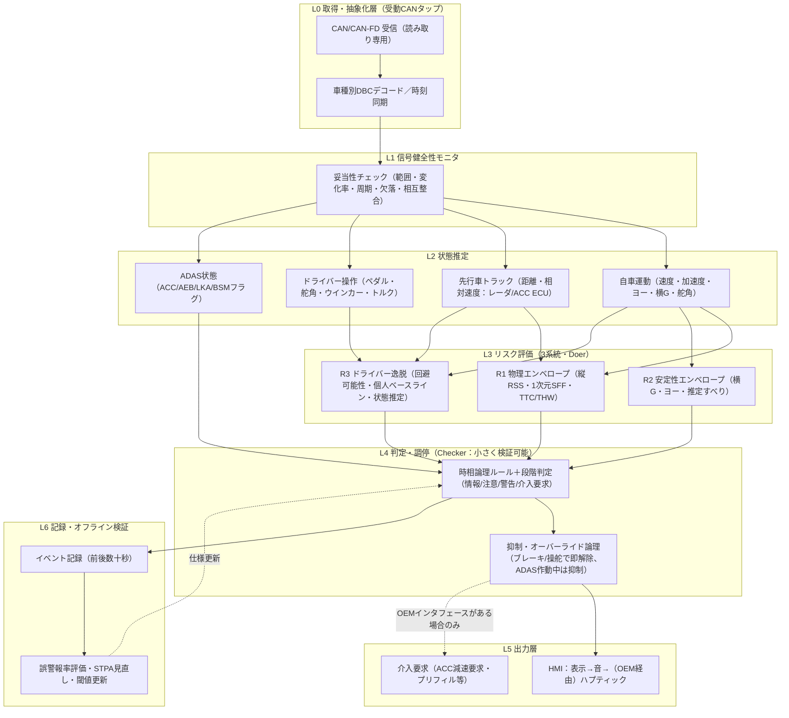

# 07 安全監視（ガーディアン型）システムアーキテクチャ — 有人運転＋CANのみ構成への転用

- 調査日: 2026-11-01
- 論点: 自動運転・ADAS研究で提案されている「事故を未然に防ぐ」ためのシステム全体アーキテクチャ（ガーディアン、シェアードコントロール、安全監視・ランタイムモニタ、階層型、ドライバーモデル比較型）を整理し、有人運転＋CANデータのみの構成へ転用できる形にまとめる
- 前提: 既存調査（01〜06）は、検知アルゴリズム・指標・データセット・規格・産業事例を扱っている。本稿は、それらを「どの層に、どういう分担で置くか」というアーキテクチャの観点を扱う。01〜06と重複する指標（TTC・THW・急ブレーキ閾値など）の詳細は再掲しない

---

## 2. エグゼクティブサマリー

1. 文献上の「事故を未然に防ぐ」アーキテクチャは、大きく5類型に整理できる。(A) ガーディアン／パラレルオートノミー（人の入力を最小限だけ修正する）、(B) ハプティック・シェアードコントロール（力覚で連続的に権限を分け合う）、(C) Simplex／Doer-Checker型の安全監視（複雑な主系を、小さく検証可能な監視系が見張る）、(D) 形式的安全ルール型（RSS、Safety Force Field）、(E) ドライバーモデル比較型（参照ドライバーモデルとの差で逸脱を見る）である
2. 共通する設計原則は次の3つである。「通常時は人（主系）に任せ、危険時だけ介入する（最小介入）」「安全判定を担う部分は小さく単純にし、高い完全性で作る」「物理的な衝突回避判定を、交通ルールなどの複雑な判断から切り離す」
3. A・B・Dは、周辺物体の位置・速度・予測（知覚）を前提にしている。CANのみの構成では、得られるのは原則としてレーダ由来の先行車1台分の距離と相対速度だけである。そのため、縦方向（追従・前方衝突）に限った縮退版としてなら転用できる
4. Cの「受動的に監視するランタイムモニタ」は、CANのみの構成と最も相性がよい。Kaneら（2015）は、計装なしの受動的な監視を自律研究車両で実証している。RV-ECU（2016）は、CANバス上で安全仕様を監視するECUを試作している。いずれも、時相論理で書いた安全仕様をバス上の信号で評価する
5. 有人車への転用で最も参考になる実装例は、openpilotの安全モデル（2020）である。原則は「ブレーキ操作で必ず制御を解除する」「ドライバーが常に即座に操作を取り戻せる」「L2では何もしないことが常に安全側」で、安全機能をNNから切り離してCANゲートウェイ（panda）側に置いている
6. 有人運転＋CANのみ向けには、6層の参照アーキテクチャを提案する（§5）。受動CANタップ、信号健全性モニタ、状態推定、3系統のリスク評価（物理エンベロープ／ドライバー逸脱／車両安定性）、Doer-Checker型の調停、段階的HMIの6層である。介入（制動・操舵）は、OEMのADAS ECUの既存機能に「要求」する形でしか安全に実現できない【推察】
7. 主なギャップは3つある。横方向・交差点・後方のリスクがCANのみでは観測できないこと、介入の権限がないこと、参照ドライバーモデル（FSM・CCDM）が実際のヒヤリハットで「遅すぎる／早すぎる」と評価されていること（Olleja et al. 2024）である

---

## 3. アーキテクチャ類型の整理

### 類型A: ガーディアン／パラレルオートノミー（最小介入のシェアードコントロール）

- **概要**: 人が常に運転し、システムは背後で監視する。事故が予見された場合に限り、人の入力を「安全な範囲に収まる最小の修正」に置き換える。TRIの Guardian は、戦闘機のフライバイワイヤに倣った「blended envelope control」を掲げ、人と機械の入力を on/off の切り替えではなく連続的に混合するとしている
- **構成要素**: 知覚（周辺物体・道路境界）→ 予測（他者の将来位置と不確かさ）→ 最適化型プランナ（NMPC: 人の入力からの偏差を最小化し、衝突回避は制約として課す）→ アクチュエータ（操舵・加減速）
- **データフロー**: ドライバー入力（操舵・アクセル・ブレーキ）と環境モデル → NMPC → 「人の入力に最も近い安全軌道」→ 車両。人の入力が安全なら、修正量はほぼ0になる
- **代表文献**: Schwarting et al. 2017（ICRA, Parallel Autonomy。TRIが資金を提供）、Schwarting et al. 2017（T-ITS）、Toyota Guardian（CES 2019）、Erlien, Fujita & Gerdes 2016（T-ITS）、Dallas et al. 2024（CCTA, TRI）
- **長所**: 「最小介入」と「安全制約」を一つの最適化で両立できる。介入しない区間では運転感覚を損なわない
- **短所**: 正確な知覚・予測（他車の位置・共分散、道路境界）が前提である。アクチュエータへの制御権限（ステアバイワイヤやアクティブ操舵）が要る。Parallel Autonomy の検証はシミュレーションにとどまる
- **CANのみ構成への転用**: △（縦方向のみ）
  - 条件1: 先行車の距離・相対速度がCANに流れていること（レーダ／ACC ECU）
  - 条件2: 「軌道最適化」を「縦方向の許容加速度の上限計算」に縮退させること【推察】
  - 横方向（道路境界・隣接車線）は、車線情報がCANに出ていない限り扱えない
  - 安定性エンベロープ（Erlien 2016・Dallas 2024 の横すべり角・ヨーレート境界）は、ヨーレート・横G・舵角・車輪速がCANにあれば、自車の状態だけで評価できる。そのため転用可能性が高い【推察】

### 類型B: ハプティック・シェアードコントロール

- **概要**: ステアリングやペダルに反力（トルク）を加え、システムの意図を人に連続的に伝える。最終的な権限は人に残す。Abbinkらは設計指針として、連続的なフィードバック、自動化レベルの滑らかな移行、直感的な伝達、人の最終権限の保持を挙げている
- **構成要素**: 環境・車両状態 → 参照（推奨操作）生成 → 人の操作との差 → 反力生成 → アクチュエータ（EPSトルク、アクティブペダル）
- **データフロー**: Balachandran et al.（2016）は、予測制御器の計画と、予測ホライズン上でのドライバー予測操作との「将来の差」から操舵反力を作る。早い段階では力覚で警告し、遅い段階ではコントローラが介入するという二段構えを、予測型シェアードコントロールの理想形としている
- **代表文献**: Abbink, Mulder & Boer 2012（Cogn. Tech. Work）、Abbink et al. 2018（IEEE THMS, 共有制御の階層トポロジー）、Balachandran et al. 2016（IEEE T-ASE）
- **長所**: 警報音より直感的である。人の権限を保ったまま「早期・弱く」介入できる
- **短所**: 長期的な効果（信頼、過信、依存、技能の維持）の実験的な裏付けは乏しい（Abbink 2012）。アクチュエータへの書き込み権限が要る
- **CANのみ構成への転用**: △
  - 「早期の弱い警告 → 遅い強い介入」という時間的な二段構えは、HMI設計の原則として転用できる
  - ただし後付けシステムがCAN経由でEPSトルクを指令するのは、セキュリティ・機能安全の両面で問題が大きい
  - 実現するならOEMのLKA/LDP機能を経由することになる【推察】

### 類型C: Simplex／Doer-Checker／ランタイム検証（安全監視）

- **概要**: 高性能だが検証が難しい主系（Doer: NN、複雑なプランナ、または人）を、小さく検証可能な監視系（Checker／Safety Controller）が見張る。危険な状態に近づいたら、監視系が安全な代替系に切り替える。安全責任はCheckerが負う。そのためDoerの安全度水準（SIL/ASIL）は低くてよく、Checkerは高い水準で作る（Koopman 2018）
- **構成要素**:
  - 主系、監視系（決定モジュール）、ベースライン（安全）コントローラの3つ
  - 安全領域と、より小さい「回復領域」を定義し、回復領域の境界で切り替える（Jackson et al. 2021 による Simplex の整理）
- **派生形**:
  - Black-Box Simplex（Mehmood et al. 2022）: 主系もベースラインも内部を見ずに、実行時チェックだけで安全を保証する。ベースラインの静的検証が不要になる
  - Certified Control（Jackson et al. 2021）: 監視系は知覚をせず、主系が出す「この行動は安全である」という証明書（certificate）を検査するだけにする。これで信頼基盤を小さくする
  - ランタイム検証（RV）: 安全要件を有界の時相論理（MTL）で記述し、観測した信号で逐次評価する
    - Kane et al. 2015: 計装なしで、ネットワーク状態から原子命題を生成して受動的に監視する
    - Daian et al. 2016（RV-ECU）: CANバス上の安全仕様を監視するECU。グローバルモニタとローカルモニタの2段構成で、仕様を出荷後に更新できる
    - Gautham et al. 2022: STPAによるハザード解析から、監視する対象と配置を多階層に導出する。AEBモデルで評価している
- **代表文献**: Mehmood et al. 2022、Jackson et al. 2021、Kane et al. 2015、Daian et al. 2016、Gautham et al. 2022、Koopman & Wagner 2016、Koopman 2018
- **長所**: 主系の中身（人を含む）を問わずに適用できる。安全論証を小さな監視系に集約できる。形式仕様として書けるので、検証・監査・更新がしやすい
- **短所**: 監視系が判断に使う入力（知覚）が正しいことは別途保証が要る。Certified Control は、まさにこの問題への対策である。代替（ベースライン）系に何を使うかが、有人車では自明でない
- **CANのみ構成への転用**: ◎（監視・警告層として）
  - Doer＝人間ドライバー、Checker＝CAN信号上の時相論理モニタ、と読み替えられる【推察】
  - 受動的な監視（Kane 2015）とCAN上での仕様監視（RV-ECU）は、後付けのCANタップ構成とそのまま整合する
  - ベースライン系（自動で安全側へ移す機能）は後付けでは持てない。現実的なのは、警告とOEM ADASの既存機能（AEB/ACC）に任せる構成である【推察】

### 類型D: 形式的安全ルール型（RSS／Safety Force Field）

- **概要**: 「事故の原因を作らない」ことを数式で定義し、ある行動が許容されるかを判定する
  - RSS（Shalev-Shwartz et al. 2017）: 法律上の注意義務（duty of care）を形式化し、縦・横の安全距離と「適切な応答」を規定する
  - SFF（Nistér et al. 2019）: 各主体が「手遅れになる前に安全手順（例: 停止まで制動）を取る」ことを原則とする。安全手順と最大制動の間の時空間領域を「claimed set」と呼び、他主体の claimed set と交差させない
- **構成要素**: 知覚（形状・位置・速度・加速度とその信頼区間）→ 安全制約の計算 → 許容行動集合 → 主プランナ（人でも自動運転でもよい）の出力を許容集合へ制限する
- **SFFの設計上の要点**:
  - 衝突回避を、優先権・標識・信号といった複雑な交通ルールから切り離す。その理由として、AEBを標識・信号の認識や地図に依存させたくないのと同じだと説明している
  - 知覚の不確かさは、信頼区間の端で計算することで扱う
  - 誤検出は、冗長な知覚系の多数決で扱う
- **ADASへの応用**: Mobileye は、RSS の数式で危険状態への進入を判定し、目立たない小さな予防制動で安全側へ戻す「Automatic Preventative Braking（APB）」を、AEBを補うものとして提案した（Shashua 2019）。最低限の構成として前方カメラ1台を想定している
- **代表文献**: Shalev-Shwartz et al. 2017、Nistér et al. 2019、Shashua 2019、Xu et al. 2021（RSSの縦方向パラメータを実走データで校正）
- **長所**: 判定根拠が説明可能で、パラメータ（反応時間 ρ、最大加速度、最小制動）を明示できる。「APB＝予防的な弱い制動」は、本プロジェクトの「数秒前の予兆」という狙いに合う
- **短所**: パラメータの設定次第で、過剰に保守的にも危険側にもなる。横方向・交差点では周辺の全主体の状態が要る
- **CANのみ構成への転用**: ○（縦方向・先行車1台に限定）
  - RSSの縦方向安全距離とSFFの1次元版（前方の静止物・先行車に対する claimed set）は、自車速・加速度・先行車距離・相対速度だけで計算できる
  - 反応時間 ρ をドライバーの状態推定（02）と連動させれば、「同じ車間でも、眠気があれば危険」という人依存の判定にできる【推察】
  - RSSのパラメータを人の運転に合わせて校正した研究（Xu et al. 2021）があるので、警報閾値の初期値に流用できる可能性がある【推察】

### 類型E: ドライバーモデル比較型（ドライバー・イン・ザ・ループ監視）

- **概要**: 「注意深く有能なドライバーなら、この状況でこう操作する」という参照モデルを持ち、実際の操作との差（遅れ、不足、過大）から危険の予兆を検知する
- **代表例**:
  - Brännström et al. 2010: 「ドライバーが操舵・制動・加速のいずれかで回避できるか」を自転車モデルで評価し、回避不能になる直前に介入を判断する脅威評価の枠組み
  - UN-R157付属書3の参照ドライバーモデル（CCDM、Fuzzy Safety Model）: 自動運転の承認時に、人の基準として使われるモデル
  - Puphal et al. 2024: ドライバーの知覚誤り（見落とし）と運転スタイルを、リスクモデルに組み込む
- **評価結果**: Olleja et al. 2024 は、SHRP2の割り込みニアミス38件で参照モデル2種を検証した。一方は人より制動が遅れ、3件で衝突した。もう一方は人より大幅に早く制動し、過度に慎重だった。規制に使うなら大幅な改良が必要だと結論している
- **長所**: 人の状態の低下（反応遅れ）を、操作の差として間接的に検出できる。ラベルなしの異常検知（01の OCSVM・自己符号化器）と組み合わせやすい
- **短所**: 参照モデル自体の妥当性が未確立である。Puphal型は視線（知覚誤り）の推定が前提で、DMS映像がないと入力をそろえられない
- **CANのみ構成への転用**: ○（操作側の入力はすべてCANにある）
  - 舵角・ペダル・ブレーキ圧はCANで取れる。比較の基準として、次の2つが使える【推察】
    - 物理ベースの参照: Brännström型の「回避可能性」、RSSの「適切な応答」
    - 個人ベースライン: その人の平常時の反応遅れ・制動開始時刻の分布
  - 視線に依存する知覚誤りモデル（Puphal）は転用できない

### 補足: 階層型・機能参照アーキテクチャ

- Behere & Törngren（2016）は、自動運転の機能参照アーキテクチャを、「認知的運転知能」と「車両プラットフォーム」の2層に分けることを推奨した。構成要素は、知覚、判断・制御、車両プラットフォーム操作の3群である
  - 本プロジェクトでは、「CAN抽象化層（車両プラットフォーム抽象化）」と「リスク評価・判断層」をきれいに分ければ、車種ごとのDBC差分を下位層に閉じ込められる【推察】
- openpilot（comma.ai 2020）の構成は、有人L2での「安全監視をどこに置くか」の実例である。panda（STM32のCANゲートウェイ）が controls_allowed 状態を持ち、ブレーキペダルで必ず解除する。NNの出力に安全を依存させない。L2では「何もしないこと」が常に安全側だとする
  - 本プロジェクトが介入まで踏み込む場合、ブレーキ・アクセル・操舵トルクによるオーバーライドで即座に解除する仕組みは必須の要件になる【推察】
- AUTOSAR上の配置（ADAS ECU内のSWCとしての安全監視の置き方）は、今回の調査で一次資料を確認できなかった（§6）

### 類型別の要求入力とCANでの代替可否（まとめ）

| 類型 | 必須入力 | CANで取れるか | 転用形 |
|---|---|---|---|
| A ガーディアン | 周辺全物体の位置・速度・予測、道路境界、操舵・加減速の制御権限 | 先行車1台分（レーダ）のみ。権限なし | 縦方向の許容加速度上限＋自車の安定性エンベロープ【推察】 |
| B ハプティック | 推奨操作、EPS/ペダルへのトルク指令 | 操作量は取れる。トルク指令は不可（OEM機能経由） | 「早期の弱い警告→遅い強い介入」というHMI原則のみ |
| C Simplex/RV | 監視対象の信号、安全仕様、代替系 | 信号は取れる。代替系は持てない | CAN上の時相論理モニタ＋段階警告（◎） |
| D RSS/SFF | 自車と他者の状態（信頼区間付き）、制動能力の仮定 | 縦方向は取れる。横方向・交差点は不可 | 縦方向RSS／1次元SFF。ρ を人の状態と連動【推察】 |
| E ドライバーモデル | 操作量、状況、（視線） | 視線以外は取れる | 回避可能性・個人ベースラインとの差【推察】 |

---

## 4. 主要文献

各項目は 種別／URL／要点／示唆 の順に記す。

### [1] Toyota Guardian Will Amplify Human Control, Not Remove It
- 著者/組織: Toyota Research Institute（Toyota Pressroom）、2019年1月
- 種別: 公式発表
- URL: https://pressroom.toyota.com/toyota-research-institute-bets-big-in-vegas-on-toyota-guardian-autonomy/
- 要点:
  - ドライバーは常に運転しており、事故を予見・認識したときだけ、ドライバーの入力と協調して修正する
  - 戦闘機のフライバイワイヤに倣った blended envelope control を採る
  - 安全な操作エンベロープは、車両の運動性能だけでなく、周辺の知覚・予測能力にも依存すると明言している
- 示唆: ガーディアン型の要求は「知覚・予測」が中心である。CANのみの構成では、エンベロープを「自車の運動」と「先行車1台」に縮退させる必要がある

### [2] Parallel Autonomy in Automated Vehicles: Safe Motion Generation with Minimal Intervention
- 著者: W. Schwarting, J. Alonso-Mora, L. Paull, S. Karaman, D. Rus（MIT CSAIL）、ICRA 2017
- 種別: 査読論文
- URL: https://dspace.mit.edu/handle/1721.1/110365 ／ PDF https://people.csail.mit.edu/jalonsom/docs/17-schwartig-autonomy-icra.pdf
- 要点:
  - 人の入力からの偏差を最小化し、衝突回避は制約で保証するNMPCを提案した
  - 設計目標は「最小介入」と「安全の保証」の2つである
  - 自車の位置、道路境界、他車の将来状態の平均・共分散が既知であることを仮定している
  - 約9秒の長いホライズンで、操舵と加速を同時に最適化する
  - 検証はシミュレーションによる
- 示唆: 「人の入力に最も近い安全行動」という定式化は、警告の強さ（偏差の大きさ）の設計にも使える【推察】

### [3] Safe Nonlinear Trajectory Generation for Parallel Autonomy with a Dynamic Vehicle Model
- 著者: W. Schwarting et al.、IEEE T-ITS 2017（DOI 10.1109/TITS.2017.2771351）
- 種別: 査読論文
- URL: https://typeset.io/pdf/safe-nonlinear-trajectory-generation-for-parallel-autonomy-2fayokyy7z.pdf
- 要点: 荷重移動と複合スリップを含む車両モデル、確率的な衝突制約を追加した（検索結果の抜粋で確認）
- 示唆: タイヤの限界付近を扱う安定性エンベロープは、CANの車両状態だけで評価できる部分である

### [4] Shared Steering Control Using Safe Envelopes for Obstacle Avoidance and Vehicle Stability
- 著者: S. M. Erlien, S. Fujita, J. C. Gerdes（Stanford DDL）、IEEE T-ITS 17(2):441–451, 2016
- 種別: 査読論文
- URL: https://dblp.org/pid/64/495
- 要点: MPCによるシェアード操舵制御で、障害物回避と車両安定性の「安全エンベロープ」を扱う。低摩擦路の障害物コースで、人間ドライバーを乗せた実車評価を行った（詳細は抜粋レベルの確認）
- 示唆: 「安定性エンベロープ」と「障害物エンベロープ」を分ける構成は、CANのみの構成で「前者は完全に、後者は縦方向のみ」という切り分けに使える

### [5] Predictive Haptic Feedback for Obstacle Avoidance Based on Model Predictive Control
- 著者: A. Balachandran, M. Brown, S. Erlien, J. C. Gerdes、IEEE T-ASE 13(1):26–31, 2016（会議版 IEEE IV 2015）
- 種別: 査読論文
- URL: https://ddl.stanford.edu/publications/conference-proceeding/creating-predictive-haptic-feedback-obstacle-avoidance-using
- 要点: 予測制御器の計画とドライバー予測操作との将来の差から、操舵反力を生成する。早期の力覚警告と、遅い段階でのコントローラ介入を組み合わせた二段構えを提案した
- 示唆: 「早期警告→遅い介入」の時間的な階層は、§5のHMI層の基本設計になる

### [6] Safe Stability Envelopes and Shared Control for Active Vehicle Safety
- 著者: J. Dallas, I. Karino, M. Thompson, B. Araki, S. Goldine, Y. M. J. Goh, J. Subosits ほか、IEEE CCTA 2024, pp.561–568
- 種別: 査読論文（TRIの研究ページに掲載）
- URL: https://www.tri.global/research/safe-stability-envelopes-and-shared-control-active-vehicle-safety ／ https://api.openalex.org/works/doi:10.1109%2FCCTA60707.2024.10666553
- 要点: 開ループ不安定領域（ドリフト）での共有制御を扱う。設定した横すべり角を超えるスピンや、走路逸脱のおそれがある場合だけ介入する。実車で検証した
- 示唆: Guardian の流れを汲む最新研究でも、「安定性の限界」が介入条件の中核にある。これはヨーレート・横G・舵角・車輪速（CAN）で評価できる

### [7] Haptic Shared Control: Smoothly Shifting Control Authority?
- 著者: D. A. Abbink, M. Mulder, E. R. Boer、Cognition, Technology & Work, 2012（オンライン 2011）
- 種別: 査読論文（レビュー）
- URL: https://repository.tudelft.nl/record/uuid:4c2e479d-4b7e-4b54-aa60-6f029eac18be
- 要点: 設計指針として、連続的なフィードバック、自動化レベルの滑らかな移行、直感的な伝達、人の最終権限の保持を挙げる。短期的な性能向上はあるが、長期効果（信頼、過信、依存、技能の維持）の証拠は乏しいとする
- 示唆: 警告・介入の長期的な影響（慣れ、過信）を、評価計画に入れるべきである

### [8] A Topology of Shared Control Systems — Finding Common Ground in Diversity
- 著者: D. A. Abbink, T. Carlson, M. Mulder, J. C. F. de Winter ほか、IEEE THMS 48(5):509–525, 2018
- 種別: 査読論文
- URL: https://discovery.ucl.ac.uk/id/eprint/10041044/ （本文は403で取得できず。書誌は検索結果で確認）
- 要点: 共有制御を、交代制御（traded control）や協調制御と結びつける階層的な枠組みを提案した
- 示唆: 警告・ハプティック・介入を「権限の配分」として一つの枠組みで記述する際の用語体系に使える

### [9] On a Formal Model of Safe and Scalable Self-driving Cars（RSS）
- 著者: S. Shalev-Shwartz, S. Shammah, A. Shashua（Mobileye）、arXiv:1708.06374, 2017（v6 2018）
- 種別: プレプリント
- URL: https://arxiv.org/abs/1708.06374
- 要点: 不法行為法の注意義務を形式化し、「事故の原因を作らない」行動を定義する安全モデルである。安全距離と適切な応答を数式で規定する
- 示唆: 縦方向の安全距離は、自車速・先行車速・反応時間 ρ・加減速の仮定だけで決まる。CANのみで計算できる

### [10] Using Autonomous Vehicle Technology to Make Roads Safer Today
- 著者: A. Shashua（Intel/Mobileye）、2019年1月8日
- 種別: 公式寄稿（企業発表）
- URL: https://www.intc.com/news-events/press-releases/detail/99/using-autonomous-vehicle-technology-to-make-roads-safer
- 要点: RSSをADASに持ち込み、AEBを補う Automatic Preventative Braking（APB）を提案した。危険状態への進入をRSSの数式で判定し、目立たない小さな制動で安全側に戻す。前方カメラ1台が基本で、サラウンドカメラと地図で対象場面を拡張するとしている
- 示唆: 「数秒前に、弱く、予防的に」という設計は、本プロジェクトの狙い（AEBより前の予兆）と一致する。センサをレーダ（CAN）に置き換えれば、縦方向版が成り立つ【推察】

### [11] An Introduction to the Safety Force Field
- 著者: D. Nistér, H.-L. Lee, J. Ng, Y. Wang（NVIDIA）、2019年3月
- 種別: ホワイトペーパー
- URL: https://www.nvidia.com/content/dam/en-zz/Solutions/self-driving-cars/safety-force-field/an-introduction-to-the-safety-force-field-updated.pdf
- 要点:
  - 安全手順（確実な制動で停止）と最大制動の間の時空間領域を claimed set とし、主体間で claimed set が交差しないよう制約する
  - 衝突回避を交通ルールから分離する
  - 知覚の不確かさは信頼区間の端で計算し、誤検出は3系統以上の冗長な知覚の多数決で扱う
  - 任意の運転ソフトウェアに、行動を監視・制限する層として組み合わせられる
- 示唆: 1次元版（直進・前方障害物）はCANのみで成立する。「信頼区間の端で計算する」原則は、レーダ信号の欠落・量子化への対処として流用できる

### [12] Certified Control: An Architecture for Verifiable Safety of Autonomous Vehicles
- 著者: D. Jackson, V. Richmond, M. Wang ほか（MIT ほか）、arXiv:2104.06178, 2021
- 種別: プレプリント
- URL: https://arxiv.org/abs/2104.06178
- 要点: ランタイムモニタは自ら知覚をせず、主系が提示する安全性の「証明書」を独立に検査する。証明書を見つけるのは高コストだが、検査は安価だという非対称性を使い、監視系を小さく形式検証可能にする。論文中で Simplex の切り替え論理（安全領域と回復領域）も整理している
- 示唆: CANのみの構成では、主系がOEMのADAS ECU（レーダ追跡）にあたり、その出力の妥当性を監視系が軽量に検査する、という読み替えができる【推察】

### [13] The Black-Box Simplex Architecture for Runtime Assurance of Autonomous CPS
- 著者: U. Mehmood, S. Sheikhi, S. Bak, S. A. Smolka, S. D. Stoller、NASA Formal Methods 2022（arXiv:2102.12981）
- 種別: 査読論文
- URL: https://arxiv.org/abs/2102.12981
- 要点: 主系とベースラインの内部情報を使わず、決定モジュールの実行時チェックと、過去に検証済みのバックアップ指令列の保持で安全を保証する。ベースラインの静的検証が不要になる
- 示唆: 「主系の内部を見ない」という前提は、主系が人間ドライバー、すなわちブラックボックスである本プロジェクトと整合する

### [14] A Case Study on Runtime Monitoring of an Autonomous Research Vehicle (ARV) System
- 著者: A. Kane, O. Chowdhury, A. Datta, P. Koopman、RV 2015（LNCS 9333, pp.102–117）
- 種別: 査読論文
- URL: https://researchconnect.stonybrook.edu/en/publications/a-case-study-on-runtime-monitoring-of-an-autonomous-research-vehi/
- 要点: 有界の命題メトリック時相論理（MTL）で書いた安全要件を、オンラインモニタ EgMon で評価した。計装をせず、観測したネットワーク状態から原子命題を生成して受動的に監視する。試験ログで、複数の安全要件違反を検出した
- 示唆: 受動的なCANタップ＋時相論理モニタは、研究車両で既に実証されたパターンである。§5の監視層の直接のモデルになる

### [15] RV-ECU: Maximum Assurance In-Vehicle Safety Monitoring
- 著者: P. Daian, B. Manja, S. Shiraishi, A. Iwai, G. Roşu、SAE Technical Paper 2016-01-0126
- 種別: 技術論文（SAE）
- URL: https://fsl.cs.illinois.edu/publications/daian-manja-shiraishi-iwai-rosu-2016-sae.html
- 要点: 自動車のバス通信とソフトウェアに対する安全仕様を、実行時検証で監視・強制するECUである。仕様は認証付きコンパイラでコード化する。グローバルモニタと、各ECU上のローカルモニタの2段構成をとり、仕様を出荷後に更新できる。リコール事例を、ソフトウェアで修正するケーススタディとして使っている。試作段階である
- 示唆: CANバス上の「安全仕様モニタ」を独立ECUとして置く構想の先例である。トヨタ系の研究者が共著に入っている

### [16] STPA-driven Multilevel Runtime Monitoring for In-time Hazard Detection
- 著者: S. Gautham, G. Bakirtzis, A. Will, A. V. Jayakumar, C. R. Elks、SAFECOMP 2022（arXiv:2204.08999）
- 種別: 査読論文
- URL: https://arxiv.org/abs/2204.08999
- 要点: STPAのハザード解析から、どこに何を監視するモニタを置くかを導く。単一のモニタでは間に合う検知ができないとして、多階層のモニタを提案した。AEBモデルへのハザード注入で評価している
- 示唆: CAN監視の要件（何を・どの層で見るか）は、STPAで体系的に導出できる

### [17] Challenges in Autonomous Vehicle Testing and Validation
- 著者: P. Koopman, M. Wagner、SAE Int. J. Trans. Safety, 2016
- 種別: 査読論文
- URL: https://typeset.io/pdf/challenges-in-autonomous-vehicle-testing-and-validation-4epg3d03w8.pdf
- 要点: 最も複雑な自律機能を単純な安全機能から分離する方式として、monitor/actuator ペアのアーキテクチャを提案した（検索結果の抜粋で確認）
- 示唆: 複雑な予兆推定（ML）と単純な安全判定（閾値・形式ルール）を分離すべきだという根拠になる

### [18] Koopman, NASA Autonomy Workshop 講演資料（2018-10-11）
- 種別: 講演スライド
- URL: https://science.nasa.gov/wp-content/uploads/2023/04/181011_Koopman_NASA_AutonomyWorkshop.pdf
- 要点（検索結果の抜粋で確認。PDF本文は抽出できず）: Doer は通常の（信頼できない）機能を担い、Checker はフェイルセーフを実装する従来型ソフトウェアである。安全責任はCheckerにあり、Doerは低いSIL、Checkerは高いSILで作る。「safety bag」とも呼ばれる
- 示唆: ML予兆検知（Doer）と、ルールベースの警告・介入判定（Checker）の完全性水準を分けて設計できる

### [19] Understanding the openpilot Safety Model
- 著者/組織: comma.ai（ブログ、著者名は記載なし）、2020-12-09
- 種別: 産業技術ブログ
- URL: https://blog.comma.ai/understanding-the-openpilot-safety-model
- 要点:
  - 安全原則は3つある。ドライバーは常に注意を払う（DMで強制）、常に即座に手動操作を取り戻せる、人が反応できないほど急に軌道を変えない
  - panda（STM32）が controls_allowed を管理し、ブレーキペダルで必ず解除する
  - 機能安全をNNやメイン計算機に依存させない
  - L2では「何もしないこと」が常に安全側である
- 示唆: CANゲートウェイ側に安全ロジックを置く実例である。介入を行う場合のオーバーライド要件の参照になる

### [20] Model-Based Threat Assessment for Avoiding Arbitrary Vehicle Collisions
- 著者: M. Brännström, E. Coelingh, J. Sjöberg（Volvo/Chalmers）、IEEE T-ITS 11(3):658–669, 2010
- 種別: 査読論文
- URL: https://research.chalmers.se/en/publication/144746
- 要点: ドライバーが操舵・制動・加速のいずれかで任意の物体を回避できるかを、線形自転車モデルと矩形の車体形状で推定する。追突について、従来法より良い自動制動タイミングを報告している
- 示唆: 「人がまだ回避できるか」という判定は、ドライバー・イン・ザ・ループ型の介入判断の基本形である。縦方向（制動回避）はCANのみで評価できる

### [21] Validation of Human Benchmark Models for Automated Driving System Approval: How Competent and Careful Are They Really?
- 著者: P. Olleja, G. Markkula, J. Bärgman、arXiv:2406.09493, 2024（Accident Analysis & Prevention 掲載）
- 種別: 査読論文／プレプリント
- URL: https://arxiv.org/abs/2406.09493
- 要点: UN-R157付属書3の参照モデル（CCDM、FSM）を、SHRP2の割り込みニアミス38件で検証した。一方は人より制動が遅れ3件で衝突し、他方は大幅に早かった。規制に使うには大幅な改良が要るとしている
- 示唆: 参照ドライバーモデルを「正解」として、そのまま逸脱判定に使うのは危険である。個人ベースラインとの併用が必要である【推察】

### [22] Human-Based Risk Model for Improved Driver Support in Interactive Driving Scenarios
- 著者: T. Puphal, B. Flade, M. Krüger, R. Hirano, A. Kimata（Honda Research Institute）、arXiv:2410.03774, 2024
- 種別: プレプリント
- URL: https://arxiv.org/abs/2410.03774
- 要点: ドライバーの知覚誤り（他車の見落とし）と運転スタイル（防御的・自信型）をリスクモデルに組み込んだ。シミュレーションで、ベースラインより早い警告と少ない警告誤りを報告している
- 示唆: 人の情報を入れるとリスク推定が改善する、という方向性を支持する。ただし見落としの推定には視線が要るため、CANのみでは「運転スタイル（個人化）」の部分だけが転用できる

### [23] A Functional Reference Architecture for Autonomous Driving
- 著者: S. Behere, M. Törngren（KTH）、Information and Software Technology 73:136–150, 2016
- 種別: 査読論文
- URL: https://www.saferresearch.com/node/1197
- 要点: 技術に依存しない論理的な機能参照アーキテクチャである。構成要素は知覚、判断・制御、車両プラットフォーム操作の3群で、運転知能と車両プラットフォームの2層を明確に分けることを推奨する
- 示唆: CAN抽象化層（車種別DBC）とリスク評価層を分ければ、車種展開と検証のコストを下げられる【推察】

### [24] Calibration and Evaluation of the Responsibility-Sensitive Safety Model of Autonomous Car-Following Maneuvers Using Naturalistic Driving Study Data
- 著者: X. Xu, X. Wang, X. Wu, O. Hassanin, C. Chai（同済大学）、Transportation Research Part C 123, 2021（DOI 10.1016/j.trc.2021.102988）
- 種別: 査読論文
- URL: https://doi.org/10.1016/j.trc.2021.102988
- 要点: 自然運転データを用いて、RSSの追従パラメータを校正・評価した（書誌は検索結果で確認。本文の数値は未確認）
- 示唆: RSSの縦方向パラメータを人の運転に合わせた値は、警告閾値の初期値の候補になる

---

## 5. 有人運転＋CANのみ向け参照アーキテクチャ案

### 5.1 全体図

### 5.2 各層の説明

**L0 取得・抽象化層**
- 文献ベース: Kane et al. 2015 は、計装なしの受動的な監視を実証した。Behere & Törngren 2016 は、車両プラットフォームの抽象化を独立させることを推奨している
- 【推察】
  - 後付け構成では読み取り専用（送信なし）にする。セキュリティ・機能安全の両面で、これが最も主張しやすい
  - 車種ごとの差分（DBC、信号の周期・分解能）はこの層に閉じ込める

**L1 信号健全性モニタ**
- 文献ベース:
  - SFFは、知覚の不確かさを信頼区間の端で計算し、誤りは冗長性で扱う（Nistér 2019）
  - Certified Control は、監視系の入力の妥当性を独立に保証する必要性を示した（Jackson 2021）
- 【推察】
  - CANのみの構成ではセンサの冗長性が乏しい。代わりに、物理的な整合（例: 車輪速から求めた加速度と、加速度センサ値の一致。レーダの相対速度と、距離の微分の一致）で妥当性を確認する
  - 欠落・異常時は「判定不能」を上位層へ明示的に伝える（警告を出さずに黙るのではなく、劣化状態として扱う）

**L2 状態推定**
- 文献ベース: 必要な状態は、RSS・SFFの縦方向計算に要る量（自車・先行車の速度・加速度）と、Brännström型の回避可能性評価に要る量（自車の運動状態）である
- 【推察】
  - 先行車は、ACC/AEB ECUが出力するターゲット情報の有無・品質に依存する。車種ごとに、出力の有無を調べておく必要がある（03のopendbc調査と連携）
  - ドライバー状態（眠気・注意低下）の推定値は、02の手法でこの層に置く

**L3 リスク評価（Doer: MLを含んでよい）**
- R1 物理エンベロープ
  - 文献ベース: 縦方向RSSの安全距離（Shalev-Shwartz 2017）、SFFの claimed set の1次元版（Nistér 2019）、APBのように予防的に弱く対処する思想（Shashua 2019）
  - 【推察】反応時間 ρ をR3のドライバー状態で可変にし、「状態が悪いほど早く警告する」
- R2 安定性エンベロープ
  - 文献ベース: Erlien 2016、Dallas 2024 は、横すべり・スピンのリスクを介入の主条件にしている
  - 【推察】横すべり角はCANから直接は取れない。ヨーレート・横G・舵角・車速から推定する（推定精度は未検証）
- R3 ドライバー逸脱
  - 文献ベース: Brännström 2010 の回避可能性、Olleja 2024 による参照モデルの限界、Puphal 2024 による個人化の有効性
  - 【推察】参照モデル（FSMなど）と個人ベースライン（平常時の制動開始タイミング分布など）を併用し、両方から外れたときに強く判定する

**L4 判定・調停（Checker: 小さく、ルールベースで、検証可能にする）**
- 文献ベース:
  - Doer/Checker の分離とSILの非対称配分（Koopman 2018、Koopman & Wagner 2016）
  - 時相論理による安全仕様の記述と実行時評価（Kane 2015、Daian 2016）
  - STPAからのモニタ要件の導出（Gautham 2022）
  - 早期警告→遅い介入の二段構え（Balachandran 2016）
- 【推察】
  - L3のML出力は「情報・注意」レベルまでとし、「警告・介入要求」はL4の形式ルールを満たしたときだけ出す。こうすれば偽警報の責任範囲を限定できる
  - OEMのADAS（AEB/ACC）が作動中、またはドライバーが既に回避操作中（強いブレーキ・操舵）の場合は、警告を抑制する。openpilotの「ブレーキで即解除」原則の、警告版にあたる

**L5 出力層**
- 文献ベース: Abbink 2012 の設計指針（連続的、滑らか、人の最終権限）。openpilot の「L2では何もしないことが常に安全側」
- 【推察】
  - 後付けの基本は警告（表示・音）までとする
  - 制動・操舵の介入は、OEMが減速要求などのインタフェースを提供している場合に限り、その既存機能へ「要求」する形にする。CANへの任意送信による直接制御は採らない

**L6 記録・オフライン検証**
- 文献ベース: RV-ECU の出荷後の仕様更新、STPAの反復（Gautham 2022）
- 【推察】
  - 警告イベントの前後をログに残し、誤警報率をKPIとして閾値と仕様を更新するループを回す（README §4 の「偽警報率を主要KPIに」と整合）

---

## 6. 課題・ギャップ／次のアクション提案

### 課題・ギャップ
- **観測範囲**: A・D類型の本来の対象（横方向、交差点、隣接車線、歩行者）は、CANのみでは観測できない。転用できるのは、縦方向・先行車1台・自車の安定性に限られる
- **介入権限**: ガーディアン型・ハプティック型の核心は「連続的な権限共有」にある。しかし後付けシステムには、制御権限も代替（ベースライン）系もない。Simplex でいう「切り替え先」が存在しない
- **参照モデルの妥当性**: Olleja 2024 は、参照ドライバーモデルが実際のニアミスで遅すぎる／早すぎることを示した。逸脱判定の基準そのものが未確立である
- **AUTOSAR上の配置**: ADAS ECU内での安全監視SWCの配置やE2E保護との関係について、オープンな一次資料を今回は確認できなかった

### 次のアクション提案
1. **縦方向RSS／1次元SFFのオフライン検証**: comma2k19（03）など、レーダ由来の先行車情報を含むCANログで、ρ・最大加減速パラメータを振る。そのうえで「警告頻度（1時間あたり）」と、ヒヤリハット候補（05の代理指標）との一致率を測る。初期値には Xu et al. 2021 の校正値の参照を検討する
2. **CAN時相論理モニタの試作**: L4を、MTL形式の安全仕様（例:「THWが閾値を下回った状態がN秒続き、かつブレーキ操作がない」）として記述し、ログに対してオフラインで実行時検証を行う。Kane 2015 の EgMon の考え方を流用し、仕様とML（L3）を分離する
3. **STPAによる監視要件の導出**: 「ドライバー＋車両＋OEM ADAS＋本システム」を制御構造として描き、STPAで危険な制御動作（警告の遅れ・過剰、ADASとの干渉）を洗い出す。そこからL1・L4のモニタ要件を導出する（Gautham 2022 の手法）
4. **安定性エンベロープの推定可能性の検証**: ヨーレート・横G・舵角・車輪速から、横すべり・スピン予兆をどこまで推定できるかを、公開CANデータや車両運動シミュレーションで確認する（Erlien 2016・Dallas 2024 の介入条件をCAN信号で再現できるか）
5. **OEM介入インタフェースの調査**: 後付けまたはOEM内蔵の構成で、ACC減速要求やブレーキのプリフィル要求など、「既存ADASへの要求」インタフェースがどこまで公開・利用可能かを調べる（opendbc の車種別対応や、各社の公開資料を対象にする）

---

## 7. 参考文献リスト

1. Toyota Research Institute (2019). Toyota Guardian Will Amplify Human Control, Not Remove It. https://pressroom.toyota.com/toyota-research-institute-bets-big-in-vegas-on-toyota-guardian-autonomy/
2. Schwarting, W., Alonso-Mora, J., Paull, L., Karaman, S., Rus, D. (2017). Parallel Autonomy in Automated Vehicles: Safe Motion Generation with Minimal Intervention. ICRA 2017. https://dspace.mit.edu/handle/1721.1/110365 （PDF: https://people.csail.mit.edu/jalonsom/docs/17-schwartig-autonomy-icra.pdf）
3. Schwarting, W. et al. (2017). Safe Nonlinear Trajectory Generation for Parallel Autonomy with a Dynamic Vehicle Model. IEEE T-ITS. https://typeset.io/pdf/safe-nonlinear-trajectory-generation-for-parallel-autonomy-2fayokyy7z.pdf
4. Erlien, S. M., Fujita, S., Gerdes, J. C. (2016). Shared Steering Control Using Safe Envelopes for Obstacle Avoidance and Vehicle Stability. IEEE T-ITS 17(2):441–451. https://dblp.org/pid/64/495
5. Balachandran, A., Brown, M., Erlien, S., Gerdes, J. C. (2016). Predictive Haptic Feedback for Obstacle Avoidance Based on Model Predictive Control. IEEE T-ASE 13(1):26–31. https://ddl.stanford.edu/publications/conference-proceeding/creating-predictive-haptic-feedback-obstacle-avoidance-using
6. Dallas, J. et al. (2024). Safe Stability Envelopes and Shared Control for Active Vehicle Safety. IEEE CCTA 2024. https://www.tri.global/research/safe-stability-envelopes-and-shared-control-active-vehicle-safety ／ https://api.openalex.org/works/doi:10.1109%2FCCTA60707.2024.10666553
7. Abbink, D. A., Mulder, M., Boer, E. R. (2012). Haptic Shared Control: Smoothly Shifting Control Authority? Cognition, Technology & Work. https://repository.tudelft.nl/record/uuid:4c2e479d-4b7e-4b54-aa60-6f029eac18be
8. Abbink, D. A. et al. (2018). A Topology of Shared Control Systems — Finding Common Ground in Diversity. IEEE THMS 48(5):509–525. https://discovery.ucl.ac.uk/id/eprint/10041044/
9. Shalev-Shwartz, S., Shammah, S., Shashua, A. (2017). On a Formal Model of Safe and Scalable Self-driving Cars. arXiv:1708.06374. https://arxiv.org/abs/1708.06374
10. Shashua, A. (2019). Using Autonomous Vehicle Technology to Make Roads Safer Today. Intel. https://www.intc.com/news-events/press-releases/detail/99/using-autonomous-vehicle-technology-to-make-roads-safer
11. Nistér, D., Lee, H.-L., Ng, J., Wang, Y. (2019). An Introduction to the Safety Force Field. NVIDIA. https://www.nvidia.com/content/dam/en-zz/Solutions/self-driving-cars/safety-force-field/an-introduction-to-the-safety-force-field-updated.pdf
12. Jackson, D. et al. (2021). Certified Control: An Architecture for Verifiable Safety of Autonomous Vehicles. arXiv:2104.06178. https://arxiv.org/abs/2104.06178
13. Mehmood, U., Sheikhi, S., Bak, S., Smolka, S. A., Stoller, S. D. (2022). The Black-Box Simplex Architecture for Runtime Assurance of Autonomous CPS. NFM 2022. https://arxiv.org/abs/2102.12981
14. Kane, A., Chowdhury, O., Datta, A., Koopman, P. (2015). A Case Study on Runtime Monitoring of an Autonomous Research Vehicle (ARV) System. RV 2015. https://researchconnect.stonybrook.edu/en/publications/a-case-study-on-runtime-monitoring-of-an-autonomous-research-vehi/
15. Daian, P., Manja, B., Shiraishi, S., Iwai, A., Roşu, G. (2016). RV-ECU: Maximum Assurance In-Vehicle Safety Monitoring. SAE 2016-01-0126. https://fsl.cs.illinois.edu/publications/daian-manja-shiraishi-iwai-rosu-2016-sae.html
16. Gautham, S., Bakirtzis, G., Will, A., Jayakumar, A. V., Elks, C. R. (2022). STPA-driven Multilevel Runtime Monitoring for In-time Hazard Detection. SAFECOMP 2022. https://arxiv.org/abs/2204.08999
17. Koopman, P., Wagner, M. (2016). Challenges in Autonomous Vehicle Testing and Validation. SAE Int. J. Trans. Safety. https://typeset.io/pdf/challenges-in-autonomous-vehicle-testing-and-validation-4epg3d03w8.pdf
18. Koopman, P. (2018). NASA Autonomy Workshop slides. https://science.nasa.gov/wp-content/uploads/2023/04/181011_Koopman_NASA_AutonomyWorkshop.pdf
19. comma.ai (2020). Understanding the openpilot Safety Model. https://blog.comma.ai/understanding-the-openpilot-safety-model
20. Brännström, M., Coelingh, E., Sjöberg, J. (2010). Model-Based Threat Assessment for Avoiding Arbitrary Vehicle Collisions. IEEE T-ITS 11(3):658–669. https://research.chalmers.se/en/publication/144746
21. Olleja, P., Markkula, G., Bärgman, J. (2024). Validation of Human Benchmark Models for Automated Driving System Approval: How Competent and Careful Are They Really? arXiv:2406.09493. https://arxiv.org/abs/2406.09493
22. Puphal, T., Flade, B., Krüger, M., Hirano, R., Kimata, A. (2024). Human-Based Risk Model for Improved Driver Support in Interactive Driving Scenarios. arXiv:2410.03774. https://arxiv.org/abs/2410.03774
23. Behere, S., Törngren, M. (2016). A Functional Reference Architecture for Autonomous Driving. Information and Software Technology 73:136–150. https://www.saferresearch.com/node/1197
24. Xu, X., Wang, X., Wu, X., Hassanin, O., Chai, C. (2021). Calibration and Evaluation of the Responsibility-Sensitive Safety Model of Autonomous Car-Following Maneuvers Using Naturalistic Driving Study Data. Transportation Research Part C 123. https://doi.org/10.1016/j.trc.2021.102988

### 確認の程度についての注記
- 本文をfetchして確認したもの: [1][2][10][11][12][14][19][22][23]、およびarXivの書誌（[9][13][16][21]）
- 検索結果の抜粋・書誌情報で確認したもの: [3][4][5][6][7][8][15][17][18][20][24]。本文中の詳細は、抜粋の範囲で記述した
- [8] のUCLページは403で本文を取得できなかった。[18] はPDFのテキストを抽出できず、検索結果の要約に依拠した
- [24] は書誌と所在のみ確認した。データセットの詳細と校正値は未確認である
