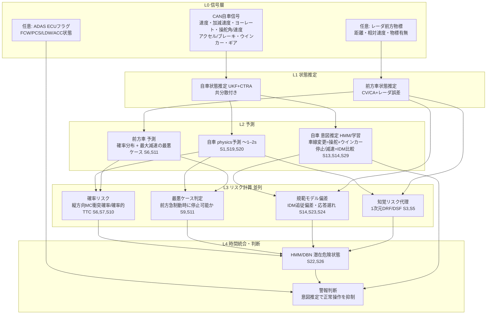

# テーマ08: リスク評価・予測層のアルゴリズム構成

- 調査日: 2026-11-01
- 論点: 自動運転・ADAS研究で使われるリスク推定手法を階層ごとに整理し、自車のCAN信号（任意でCANに流れるレーダ由来の前方車両情報）だけで実現できる構成を明らかにする
- 前提: カメラ・LiDAR・DMS映像は使わない。TTC・THW・DRAC・SHRP2トリガなど既知の代理安全指標は05で扱ったため、本稿では扱わない。本稿が扱うのは、それらを包む「予測→リスク計算→時間統合」の構成である

---

## 1. エグゼクティブサマリー

- リスク評価は、運動モデルの選び方で決まる。Lefèvre ら（2014）は運動モデルを physics-based、maneuver-based、interaction-aware の3つに分けた。physics-based は計算が軽い一方、信頼できる予測は約1秒先までとされる。より長く先読みするには、運転意図（maneuver）の推定が必要になる
- リスクの計算方式は、文献上ほぼ5つの系統に整理できる。(a) 決定論的な衝突判定、(b) 確率的リスク（Monte Carlo、確率的TTC）、(c) 集合ベースの最悪ケース（到達可能集合）、(d) リスク場（Driving Safety Field、Driver's Risk Field、リスクポテンシャル）、(e) 行動ベース（意図と期待の不一致、規範ドライバーモデルからの逸脱）である
- CANのみで成立しやすいのは次の3つである
  - 自車の physics-based 予測（CTRA などと UKF の組み合わせ）
  - レーダ前方情報を使った縦方向1次元の確率リスクと最悪ケース判定
  - IDM（Intelligent Driver Model）など規範モデルとの縦方向の偏差
- 2次元のリスク場や交差点での意図推定は、道路形状・地図・自車位置を前提にしている。CANだけでは入力が欠ける【推察】
- 自車の運転意図は、CAN（操舵・ペダル・速度）だけでもある程度推定できる
  - 速度プロファイルとIDMを比べる方式（Liebner ら 2013）は、C言語実装で1ms未満と軽い
  - 一方、交差点までの距離などの地図情報を前提にしている
- CANのみで自車軌跡を予測した研究（Kim ら 2021）は、ブレーキ・アクセル・操舵・速度・加速度・ヨーレートの8信号を入力にしている。評価は1秒先のみで、データもHILS（シミュレータ）上のものに限られ、実車での検証はない
- 時間方向の統合（HMM・DBN）は、瞬時のリスク値を潜在的な危険状態の確率へ変換し、警報のばたつきを抑える層として使える。ただし、CAN単独の評価例は少ない
- 結論【推察】: CANのみの構成で現実的なのは次の3層である
  1. 自車の状態推定と、短期の physics 予測・意図推定の組み合わせ
  2. 縦方向の確率リスク・最悪ケース判定と、規範モデルからの偏差スコアの並列計算
  3. HMM による時間統合と、警報判断

---

## 2. リスク評価手法の分類

### 2.1 運動予測モデル（リスク計算の前段）

| 分類 | 原理 | 入力 | 出力 | 予測リードタイム | 計算コスト | 代表文献 | CANのみ |
|---|---|---|---|---|---|---|---|
| Physics-based | 運動学・動力学モデル（CV/CA/CTRV/CTRA、自転車モデル）で外挿する | 速度、加速度、ヨーレート、操舵角 | 単一軌跡（＋共分散） | 信頼できるのは約1秒以内とされる [S1][S2] | 極小（カルマンフィルタ1ステップ） | Lefèvre 2014 [S1]、Brännström 2010 [S9]、Houenou 2013 [S19] | ◎（自車）。前方車はレーダがあれば○ |
| Maneuver-based | 意図（車線変更・右左折・停止・追従）を推定し、意図ごとの典型軌跡やモデルで予測する | 上記に加えて、ウインカー・ペダル・操舵の時系列、地図・車線位置 | 意図の確率と、意図ごとの軌跡 | 車線変更は0.5〜3.5秒前が多い [S16]。交差点では右左折の推定を交差点の1.6秒前に行った例がある [S15] | 小〜中（HMMやベイズ網は軽い。GP系は O(n³) と重い [S2]） | Berndt 2008 [S13]、Liebner 2013 [S14]、Tang 2015 [S15] | △（操舵・ウインカーによる意図推定は可。交差点の意図は地図か自車位置が必要） |
| Interaction-aware | 複数の交通参加者の相互作用（DBN、ゲーム理論、深層学習）を扱う | 周辺全車両の状態と地図 | 同時軌跡分布 | 長い（数秒以上） | 大（車両数とともに増える [S2]） | Lefèvre 2014 [S1] | ×（周辺車両の観測がない。前方1台のみなら部分的に可能） |
| 学習型の自車軌跡予測 | CAN時系列を LSTM・CVAE などで多峰分布の軌跡に写像する | CAN 8信号（0.1秒周期、過去5秒） | 自車軌跡の分布 | 1秒先での評価のみ確認 [S20] | 中（推論は軽く、学習が重い） | Kim 2021 [S20] | ○（ただしシミュレータでのみ検証） |

### 2.2 リスク計算方式

| 分類 | 原理 | 入力 | 出力 | リードタイム | 計算コスト | 代表文献 | CANのみ |
|---|---|---|---|---|---|---|---|
| (a) 決定論的な衝突判定・回避可能性 | 予測軌跡同士の交差を判定する。あるいは、制動・操舵・加速のどれでも回避できなくなる時点を求める | 自車と対象物の予測軌跡、車両運動モデル | 衝突の有無、回避手段ごとの余裕 | 短い（AEB作動判断向け） | 小 | Brännström 2010 [S9] | ○（縦方向。対象物はレーダ） |
| (b) 確率的リスク | 将来の入力（加減速・操舵）を確率変数とし、Monte Carlo 法などで将来分布を作って衝突確率を求める。TTCも確率分布として扱う | 運動モデル、入力の事前分布（ドライバーモデル） | 衝突確率、TTCの分布 | 数秒 | 中〜大（サンプル数M×時間点数N に比例、O(MN) [S8]） | Broadhurst 2005 [S7]、Eidehall & Petersson 2008 [S6]、Berthelot 2011/2012 [S10] | ○（前方車1台の縦方向問題に絞れば軽い【推察】） |
| (c) 集合ベース（到達可能集合） | 物理的制約の下で取り得る全占有領域を過大近似し、自車の走行可能領域との重なりで安全性を判定する | 速度・加速度の上下限、道路形状、交通ルール | 占有集合、走行可能領域 | 数秒 | 中（リアルタイム計算可能と報告 [S11][S12]） | Koschi & Althoff（SPOT）[S11]、Söntges & Althoff 2018 [S12] | △（2次元には道路形状が要る。縦方向1次元なら、前方車の最大減速に対し停止可能かという判定に縮退できる【推察】） |
| (d) リスク場・ポテンシャル場 | 障害物・道路・運転者特性からスカラー場を作り、自車位置での場の値や場が及ぼす力をリスクとする | 自車の速度・操舵角、障害物の位置・速度、道路境界 | リスク値（連続量） | 瞬時値（予測は場の形状に織り込まれる） | 小〜中（格子上の積和） | Wang 2015/2016（DSF）[S3][S4]、Kolekar 2020（DRF）[S5]、Raksincharoensak 2014 [S17]、Jensen 2022 [S18] | △（DRFの「自車が進む先」の部分は速度と操舵角から計算できる。障害物・道路側の入力はレーダ物標以外にない） |
| (e) 行動ベース（意図と期待の不一致） | 推定した意図と、交通ルール・状況から期待される行動とのずれを確率で評価する | 意図推定の結果、交通ルール、地図 | 不一致の確率 | 交差点では衝突の数秒前 | 中（粒子フィルタ） | Lefèvre 2012/2015 [S21][S22] | △（交通ルールと地図の情報が要る） |
| (e') 規範ドライバーモデルからの逸脱 | 規範モデル（IDM、参照ドライバー、NIEON）の操作・応答時間と実際の操作の差をリスクとする | 速度、ペダル、操舵、前方車距離 | 偏差スコア | 数秒〜（逸脱は事象前から観測可能【推察】） | 小 | Liebner 2013 [S14]、Engström 2024 [S23]、Scanlon 2026 [S24]、DAISY [S25] | ○（縦方向は前方車距離があれば可） |
| (f) 時間統合（HMM・DBN） | 瞬時の観測（イベント、リスク値）から潜在的な危険状態とその遷移確率を推定する | 時系列の特徴量、イベント列 | 危険状態の事後確率 | 秒〜月（用途次第） | 小（前向き後ろ向きアルゴリズム） | Jackson, Albert, Zhang 2015 [S26]、Lefèvre 2015 [S22] | ◎ |

凡例: ◎ CANのみで直接できる / ○ CANとレーダ前方情報でできる / △ 部分的にできる（地図・自車位置・車線情報があれば完全） / × 困難

---

## 3. 主要文献

### 3.1 サーベイ・分類

#### [S1] A survey on motion prediction and risk assessment for intelligent vehicles
- 著者: Stéphanie Lefèvre, Dizan Vasquez, Christian Laugier（Inria ほか）
- 年・種別: 2014、査読論文（ROBOMECH Journal 1:1、レビュー）
- URL: https://doi.org/10.1186/s40648-014-0001-z （書誌は https://cir.nii.ac.jp/crid/1360855570121451776 で確認）
- 要点
  - 運動モデルを physics-based、maneuver-based、interaction-aware の3つに分けた
  - モデルの網羅性とリアルタイム性はトレードオフの関係にあると指摘している
  - どのリスク評価方式を選べるかは、運動モデルの選択で決まるとしている
  - リスク評価は、衝突予測に基づくものと、文脈上の期待から外れた行動に基づくもの（behaviour-based）の2系統に分けている
- 示唆: CANのみの構成では interaction-aware が実質的に使えない。そのため、physics と maneuver の組み合わせに、behaviour-based のリスク（期待からの逸脱）を加えるのが自然な選択肢になる【推察】

#### [S2] Lefèvre サーベイの講義用要約（2次情報）
- 組織: Xugui Zhou の講義 CSC7700 の受講生ブログ
- 種別: 2次情報（非査読）
- URL: https://xugui-zhou.github.io/teaching/CSC7700/presentations/Blog%20post%207/blog.html
- 要点
  - physics-based が有効なのは1秒未満の短い予測ホライズンに限られる、と要約している
  - maneuver-based の欠点として、典型軌跡の時間依存性が硬いこと、GPのコストが O(n³) であること、道路形状ごとに学習が要ることを挙げている
  - interaction-aware の欠点として、計算量が車両数とともに増えることを挙げている
- 示唆: 原典の数値を確認するための補助資料である。この「約1秒」という値は、Springer の要約にある「1秒超の長期予測は信頼できない」という記述と一致する

#### [S27] Collision Avoidance: A Literature Review on Threat-Assessment Techniques
- 著者: John Dahl, Gabriel Rodrigues de Campos, Claes Olsson, Jonas Fredriksson（Chalmers、Zenuity）
- 年・種別: 2019、査読論文（IEEE Transactions on Intelligent Vehicles 4(1):101–113）
- URL: https://research.chalmers.se/en/publication/516384
- 要点
  - 脅威評価を5系統に分類した。単一行動に基づく指標、最適化、形式手法、確率的枠組み、データ駆動（機械学習）である
  - 各系統を、計算量、頑健性、向いている用途の観点で比べている
- 示唆: Lefèvre 2014 の後継となるサーベイの1つである。本稿 2.2 の (a)〜(c) は、この分類とおおむね対応する

#### [S28] Criticality Metrics for Automated Driving: A Review and Suitability Analysis of the State of the Art
- 著者: Lukas Westhofen, Christian Neurohr ほか（DLR、Bosch、FZI ほか）
- 年・種別: 2022–23、査読論文（Archives of Computational Methods in Engineering）／プレプリント arXiv:2108.02403
- URL: https://arxiv.org/abs/2108.02403
- 要点
  - シナリオ単位の危険度指標（criticality metrics）を網羅的に整理し、用途の要件に合う指標を選ぶための適合性分析の方法を提案した
  - 付属のWeb版（criticality-metrics.readthedocs.io）では、Monte Carlo 衝突確率（P-MC）などを指標ごとに定義している
- 示唆: CANのみで計算できる指標を絞り込むときのチェックリストに使える

### 3.2 確率的リスク・到達可能集合

#### [S6] Statistical Threat Assessment for General Road Scenes Using Monte Carlo Sampling
- 著者: Andreas Eidehall, Lars Petersson
- 年・種別: 2008、査読論文（IEEE T-ITS 9(1):137–147）
- URL: https://researchportalplus.anu.edu.au/en/publications/threat-assessment-for-general-road-scenes-using-monte-carlo-sampl/ （2006年の会議版）、書誌は https://manuscript.isc.ac/Inventory/49/1022913.htm
- 要点
  - 周辺物体の将来の運転入力を確率変数として扱い、動的なドライバーモデルを事前分布にした
  - 将来の分布を Monte Carlo 法で近似し、そこから衝突確率やTTCを求める
  - 計算負荷が高いことを認めたうえで、計算量を増やさずに標本を密にする工夫を示している
- 示唆: 前方車の減速と自車ドライバーの反応遅れを確率変数にすれば、CAN（とレーダ）だけで縦方向の衝突確率を計算できる【推察】

#### [S7] Monte Carlo Road Safety Reasoning
- 著者: Adrian Broadhurst, Simon Baker, Takeo Kanade（CMU）
- 年・種別: 2005（IEEE IV。年は criticality-metrics の引用キーによる）、査読会議論文
- URL: https://criticality-metrics.readthedocs.io/en/latest/probability-scale/P-MC.html （指標の定義と出典）、原典PDF: https://typeset.io/pdf/monte-carlo-road-safety-reasoning-22sk69fkmc.pdf
- 要点
  - すべての道路利用者について将来経路を多数サンプリングする
  - 一定のホライズン内で外形の箱が交差した割合を衝突確率とする（P-MC）
- 示唆: 確率的リスクの原型である。サンプル数がそのまま計算量になる

#### [S8] Fast Collision Probability Estimation Based on Finite-Dimensional Monte Carlo Method
- 種別: プレプリント（arXiv:2003.03973）
- URL: https://arxiv.org/abs/2003.03973
- 要点: Monte Carlo 法の計算量は試行数Mとサンプリング点数Nの積 O(MN) になると整理し、高速化の手法を提案している
- 示唆: 車載ECUで動かすには、問題の次元を落とす（縦方向1次元にする）か、解析近似が必要になる【推察】

#### [S10] Handling uncertainties in criticality assessment ／ A novel approach for the probabilistic computation of Time-To-Collision
- 著者: Adam Berthelot, Andreas Tamke, Thao Dang, Gabi Breuel（Daimler ほか）
- 年・種別: 2011（IEEE IV、pp.571–576）／2012（IEEE IV、pp.1173–1178）、査読会議論文
- URL: https://researchr.org/publication/BerthelotTDB11/bibtex 、 https://researchr.org/publication/BerthelotTDB12-0
- 要点: 状態推定の不確かさを考慮し、TTCを点の値ではなく確率分布として計算する系統の研究である（本文は未取得。書誌と表題で確認）
- 示唆: レーダの距離・相対速度の誤差を確率的TTCに反映させれば、閾値付近の誤警報を抑えられる【推察】

#### [S11] SPOT: Set-Based Prediction of Traffic Participants
- 著者: Markus Koschi, Matthias Althoff（TUM）
- 年・種別: 2017（IEEE IV のツール論文）、査読会議論文。続報は IEEE T-IV 2020（遮蔽と交通ルールを考慮）
- URL: https://commonroad.in.tum.de/tools/spot 、論文: https://mediatum.ub.tum.de/doc/1379612/918437.pdf
- 要点
  - 到達可能性解析で、周辺参加者の将来の占有領域を過大近似として求める
  - 全力加速、全力制動、任意の車線変更を含む
  - 交通ルール違反を検出した参加者は、その仮定を外して占有を広げる
- 示唆: 前方車が最大減速度で制動しても自車は停止できるか、という縦方向の最悪ケース判定に縮退すれば、レーダとCANで実装できる【推察】

#### [S12] Computing the Drivable Area of Autonomous Road Vehicles in Dynamic Road Scenes
- 著者: Sebastian Söntges, Matthias Althoff（TUM）
- 年・種別: 2018、査読論文（IEEE T-ITS 19(6):1855–1866）
- URL: https://ieeexplore.ieee.org/document/8047450 、 https://mediatum.ub.tum.de/doc/1379679/document.pdf
- 要点
  - 自車を速度と加速度に上下限のある質点とみなし、動的障害物の存在下での走行可能領域を過大近似する
  - 実車で使える速さで計算できると示している
- 示唆: 「走行可能領域が縮んでいく速さ」は、選択肢の消失を表すリスク指標になり得る。ただし、2次元で使うには道路形状が必要である【推察】

#### [S9] Model-Based Threat Assessment for Avoiding Arbitrary Vehicle Collisions
- 著者: Mattias Brännström, Erik Coelingh（Volvo Cars）, Jonas Sjöberg（Chalmers）
- 年・種別: 2010、査読論文（IEEE T-ITS 11(3):658–669）
- URL: https://research.chalmers.se/en/publication/144746
- 要点
  - 自車を線形の自転車モデル、物体を時間とともに変化する多角形で表す
  - 操舵・制動・加速のうち、どの回避操作がまだ間に合うかを計算する
  - 追突場面では、従来手法より自動ブレーキの作動タイミングが優れていた
- 示唆: 「回避操作が残っているか」というリスクの定義は、ドライバーの操作能力モデルと直接つながる。CANの操舵・制動の実測値から、個人ごとの能力を推定する拡張が考えられる【推察】

### 3.3 リスク場・ポテンシャル場

#### [S3] The Driving Safety Field Based on Driver–Vehicle–Road Interactions
- 著者: Jianqiang Wang, Jian Wu, Yang Li（清華大学）
- 年・種別: 2015、査読論文（IEEE T-ITS 16(4):2203–2214）
- URL: https://bohrium.dp.tech/paper/arxiv/5488ea1b45ce471f9091111f （書誌）、解説: https://arxiv.org/pdf/2208.07541
- 要点
  - 安全場を3つの成分の和で表す
    - ポテンシャル場: 静止物体による
    - 運動場: 移動物体による
    - 行動場: ドライバーの個人特性による
  - ドライバー・車両・道路の相互作用と、安全性の時間変化を表現できるとしている
  - 移動車両の場は、速度を考慮した円形で定義されている。のちに楕円形へ拡張された（[S3]の解説 arXiv:2208.07541 による）
- 示唆: 「行動場」はドライバー特性の項であり、CANから推定した運転スタイルを入れる口になり得る【推察】

#### [S4] Driving safety field theory modeling and its application in pre-collision warning system
- 著者: Jianqiang Wang, Jian Wu, Xunjia Zheng, Daiheng Ni, Keqiang Li
- 年・種別: 2016、査読論文（Transportation Research Part C 72:306–324）
- URL: https://scholarhub.vn/publication/Driving-safety-field-theory-modeling-and-its-application-in-pre-collision-warning-system/d47ec5b7-4167-4069-82ff-6140b2bff4b9
- 要点: 安全場から運転リスク指数 RDSI を定義し、衝突前警報のアルゴリズムを作って実車で効果を確かめた
- 示唆: 場の理論を警報まで落とし込んだ例である。追従場面に限れば、前方車1台との1次元の場になり、レーダとCANで計算できる【推察】

#### [S5] Human-like driving behaviour emerges from a risk-based driver model
- 著者: Sarvesh Kolekar, Joost de Winter, David Abbink（TU Delft）
- 年・種別: 2020、査読論文（Nature Communications 11:4850）
- URL: https://doi.org/10.1038/s41467-020-18353-4 （TU Delft リポジトリ: https://repository.tudelft.nl/record/uuid:64eceec9-8aab-410a-9266-f0225cfe63d7 ）
- 要点
  - Driver's Risk Field（DRF）は、事象が起こる確率についてドライバーが抱く主観的な信念を2次元の場で表したものである
  - DRF に結果の重大度（コストマップ）を掛けると、知覚リスクが得られる
  - 知覚リスクを閾値以下に保つ制御器を組み合わせるだけで、7種類の場面で人間らしい挙動が再現された（カーブ、車線幅、障害物回避、追従、追い越し、対向車など）
  - DRF は、操舵角と速度を一定と仮定した先読み時間分の予測経路に沿って広がる（パラメータは6つ）
- 示唆
  - DRF の「自車側」の部分は、速度と操舵角というCAN信号だけで決まる
  - レーダ物標をコストマップにすれば、主観リスクの代理指標として計算できる【推察】
  - 知覚リスクが低いのに物理リスクが高い状態（主観と客観の乖離）は、見落としの兆候と解釈できる可能性がある【推察】

#### [S18] Mathematical Models of Human Drivers Using Artificial Risk Fields
- 著者: Emily Jensen, Maya Luster, Hansol Yoon, Brandon Pitts, Sriram Sankaranarayanan
- 年・種別: 2022、プレプリント（arXiv:2205.12722、IEEE ITSC 採択）
- URL: https://arxiv.org/abs/2205.12722
- 要点
  - 状態に非負のリスク値を割り当てるリスク場から、状態を運転操作に写像する確率モデルを作った
  - データに最も合うリスク場は、凸最適化で推定できる
  - シミュレータ実験では、最大20秒先までの軌跡分布を高い精度で予測できたと報告している
  - 一方、道路状況に応じた加減速の選択は扱えないと述べている
- 示唆: リスク場をデータから個人ごとに推定すれば、「その人の普段のリスク許容度」をベースラインにできる【推察】

#### [S17] Driver Speed Control Modeling for Predictive Braking Assistance System Based on Risk Potential in Intersections
- 著者: Raksincharoensak ほか（東京農工大学）
- 年・種別: 2014、査読論文（Journal of Robotics and Mechatronics 26(5):628）
- URL: https://www.fujipress.jp/jrm/rb/robot002600050628/
- 要点
  - 交差点で歩行者が飛び出すニアミス場面をドライビングシミュレータで再現した
  - 人工リスクポテンシャル場（車両と歩行者の間の仮想ばね）で、予測的な制動支援の強さを決める
  - 場面のパラメータには、ドライブレコーダーのヒヤリハットデータを使っている
- 示唆: 日本のヒヤリハットDBとリスクポテンシャル法の接続例である。ただし、歩行者の検知（外界センサ）を前提にしている

### 3.4 運転意図推定

#### [S13] Continuous Driver Intention Recognition with Hidden Markov Models
- 著者: Holger Berndt, Jörg Emmert, Klaus Dietmayer（Ulm大学）
- 年・種別: 2008、査読会議論文（IEEE ITSC、pp.1189–1194）
- URL: https://api.crossref.org/works/10.1109%2FITSC.2008.4732630
- 要点: HMMで運転意図を連続的に認識する初期の代表的研究である（Crossref 上の被引用は118件。本文は未取得）
- 示唆: CANの操舵・速度などを観測とし、HMMで意図を推定する枠組みの基準となる文献である

#### [S14] Velocity-Based Driver Intent Inference at Urban Intersections in the Presence of Preceding Vehicles
- 著者: Martin Liebner, Felix Klanner, Michael Baumann, Christian Ruhhammer, Christoph Stiller（BMW、KIT）
- 年・種別: 2013、査読論文（IEEE ITS Magazine 5(2):10–21）
- URL: https://www.mrt.kit.edu/z/publ/download/2013/LiebnerAl2013ITSMag.pdf
- 要点（本文を確認）
  - 交差点に接近するときの速度プロファイルから、右折・停止・直進の意図を推定する
  - 先行車がいる場合は、速度が追従のために落ちているのか右左折のために落ちているのかを区別する必要がある。そこで、IDM（Intelligent Driver Model）に希望速度プロファイルを組み込んで両方を表した
  - 分類はベイズ網で行い、比較ベースとシミュレーションベースの2方式を比べた
  - 計算時間は、過去1秒の速度プロファイル（0.01秒刻み）を評価するのに、MATLABの比較ベースで17ms、シミュレーションベースで207msだった。比較ベースをC言語で実装すると1ms未満になる
  - 分類性能は、予測TTC 2秒の時点で評価している
  - 意図を推定できない状況では「わからない」を表現できる
- 示唆
  - 「規範モデル（IDM）と実際の速度の比較」は、意図推定とリスク評価の両方に使える
  - 一方、交差点までの距離や道路曲率（地図）を前提にしている。CANのみの場合は、追従場面（レーダで先行車あり）での縦方向の偏差評価に限られる【推察】

#### [S15] Turn Prediction at Generalized Intersections
- 著者: Bo Tang, Salman Khokhar, Rakesh Gupta（Honda Research Institute USA）
- 年・種別: 2015、査読会議論文（IEEE IV）
- URL: https://web.media.mit.edu/~rgupta/pdf/IV2015_Gupta.pdf
- 要点（本文を確認）
  - 1台の車で集めた375本の右左折トラックを使い、HMM・SVM・DBNを比べた
  - 交差点の1.6秒前に、90%を超える右左折予測精度を得た。SVMとDBNがHMMより高精度だった
  - 特徴量は、車線中心からの距離、交差点までの距離、車線に対する方位角、速度、加速度の5つである
  - CANデータはサンプリングが疎だったため、速度・加速度はGPSから計算している
- 示唆: 右左折の推定精度の多くは、車線レベル地図とGPSから得た特徴量に依存している。CANのみでは同じ性能を見込めない【推察】

#### [S16] Overtake Detection in Trucks Using CAN Bus Signals: A Comparative Study of Machine Learning Methods
- 著者: Fernando Alonso-Fernandez, Talha Hanif Butt, Prayag Tiwari（Halmstad大学、Volvo Group のデータ）
- 年・種別: 2025、プレプリント（arXiv:2507.00593、ESWA 査読中）
- URL: https://arxiv.org/abs/2507.00593
- 要点
  - 営業運行中のトラック5台のCANログから、ANN・RF・SVMとそれらのスコア融合で追い越しを検出した
  - 融合した方式で、真陰性率93%、真陽性率86.5%だった
  - 先行研究のレビューでは、車線変更の予測ホライズンは最大3.5秒で、1秒以下の研究が多いとしている
- 示唆: CANのみによる操作検出の最新事例である。「予測」より「検出」に近く、リードタイムは短い

#### [S29] A Mathematical Model for Predicting Lane Changes Using the Steering Wheel Angle
- 著者: Kim Schmidt, Matthias Beggiato, Karl Heinz Hoffmann, Josef F. Krems（TU Chemnitz）
- 年・種別: 2014、査読論文（Journal of Safety Research 49）
- URL: https://www.pubmed.gov/24913491/
- 要点
  - 51人による3,111回の車線変更（シミュレータの高速道路）を分析した
  - 参加者は、隣の車線へ進入する約7秒前に副次課題を終えており、計画段階が始まっていると解釈された
  - 操舵角は早期の予測因子として有望だった（車線に向かい始める時点の平均は約2.5度）
  - 操舵角の数理モデルを提案している
  - 動機は、意図を検知して支援システムを選択的に作動させ、誤警報を減らすことである
- 示唆: 操舵角のみ（CAN）でも車線変更の開始を早期に捉えられる。これを警報抑制に使うことで、誤警報の削減に直結する【推察】

#### [S30] Car that Knows Before You Do: Anticipating Maneuvers via Learning Temporal Driving Models
- 著者: Ashesh Jain, Hema S. Koppula, Bharad Raghavan, Shane Soh, Ashutosh Saxena（Cornell、Stanford）
- 年・種別: 2015、査読会議論文（ICCV）
- URL: https://openaccess.thecvf.com/content_iccv_2015/papers/Jain_Car_That_Knows_ICCV_2015_paper.pdf
- 要点
  - 車内外の映像、GPS、速度を入力とする AIO-HMM（自己回帰型の入出力HMM）を提案した
  - 1,180マイルの実走データで、操作を3.5秒前に F1 80%超で予測した
- 示唆: 比較対象として載せる。リードタイム3.5秒の実現には、車内カメラ（顔の動き）が大きく効いている。CANのみでは、同じリードタイムは期待しにくい【推察】

#### [S31] Predicting driver lane change intent using HCRF
- 著者: Yu Wen, Xuetao Zhang, Fei Wang, Jinsong Han（西安交通大学）
- 年・種別: 2015、査読会議論文（IEEE ICVES）
- URL: https://scholar.xjtu.edu.cn/en/publications/predicting-driver-lane-change-intent-using-hcrf/
- 要点: 操舵角、横位置、視線を入力にした HCRF で、車線変更の0.5秒前に99%、2秒前に85%の精度を得た（シミュレータ）。SVMやHMMより高精度だった
- 示唆: 視線と横位置を除いたCANのみの条件では、2秒前の精度はさらに下がると見込まれる【推察】

### 3.5 行動ベースのリスク・規範モデル

#### [S21] Evaluating Risk at Road Intersections by Detecting Conflicting Intentions
- 著者: Stéphanie Lefèvre, Christian Laugier, Javier Ibañez-Guzmán（Inria、Renault）
- 年・種別: 2012、査読会議論文（IEEE/RSJ IROS）
- URL: https://hal-univ-tlse3.archives-ouvertes.fr/INRIA/hal-00743231
- 要点
  - 軌跡予測を行わない
  - ドライバーの「意図」と、交通ルール・状況から「期待される行動」を比べ、両者の不一致を危険とする
- 示唆: 本人の意図と、規範（期待）とのずれをリスクとする考え方は、自車のみ（CAN）にも適用できる。ただし、「期待」を定義するには交通ルールと地図の情報が要る【推察】

#### [S22] Intention-aware risk estimation: Field results（2015）
- 著者: Lefèvre, Vasquez, Laugier, Ibañez-Guzmán
- 年・種別: 2015、査読会議論文（IEEE ARSO と推定。書誌は下記カタログによる）
- URL: https://katalog.lib.cas.cz/KNAV/EdsRecord/edsair,edsair.doi.dedup.....43cc51cd4f780a3cb423b3d079b73e3f 、要約: https://pemami4911.github.io/paper-summaries/general-ml/2016/01/29/intention-aware.html
- 要点
  - リスクを「意図が期待と一致しない確率」と定義し、ベイズプログラミングと粒子フィルタで計算した
  - 実車2台（V2Vで10Hzの位置・速度を共有）の実験で、危険試行90回すべてでブレーキが間に合う時点に警報が出た
  - 非危険試行20回では、誤警報はなかった
- 示唆: 状態遷移モデルによるリスク推定が、実車で誤警報ゼロを達成した例である。ただし入力はV2Vであり、試行数も少ない

#### [S23] Modeling road user response timing in naturalistic traffic conflicts: A surprise-based framework
- 著者: Johan Engström, Shu-Yuan Liu, Azadeh Dinparastdjadid, Camelia Simoiu（Waymo）
- 年・種別: 2024、査読論文（Accident Analysis & Prevention）／プレプリント arXiv:2208.08651
- URL: https://waymo.com/research/modeling-road-user-response-timing-in-naturalistic/ 、 https://arxiv.org/abs/2208.08651
- 要点
  - 応答時間を固定の反応時間として扱わず、事前の信念が「驚き」（予期の破れ）によって更新される過程としてモデル化した
  - SHRP2 の衝突・ニアミス時の応答データに単純なモデルを当てはめた
- 示唆: 規範ドライバーの応答時間を状況依存にできる。CANではブレーキ・操舵の開始時刻を観測できるため、「規範より応答が遅い」ことを偏差指標にできる【推察】

#### [S24] Collision Avoidance Effectiveness of an Automated Driving System Using a Human Driver Behavior Reference Model in Reconstructed Fatal Collisions
- 著者: John M. Scanlon, Kristofer D. Kusano, Johan Engström, Trent Victor（Waymo）
- 年・種別: 2026、SAE Technical Paper 2026-01-0520（査読付きの技術論文）
- URL: https://saemobilus.sae.org/papers/collision-avoidance-effectiveness-automated-driving-system-using-a-human-driver-behavior-reference-model-reconstructed-fatal-collisions-2026-01-0520 、関連: https://waymo.com/blog/2022/09/benchmarking-av-safety/
- 要点
  - NIEON は、障害がなく視線が衝突対象に向いているドライバーの応答時間と回避行動を表す参照モデルである
  - 再構成した16件の死亡事故では、NIEONで重傷リスクが84%減、Waymo Driver で93%減と報告された
  - 後継として、能動的推論に基づく参照ドライバー ReD が発表されている（Waymo ブログ、2026年6月）
- 示唆: 規範（参照）ドライバーモデルを具体化した例である。CANで観測した実際の制動開始と、NIEON相当の制動開始との差は、注意低下の代理指標になり得る【推察】

#### [S25] DAISY（Driver AssIsting SYstem）— 参照ドライバーと実際のドライバーの比較
- 組織: SWOV（オランダ交通安全研究所）の文献要約
- 種別: 研究報告の要約（非査読ページ）
- URL: https://swov.nl/en/publicatie/what-should-vehicle-know-about-driver
- 要点: 4つのモジュールから成る
  1. 参照ドライバー（状況評価と規範ドライバーモデル）
  2. 実際のドライバーのモデル
  3. 両者の乖離を解釈する助言モジュール
  4. 警報装置
- 示唆: 「規範モデルからの逸脱を警報する」構成は1990年代から提案されている。本稿の構成案（5章）の偏差層は、この系譜に当たる

### 3.6 自車運動予測（CANのみ）

#### [S20] Driving Style-Based Conditional Variational Autoencoder for Prediction of Ego Vehicle Trajectory
- 著者: Dongchan Kim, Hyukju Shon, Nahyun Kweon, Seungwon Choi, Chanuk Yang, Kunsoo Huh（漢陽大学）
- 年・種別: 2021、査読論文（IEEE Access 9:169348–169356）
- URL: https://doi.org/10.1109/ACCESS.2021.3138502 （オープンアクセス: https://scholarworks.bwise.kr/hanyang/handle/2021.sw.hanyang/144014 ）
- 要点（本文を確認）
  - 入力はCANの8信号である: ブレーキ、アクセル、操舵角、操舵角速度、縦速度、縦加速度、横加速度、ヨーレート（0.1秒周期、5秒窓）
  - DeepConvLSTM で運転スタイル（通常・攻撃的・注意散漫の3種）を認識し、その結果を条件として CVAE が自車軌跡を多峰的に生成する
  - 推定した過去軌跡も入力に加えている
  - データは CarMaker HILS で12人から収集したもので、実車での検証は今後の課題としている
  - 評価は1秒先の位置誤差（RMSE・MAE）で行った。ある試験例での総MAEは、提案手法が0.05〜0.07m、UKF+CTRA が0.29〜2.08m、UKF+CV が0.49〜5.55m だった
- 示唆
  - CANのみでも、1秒先の自車軌跡は物理モデルより学習モデルの方が精度が高い
  - 一方、ホライズン1秒、シミュレータのみという条件は、事故の予兆検知（数秒〜数十秒前）には短すぎる
  - 実車で長いホライズンを検証することが、未解決の課題である【推察】

#### [S19] Vehicle trajectory prediction based on motion model and maneuver recognition
- 著者: Adam Houenou, Philippe Bonnifait, Véronique Cherfaoui, Wen Yao（UTC Compiègne）
- 年・種別: 2013、査読会議論文（IEEE/RSJ IROS、pp.4363–4369）
- URL: https://dblp.uni-trier.de/rec/conf/iros/HouenouBCY13.html
- 要点
  - CYRA（ヨーレート・加速度一定）モデルによる予測と、操作認識に基づく予測を組み合わせる
  - 短期では運動モデルを、長期では操作に基づく予測を重視する
  - 操作の認識は、車線中心線との比較で行う
- 示唆: physics と maneuver の時間ブレンドは、CANのみの構成でも使える。ただし、操作の認識に車線情報を使う点はCANのみでは代替が必要になる【推察】

### 3.7 時間統合（HMM）

#### [S26] A two-state mixed hidden Markov model for risky teenage driving behavior
- 著者: John C. Jackson, Paul S. Albert, Zhiwei Zhang（NIH）
- 年・種別: 2015、査読論文（Annals of Applied Statistics 9(2):849–865）／プレプリント arXiv:1509.04831
- URL: https://arxiv.org/abs/1509.04831
- 要点
  - 免許取得後18か月間の10代ドライバーのデータを使った
  - 加速度の高いイベント（g-force イベント、危険運転の代理指標）と衝突・ニアミスを、2状態の隠れマルコフモデルで同時にモデル化した
  - 個人差は共有ランダム効果で表した
  - 前向き後ろ向きアルゴリズムで、隠れ状態の確率を得る
- 示唆: CANで取れるイベント列を、潜在的な「危険状態」へ写像する時間統合層の統計的な原型である。時間スケールは月単位だが、秒〜分単位に置き換えることもできる【推察】

---

## 4. CANのみ向けリスク評価層の構成案

### 4.1 各層の説明（文献根拠と推察を区別）

- L0 信号層
  - 文献根拠: Kim 2021 [S20] の8信号（0.1秒周期）は、CANのみで自車を予測するための入力の基準になる
  - 【推察】ウインカーとギアは、意図推定の強い手がかりとして追加すべきである。ADAS ECU のフラグは、L3の結果と照合して冗長性を持たせるのに使う
- L1 状態推定
  - 文献根拠: UKF と CTRA の組み合わせは、[S20] で比較基準として使われている。縦方向の推定精度は良いが、横方向の誤差が大きい
  - 【推察】ここで得る共分散は、L3の確率リスクにそのまま渡す
- L2 予測
  - 文献根拠
    - physics 予測が信頼できるのは約1秒までである [S1][S2]
    - 長期予測には操作認識とのブレンドが有効である [S19]
    - 操舵角から車線変更の開始を早期に予測できる [S29]
    - 速度とIDMの比較による意図推定は、1ms未満で計算できる [S14]
  - 【推察】
    - 交差点の右左折意図は、地図がないと推定精度が落ちる [S15]
    - そのため、CANのみでは「車線変更」「減速・停止」「追従」の3種に絞る
- L3 リスク計算（並列）
  - 文献根拠
    - Monte Carlo による衝突確率 [S6][S7]
    - 確率的TTC [S10]
    - 回避操作が残っているかの判定 [S9]
    - 到達可能集合による最悪ケース判定 [S11]
    - 規範モデル・参照ドライバー [S14][S23][S24][S25]
    - DRF による知覚リスク [S5]
  - 【推察】
    - CANのみの構成では、4つとも縦方向1次元（前方1物標）に縮退して実装する
    - R1・R2は「物理的にどれだけ危ないか」を表す
    - R3・R4は「ドライバーの挙動が規範からどれだけ外れているか（＝予兆）」を表す
    - 予兆検知のリードタイムを稼ぐのは、R3・R4の側である
- L4 時間統合・判断
  - 文献根拠
    - 2状態HMMによる潜在的危険状態の推定 [S26]
    - 状態遷移モデルによるリスク推定で、実車試験での誤警報がゼロだった例 [S22]
    - 意図推定は、支援システムの誤警報削減に使える [S29]
  - 【推察】
    - 瞬時のリスク値を直接閾値で判定せず、HMMの事後確率とヒステリシスで警報を出す
    - 意図推定で「正常な車線変更・減速」と判断した場合は、警報を抑制する

### 4.2 CANのみで欠ける入力と、その代替【推察】

| 欠ける入力 | 影響を受ける手法 | 代替案 |
|---|---|---|
| 車線位置・車線境界 | TLC、車線変更の検出、DRFの道路側の項 | LDW・LKA の ECU フラグが CAN に流れていれば利用する。ない場合は、操舵とヨーレートの高周波成分で代替する |
| 周辺車両（前方以外） | interaction-aware、2次元の到達可能集合 | 扱わない（前方1物標に限定する） |
| 地図・交差点位置 | 右左折意図、意図と期待の不一致 [S21] | ナビECUの位置・地図情報が CAN（または車内ネットワーク）にあれば利用する。ない場合は対象外とする |
| 視線・顔 | 操作予測の長いリードタイム [S30] | 操舵の微小修正パターンや応答遅れ（[S23]相当）で間接的に推定する |

---

## 5. 課題・ギャップ / 次のアクション提案

### 5.1 課題・ギャップ
- CANのみで、数秒以上先の自車予測を実車で検証した研究は見当たらない。唯一の明示例 [S20] も、ホライズン1秒、HILSのみである
- 意図推定の多くは、地図・GPS・視線・車線位置を併用している [S15][S30][S31]。CANのみで性能が出るかは未検証である
- リスク場（DSF・DRF）やポテンシャル法は2次元の外界認識を前提にしており、1次元に縮退させた場合の妥当性は未評価である
- 確率的リスクと最悪ケース判定は、物理的に急迫した危険には強い。一方、事前の兆候（ドライバー挙動の逸脱）は捉えない。予兆を担う規範偏差系の評価指標（リードタイム、誤警報率）が未整備である
- 時間統合（HMM）の公開例は、月単位の統計モデル [S26] か、V2Vを使った交差点での実験 [S22] であり、秒単位のCAN警報で誤警報率を評価した例はない

### 5.2 次のアクション提案
1. 縦方向リスクの基準実装
   - 前方レーダが CAN に流れる車種のログで、R1（Monte Carlo 衝突確率）と R2（前方急制動時に停止可能か）を実装する
   - 05 の TTC・THW トリガと比べ、警報のリードタイムと誤警報率を評価する
   - 前方車の減速の事前分布と、ドライバー応答時間の分布は、Engström [S23] の枠組みに沿って設定する
2. IDM 偏差スコアの試作
   - 追従区間で、IDMのパラメータをドライバーごとにオンライン推定する
   - 予測した加速度と実際の加速度の残差の時系列を、予兆特徴量にする（[S14] を追従場面に転用）
   - 【推察】オンライン推定したパラメータの漂流（例: 希望車間時間の短縮）は、運転状態の変化を示す可能性がある
3. CANのみの意図推定器
   - 操舵角・操舵角速度・ウインカー・ブレーキ・アクセルで「車線変更開始」「減速開始」を推定する
   - 推定結果は、警報の抑制（正常操作の判定）に使う。[S29] のように誤警報削減を主目的とする
   - 評価は、comma2k19 など公開CANデータ（03参照）でのリードタイムと F1 で行う
4. HMM による時間統合
   - L3の4出力を観測とする2〜3状態のHMMを学習する
   - 警報の点灯回数・持続時間・誤警報率（100kmあたり）を、瞬時閾値方式と比べる
5. 入力範囲の再確認
   - 対象車種で、LDW・LKA・ナビECUの情報が CAN 上で取得できるかを確認する
   - 取得できる場合、意図推定とリスク場の2次元化が可能になり、構成案の△の多くが○に上がる【推察】

---

## 6. 参考文献リスト

| ID | 文献 | 種別 | URL |
|---|---|---|---|
| S1 | Lefèvre, Vasquez, Laugier. A survey on motion prediction and risk assessment for intelligent vehicles. ROBOMECH J. 2014 | 査読論文 | https://doi.org/10.1186/s40648-014-0001-z |
| S2 | Lefèvre サーベイの講義用要約（CSC7700 ブログ） | 2次情報 | https://xugui-zhou.github.io/teaching/CSC7700/presentations/Blog%20post%207/blog.html |
| S3 | Wang, Wu, Li. The Driving Safety Field Based on Driver–Vehicle–Road Interactions. IEEE T-ITS 2015 | 査読論文 | https://bohrium.dp.tech/paper/arxiv/5488ea1b45ce471f9091111f |
| S4 | Wang et al. Driving safety field theory modeling and its application in pre-collision warning system. TR-C 2016 | 査読論文 | https://scholarhub.vn/publication/Driving-safety-field-theory-modeling-and-its-application-in-pre-collision-warning-system/d47ec5b7-4167-4069-82ff-6140b2bff4b9 |
| S5 | Kolekar, de Winter, Abbink. Human-like driving behaviour emerges from a risk-based driver model. Nat. Commun. 2020 | 査読論文 | https://doi.org/10.1038/s41467-020-18353-4 |
| S6 | Eidehall, Petersson. Statistical Threat Assessment for General Road Scenes Using Monte Carlo Sampling. IEEE T-ITS 2008 | 査読論文 | https://researchportalplus.anu.edu.au/en/publications/threat-assessment-for-general-road-scenes-using-monte-carlo-sampl/ |
| S7 | Broadhurst, Baker, Kanade. Monte Carlo Road Safety Reasoning. IEEE IV 2005 | 査読会議論文 | https://typeset.io/pdf/monte-carlo-road-safety-reasoning-22sk69fkmc.pdf （定義: https://criticality-metrics.readthedocs.io/en/latest/probability-scale/P-MC.html ） |
| S8 | Fast Collision Probability Estimation Based on Finite-Dimensional Monte Carlo Method. arXiv 2020 | プレプリント | https://arxiv.org/abs/2003.03973 |
| S9 | Brännström, Coelingh, Sjöberg. Model-Based Threat Assessment for Avoiding Arbitrary Vehicle Collisions. IEEE T-ITS 2010 | 査読論文 | https://research.chalmers.se/en/publication/144746 |
| S10 | Berthelot, Tamke, Dang, Breuel. Handling uncertainties in criticality assessment. IEEE IV 2011 ／ A novel approach for the probabilistic computation of TTC. IEEE IV 2012 | 査読会議論文 | https://researchr.org/publication/BerthelotTDB11/bibtex ／ https://researchr.org/publication/BerthelotTDB12-0 |
| S11 | Koschi, Althoff. SPOT: Set-Based Prediction of Traffic Participants. IEEE IV 2017 | 査読会議論文・ツール | https://commonroad.in.tum.de/tools/spot ／ https://mediatum.ub.tum.de/doc/1379612/918437.pdf |
| S12 | Söntges, Althoff. Computing the Drivable Area of Autonomous Road Vehicles in Dynamic Road Scenes. IEEE T-ITS 2018 | 査読論文 | https://ieeexplore.ieee.org/document/8047450 |
| S13 | Berndt, Emmert, Dietmayer. Continuous Driver Intention Recognition with Hidden Markov Models. IEEE ITSC 2008 | 査読会議論文 | https://api.crossref.org/works/10.1109%2FITSC.2008.4732630 |
| S14 | Liebner et al. Velocity-Based Driver Intent Inference at Urban Intersections in the Presence of Preceding Vehicles. IEEE ITS Mag. 2013 | 査読論文 | https://www.mrt.kit.edu/z/publ/download/2013/LiebnerAl2013ITSMag.pdf |
| S15 | Tang, Khokhar, Gupta. Turn Prediction at Generalized Intersections. IEEE IV 2015 | 査読会議論文 | https://web.media.mit.edu/~rgupta/pdf/IV2015_Gupta.pdf |
| S16 | Alonso-Fernandez, Butt, Tiwari. Overtake Detection in Trucks Using CAN Bus Signals. arXiv 2025 | プレプリント | https://arxiv.org/abs/2507.00593 |
| S17 | Raksincharoensak ほか. Driver Speed Control Modeling for Predictive Braking Assistance System Based on Risk Potential in Intersections. JRM 2014 | 査読論文 | https://www.fujipress.jp/jrm/rb/robot002600050628/ |
| S18 | Jensen et al. Mathematical Models of Human Drivers Using Artificial Risk Fields. arXiv 2022（ITSC） | プレプリント | https://arxiv.org/abs/2205.12722 |
| S19 | Houenou, Bonnifait, Cherfaoui, Yao. Vehicle trajectory prediction based on motion model and maneuver recognition. IROS 2013 | 査読会議論文 | https://dblp.uni-trier.de/rec/conf/iros/HouenouBCY13.html |
| S20 | Kim et al. Driving Style-Based Conditional Variational Autoencoder for Prediction of Ego Vehicle Trajectory. IEEE Access 2021 | 査読論文 | https://doi.org/10.1109/ACCESS.2021.3138502 ／ https://scholarworks.bwise.kr/hanyang/handle/2021.sw.hanyang/144014 |
| S21 | Lefèvre, Laugier, Ibañez-Guzmán. Evaluating Risk at Road Intersections by Detecting Conflicting Intentions. IROS 2012 | 査読会議論文 | https://hal-univ-tlse3.archives-ouvertes.fr/INRIA/hal-00743231 |
| S22 | Lefèvre, Vasquez, Laugier, Ibañez-Guzmán. Intention-aware risk estimation: Field results. 2015 | 査読会議論文 | https://katalog.lib.cas.cz/KNAV/EdsRecord/edsair,edsair.doi.dedup.....43cc51cd4f780a3cb423b3d079b73e3f （要約: https://pemami4911.github.io/paper-summaries/general-ml/2016/01/29/intention-aware.html ） |
| S23 | Engström, Liu, Dinparastdjadid, Simoiu. Modeling road user response timing in naturalistic traffic conflicts: A surprise-based framework. AAP 2024 | 査読論文・プレプリント | https://waymo.com/research/modeling-road-user-response-timing-in-naturalistic/ ／ https://arxiv.org/abs/2208.08651 |
| S24 | Scanlon, Kusano, Engström, Victor. Collision Avoidance Effectiveness of an ADS Using a Human Driver Behavior Reference Model in Reconstructed Fatal Collisions. SAE 2026-01-0520 | 技術論文 | https://saemobilus.sae.org/papers/collision-avoidance-effectiveness-automated-driving-system-using-a-human-driver-behavior-reference-model-reconstructed-fatal-collisions-2026-01-0520 |
| S25 | SWOV. What should the vehicle know about the driver?（DAISY の要約を含む） | 研究報告要約 | https://swov.nl/en/publicatie/what-should-vehicle-know-about-driver |
| S26 | Jackson, Albert, Zhang. A two-state mixed hidden Markov model for risky teenage driving behavior. Ann. Appl. Stat. 2015 | 査読論文・プレプリント | https://arxiv.org/abs/1509.04831 |
| S27 | Dahl, de Campos, Olsson, Fredriksson. Collision Avoidance: A Literature Review on Threat-Assessment Techniques. IEEE T-IV 2019 | 査読論文 | https://research.chalmers.se/en/publication/516384 |
| S28 | Westhofen, Neurohr et al. Criticality Metrics for Automated Driving: A Review and Suitability Analysis. ACME 2022–23 | 査読論文・プレプリント | https://arxiv.org/abs/2108.02403 |
| S29 | Schmidt, Beggiato, Hoffmann, Krems. A Mathematical Model for Predicting Lane Changes Using the Steering Wheel Angle. J. Safety Res. 2014 | 査読論文 | https://www.pubmed.gov/24913491/ |
| S30 | Jain et al. Car that Knows Before You Do. ICCV 2015 | 査読会議論文 | https://openaccess.thecvf.com/content_iccv_2015/papers/Jain_Car_That_Knows_ICCV_2015_paper.pdf |
| S31 | Wen, Zhang, Wang, Han. Predicting driver lane change intent using HCRF. IEEE ICVES 2015 | 査読会議論文 | https://scholar.xjtu.edu.cn/en/publications/predicting-driver-lane-change-intent-using-hcrf/ |

ソースは31件である。このうち査読論文・査読会議論文・プレプリントは27件（S1、S3〜S24、S26〜S31。S24 は SAE 技術論文）、2次情報・要約は S2、S25 の2件である。

### 確認しきれなかった点
- S1（Lefèvre 2014）は、本文PDFの取得が出版社の認証で拒否された。「physics-based が信頼できるのは約1秒」という値は、2次要約 [S2] と検索結果の抜粋による
- S5（DRF）と S3・S4（DSF）は、本文を取得できなかった。数式・パラメータ値は、抄録と2次資料による
- S10（Berthelot）と S13（Berndt）は、書誌のみを確認した。手法の詳細は未確認である
- S22 の掲載会議（ARSO 2015）は推定である。S7 の年（2005）は、引用キーによる
- S24（NIEON）は抄録と Waymo の要約のみを確認した。ReD の Nature Communications 論文の書誌は未確認である
- 交差点での意図推定で「交差点の最大7秒前」と報告した IV 2014 の論文は、著者を特定できなかったため掲載していない
