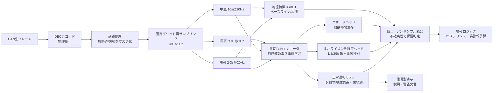

# CAN時系列から危険予兆を学習・推論するMLモデルのアーキテクチャ

- 調査日: 2026-11-01
- 論点: CAN時系列から危険予兆を学習・推論するMLモデルについて、論文で使われているネットワーク構成・入力表現・学習戦略を整理し、本プロジェクト（有人運転車両でCANデータのみを使う事故予兆検知）のモデル設計指針を得る
- 既存調査との関係: 01（DeepConvGRU-Attention、DepthConv-GRU、FCN-LSTM、GConvLSTM、マルチタスクLSTM自己符号化器 [arXiv 1907.00749]、One-class SVM）と05（AdaBoostによる約1秒先予測、GSSM、Deep Isolation Forest、CNN-LSTM-Attention）で既出の手法は再掲しない。本書は、それらを横断する入力表現・構成要素・学習戦略・信頼性技術を深掘りする
- 凡例: 【推察】は筆者の推論である。性能数値はすべて出典の報告値で、データセットや評価条件が異なるため、文献間で直接は比較できない

---

## 1. エグゼクティブサマリー

1. 入力は、DBCでデコードした物理量を固定時間グリッドに再サンプリングし、信号ごとに正規化する構成が主流である [1][3][5][23]。生バイトやCAN-ID系列の入力は、主に侵入検知（IDS）向けである [11]。運転挙動の予兆検知では、デコード済み物理量を使うのが妥当である。
2. 非同期CANの扱い方は2通りある。固定周期に再サンプリングする方式 [23] と、CAN-IDごとのLSTMをメッセージ到着時に更新するイベント駆動方式（CANet）[1] である。
3. 正常運転を学習して逸脱を測る方式では、小さなモデルで十分に機能する。CANetは最小規模（hscale=5）でも性能を保った [1]。小型のRNN/CNN予測器は、パラメータを最大23%、計算量を最大60%減らしても検知性能をほぼ維持した [4]。3残差ブロックの軽量TCNは、再帰型自己符号化器（INDRA）より偽陽性をおよそ1/10に減らした [2]。
4. 大規模事前学習には注意が要る。Foundation CAN LM（約1万台・90日、約50Mパラメータ）は、衝突検出のF1でGLM（一般化線形モデル）に負けた（10:1で76.1% 対 81.1%、100:1で54.2% 対 65.3%）[5]。サンプリング1Hz・窓10秒という粗い入力が一因と著者自身が示唆している。汎用時系列基盤モデル（MOMENT、Chronos、PatchTST系）をCANの危険予兆に使った査読報告は見つからなかった [19][20][21]。
5. 学習戦略で本プロジェクトに特に効くのは、次の4つである【推察】。
   - 不均衡対策の損失関数（focal loss）[10]
   - 自己教師あり事前学習（コントラスティブと生成型は同程度の性能）[6]
   - 学習時だけ映像や言語記述を「特権情報」として使い、推論はCANのみで行う枠組み（F1が相対+7.6%）[14]
   - 継続学習による個人適応（精度低下を約11%から約2%に抑制）[13]
6. 信頼性技術では次の報告がある。
   - 不確実性: 誤動作予測でDeep EnsembleがMC Dropoutより偽警報を抑えた [9]
   - 説明: GDNの注意重みによる信号単位の異常の局在化 [15]、SHAPによる要因分析 [25]
   - 軽量化: 2bit量子化MLPがFPGA型ECU上で1メッセージ0.11 ms・0.23 mJで推論した [16]
7. 推奨構成は「物理量グリッド → 多重時間スケール窓 → (a)正常運転モデルの逸脱スコア ＋ (b)自己教師ありで事前学習したTCNエンコーダの多ホライズン危険度ヘッド → 較正・アンサンブル不確実性 → 警報ロジック」の二系統である【推察】。生存分析型のニューラルネットをCANの危険予兆に使った例は見つからず、研究上の空白である。

---

## 2. 入力表現・前処理の選択肢

### 2.1 入力の粒度: 生フレーム vs デコード済み物理量

| 選択肢 | 内容 | 主な用途・根拠 | 本プロジェクト適性 |
|---|---|---|---|
| CAN-ID系列・タイミング特徴 | ID出現順、到着間隔、窓内のID数・エントロピーなど | 侵入検知のDoS・ファジング検出が中心 [11] | 低い。運転挙動を表さない |
| ペイロードのビット・バイト・16進表現、ビット画像 | 生データを2値・整数・one-hotに符号化。画像化してCNNに入れる例もある [11] | DBCが不要。IDS研究で多い [11] | 低〜中。DBCが得られない車種の探索段階に限る【推察】 |
| デコード済み物理量の多変量時系列 | DBCで速度・操舵角・ペダル・ヨーレートなどに変換する | CANet [1]、CANShield [3]、小型RNN/CNN異常検知 [4]、Foundation CAN LM（44信号）[5] | 高い。物理的に解釈でき、車種間でも単位をそろえられる |

- CANShieldは、ID系列や生ペイロードだけを見るIDSでは、メッセージの周期を保ったまま値だけを偽装する攻撃を見逃すと指摘し、信号レベルの入力を採った [3]。
- これを運転挙動に読み替えると、「周期は正常で値の推移だけが危険」という事象を捉えるには、信号レベルの入力が必要になる【推察】。

### 2.2 非同期CANの同期化

| 方式 | 内容 | 根拠 |
|---|---|---|
| 固定周期への離散化（再サンプリング） | メッセージ流を一定間隔の時刻に離散化し、多変量時系列にする | Janodetら（SynCAN）[23]。CANetも時間を離散化して扱う [1]。Foundation CAN LMは1 Hzに再サンプリング [5] |
| イベント駆動（ID別サブネット） | CAN-IDごとにLSTMを持ち、そのIDのメッセージが届いた時点で該当LSTMだけを更新する。全LSTMの隠れ状態を連結した「結合潜在ベクトル」から全信号を再構成する | CANet [1]。10ID・20信号のSynCANと、実車13ID・20信号で評価 |
| 補間・保持 | 前値保持・線形補間 | 【推察】速度や操舵など周期が10〜100 msの信号は前値保持で十分。ただし低頻度の状態フラグは、補間すると偽の遷移ができるため保持にする |

- サンプリング周波数について
  - Foundation CAN LMは1 Hz・10秒窓（450トークン）で学習した。著者は、より長い窓とより高いサンプリング（例: 5 Hz）を今後の課題に挙げている [5]
  - 【推察】数秒先の予兆検知には1 Hzでは粗すぎる。急操作の立ち上がり（ジャーク）を捉えるには10〜20 Hzが必要で、これは既存調査のSHRP2（10 Hz）とも整合する

### 2.3 ウィンドウ長と多重時間スケール

- CANShieldは、時間スケールと粒度の異なる複数の自己符号化器を並べ、短期・長期の時間依存と信号間依存を学習し、アンサンブルで判定する [3]。
- 05の推奨は、観測窓3〜10秒・予測ホライズン1〜5秒である。【推察】そこで、短窓（2〜3秒、20 Hz）で急操作を、中窓（10秒）で操作の文脈を、長窓（60秒以上、1 Hz）で疲労やふらつきの傾向を見る3スケール構成が妥当である。

### 2.4 正規化・品質処理

- CANetは信号ごとに0-1スケーリングした [1]。
- Foundation CAN LMは次のように処理した [5]
  - 9日分のデータから得た経験的な上下限でmin-max正規化する
  - 静的なセンサ範囲を外れた値は〈OUTLIER〉、無効値は〈ERROR〉、欠損は〈NULL〉の特殊トークンにする
  - 変動幅の小さい信号ほど細かいビン（例: 128 / 256）で離散化する
- 【推察】CAN特有の無効値（0xFF埋めなど）や、ECUスリープ中の欠損を「値」ではなく「状態」として明示的に符号化すると、偽の異常を減らせる。トークン化しない連続値モデルでも、欠損マスクのチャネルを追加すれば同じ効果を見込める。

### 2.5 画像化（GAF・リカレンスプロット）

- GAF-ViTは、多変量の運転挙動系列をGramian Angular Field（GASF / GADF）で多チャネル画像に変換し、チャネル注意を付けたViTで分類した。Waymo Open Datasetの軌跡でSOTAを報告している [7]。
- 【推察】ただし、窓長Nに対して画像サイズがN²に増え、車載の計算資源には重い。入力はカメラではなく軌跡であり、CAN単独の評価もない。本プロジェクトでは優先度を低くする。

---

## 3. モデル構成の分類

| 分類 | 構成 | タスク | データ | 性能（出典の報告値） | 計算量 | 代表文献 | 本プロジェクト適性 |
|---|---|---|---|---|---|---|---|
| A. 特徴量＋勾配ブースティング | 窓統計量・運動学特徴 → XGBoost / RF | 危険事象・ニアミスの分類 | テレマティクス、自然運転データ | 05既出（AdaBoostで約1秒先、精度約90%）。SHAPで文脈特徴の寄与を解析 [25] | 極小 | [25]、05 | 高い（ベースライン兼説明用） |
| B. 1D-CNN / TCN | 因果的な膨張畳み込みの残差ブロック | 信号の再構成・予測による異常検知、分類 | SynCAN、CrySyS | 3残差ブロック・各64フィルタ・カーネル2の軽量TCNが、INDRAより偽陽性をほぼすべてのケースで約1/10に削減 [2]。汎用系列課題でもTCNがLSTMを上回る [18] | 小。並列化でき、学習が速い [2] | [2][18] | 高い（主力の候補） |
| C. RNN（LSTM/GRU）・小型予測器 | 小型LSTM/GRU/CNNで次時刻を予測し、予測誤差で判定 | 教師なし異常検知 | Renault実車のCANセンサ | パラメータ最大−23%・計算量最大−60%で、検知性能はほぼ同等 [4] | 小 | [4]、01既出のDeepConvGRU等 | 高い |
| D. 再構成型（自己符号化器） | CANet: ID別LSTM → 結合潜在 → 全結合（ELU）で全信号を再構成。CANShield: 多重スケールのCNN-AEアンサンブル。USAD: 敵対的に学習する2デコーダAE | 正常のみで学習する異常検知 | SynCAN、実車 | CANet（SynCAN、点単位）: 正常の正解率0.99以上、プラトー・プレイバック攻撃の検出率0.85〜0.955、連続変化攻撃0.70超 [1] | CANetは小。hscale=30で過学習 [1] | [1][3][22] | 中〜高。ただし、稀な正常操作（Uターンなど）を異常と誤判定する問題がある（01の[1907.00749]） |
| E. グラフ型（GNN） | 信号間の依存グラフを学習し、予測からのずれで判定 | 多センサの異常検知と原因の局在化 | 産業プラント等（車両以外） | 注意重みで異常の原因信号を推定できる [15] | 中 | [15]、01既出のGConvLSTM | 中（説明性の点で有望。車両CANでの検証はない） |
| F. Transformer / 事前学習LM | PatchTST: パッチ化＋チャネル独立。Foundation CAN LM: BERT型・9層・隠れ次元670・約50M、MLM事前学習 | 長期予測、保険系の下流タスク | 汎用ベンチマーク、約1万台×90日の1 Hz CAN | 衝突検出F1: 76.1%（GLM 81.1%、10:1）、54.2%（GLM 65.3%、100:1）。衝突部位8クラス分類のmacro-F1: 27.0%（1D-CNN 24.3%）[5]。PatchTSTは長期予測で既存Transformerを上回る [19] | 大。50Mパラメータ規模は車載では重い【推察】 | [5][19] | 中。クラウドでの事前学習の教師役としては有望。車載推論の主力には不向き【推察】 |
| G. 汎用時系列基盤モデル | MOMENT: マスク予測で事前学習したTransformer。Chronos: スケーリングと量子化でトークン化したT5系（20M〜710M、単変量） | 予測・分類・異常検知（汎用） | 公開時系列の集合（Time-series Pile 等） | 車両CANの危険予兆への適用報告は見つからなかった | 大 | [20][21] | 低〜中。特徴抽出器としてゼロショットで比べる程度【推察】 |
| H. 画像化＋視覚モデル | GAF → チャネル注意 → ViT | 運転挙動の分類 | Waymo軌跡 | SOTAを報告（数値は未確認）[7] | 大 | [7] | 低い |
| I. 生存・ハザード型 | RNNで各時刻のハザード率を出し、連鎖律で生存関数にする（DRSA） | 事象発生時刻の予測 | 一般（車両以外） | CANによる危険予兆への適用は見つからなかった [26] | 小〜中 | [26] | 研究ギャップ。「何秒後に危険か」を直接出力できるため有望【推察】 |

補足:

- CANetの閾値は、正常な検証データの二乗誤差の99.99パーセンタイルを信号ごとに取って決める [1]。TCN論文は99.9パーセンタイルで信号別閾値を置いた [2]。【推察】閾値を「時間あたりの偽警報数の予算」から逆算する設計に置き換えると、Euro NCAP 2026が問題視する誤警報のKPIと結び付けられる。
- TCN論文自身も認めるとおり、SynCANでの適合率は攻撃種別によって0〜0.9と大きくばらつく [2]。点単位の正解率が高くても、警報単位の適合率が高いとは限らない。

---

## 4. 学習戦略・信頼性技術

### 4.1 クラス不均衡

- Yuら（Transportation Research Part C, 2020）は、上海の都市高速の交通データで、交差エントロピー・α重み付き交差エントロピー・focal lossを、衝突:非衝突の比を変えながら比べた。不均衡なデータではfocal lossを使ったCNNが大きく改善した [10]。入力は交通流データであり、車両のCANではない。
- Foundation CAN LMでは、陰性:陽性を10:1から100:1にするとF1が76.1%から54.2%に落ちた [5]。実運用の比率はこれよりさらに極端になる【推察】。
- 【推察】本プロジェクトでは、focal lossかクラス重み付けを既定にする。評価はPR-AUCと、時間あたりの偽警報数で行う。オーバーサンプリングは時系列の窓が重なってリークしやすいので、トリップ単位で分割した後に限って使う。

### 4.2 自己教師あり事前学習

- Kreutzら（ITSC 2022）は、Tesla Model 3のCANデータで多変量時系列の自己教師あり表現を学習し、潜在空間でクラスタリングと区間分割を同時に行って運転イベントを教師なしで発見した。コントラスティブ型が生成型と同程度の性能を示した [6]。
- Foundation CAN LMはMLM（マスク言語モデル）で事前学習した。モデルを20Mから100Mに大きくしても、事前学習損失はほぼ変わらなかった [5]。
- 【推察】規模の拡大よりも、時間解像度と窓長の設計のほうが効く可能性が高い。comma2k19などの無ラベルCANで、20 Hzのマスク予測またはコントラスティブ事前学習を行い、小型TCNエンコーダを作るのが費用対効果が高い。

### 4.3 学習時だけ使う特権情報（LUPI）

- Chenら（2025）は、GPT-4oで運転挙動の自然言語記述を生成し、それを埋め込みに変えてSVM+の特権情報として学習時だけ使った。推論はセンサデータのみで行う。SVMと比べてF1が相対+7.6%（追従）、+7.9%（車線変更）になった [14]。
- 【推察】本プロジェクトの「開発時は映像付きの少数車両でラベルを作り、運用時はCANのみで推論する」という前提（05の推奨）と構造が一致する。映像やDMSから得た注視・周辺状況を特権情報や蒸留の教師として使い、生徒モデルはCANだけを入力にする構成が有力である。

### 4.4 継続学習・個人適応

- Fananら（2024）は、OCSLabデータでの行動ベースのドライバー識別に継続学習を適用した。既存手法DERは静的学習より約11%精度が落ちたが、時間的連続性を使う提案手法SmooDERは約2%の低下に抑えた [13]。
- Puphalら（2024）は、運転者ごとの危険係数で警報の危険マップを個人化し、個人化しない場合より偽陽性・偽陰性の両方の警報誤りを減らしたと報告した（数値はアブストラクトに記載なし）[17]。
- 【推察】個人適応は、警報閾値と正常運転モデルの統計量（平均・分散）に限ると安全である。全重みを更新すると、危険な癖まで「正常」として学習してしまうリスクがある。

### 4.5 連合学習

- Doomraら（2020）は、CANデータからウインカーのON/OFFを予測するLSTMを、集中学習と連合学習で比べ、連合学習が有効であると結論した。動機はプライバシーと通信帯域である [8]。
- PCIAFL（ICDCN 2026）は、共有CNN-LSTMバックボーンにクライアント固有の分類器とコスト考慮型損失を組み合わせ、UAH-DriveSetで精度92.60%を報告した（検索結果の抄録による）[24]。

### 4.6 データ合成・反実仮想

- Liら（2025）は、事故は稀でデータが疎であるという問題に対し、ニアミスの反実仮想シナリオを生成モデルやデジタルツインで合成する「反実仮想安全学習」を提言した [12]。
- 【推察】CAN単独のモデルでも、シミュレータ（CARLAなど）で作ったCAN相当の信号で事前学習し、実データで微調整する道がある。ただし、シミュレーションと実車のギャップを評価する必要がある。

### 4.7 ドメイン適応（車種間）

- CAN信号での車種間ドメイン適応を明示的に扱った論文は、今回の検索では見つからなかった。
- 【推察】実務的な対策は次の3つである。(1) 物理単位に正規化し、車種固有の生値を避ける。(2) 車種非依存の信号サブセット（速度・加減速・操舵角・ヨーレート・ペダル）に絞る。(3) 車種IDを条件入力にするか、BatchNormの統計を車種ごとに持つ。

### 4.8 不確実性推定

- Grewalら（ICST 2024）は、自動運転システムの誤動作予測で、MC DropoutとDeep Ensembleを比べた。両方とも数秒前に警告できた。Deep Ensembleは偽警報なしでほとんどの誤動作を検出し、少数のモデルでも実時間で動かせた [9]。評価はシミュレータ（Udacity）上で行われた。
- 【推察】車載では、3〜5個の小型TCNのアンサンブルで分散を出し、分散が大きい（分布外の）区間は警報を保留してログに回す方式が、誤警報の抑制に効く。

### 4.9 説明可能性

- GDN（AAAI 2021）は、センサ間の関係をグラフとして学習し、注意重みで異常の原因信号を推定する [15]。
- Maselloら（Accident Analysis & Prevention, 2023）は、XGBoostとSHAPで、ニアミス・速度超過・注意散漫の事象に文脈特徴（制限速度・気温・交通状況・勾配など）が強く寄与することを示した（検索結果の抄録による）[25]。
- 【推察】ドライバーへの警告文言（「ブレーキ操作が遅れがち」など）を作るには、信号ごとの再構成誤差（CANet、TCN）やSHAPのような信号単位の寄与が必要である。注意重みの可視化だけでは、根拠として弱い。

### 4.10 軽量化と車載推論

- Khandelwalら（FPL 2023）は、2bitに量子化したMLPをZynq UltraScale+ のFPGA型ECUで動かし、1メッセージ0.11 ms・0.23 mJで推論した。同じモデルの浮動小数点版はJetson Nanoで1.2 msだった [16]。対象はIDSである。
- 運転者行動認識（映像）では、蒸留と量子化の組み合わせで、モデルサイズ1/3、推論1.4倍速を報告した例がある [27]。
- CANetは最小規模（hscale=5）でも性能を保っており、組込み向きであると著者自身が述べている [1]。
- 【推察】10〜20 Hzの推論周期（50〜100 ms）に対して、数万〜数十万パラメータのTCNをint8にすれば、車載のマイコンやゲートウェイECUでも余裕がある。ただし、LSTMやTCNのint8を車載ECUで実測したベンチマークは見つからなかった。

---

## 5. 主要文献

### [1] CANet: An Unsupervised Intrusion Detection System for High Dimensional CAN Bus Data
- 著者/組織: Hanselmann, Strauss, Dormann, Ulmer（ETAS GmbH / Robert Bosch GmbH）
- 年・種別: 2019（arXiv）、2020（IEEE Access）・論文
- URL: https://arxiv.org/abs/1906.02492
- 要点
  - CAN-IDごとのLSTMと結合潜在ベクトルで、非同期に届く全ID・全信号を同時に再構成する
  - 信号ごとに0-1正規化し、99.99パーセンタイルで閾値を決める
  - SynCAN（10ID・20信号、約16.5時間）を公開した
- 示唆: 非同期CANを再サンプリングせずに扱える。信号間の相関の崩れも検出できる

### [2] Detecting message modification attacks on the CAN bus with Temporal Convolutional Networks
- 著者/組織: Chiscop（TNO）, Gazdag, Bosman, Biczók（CrySyS Lab, BME）
- 年・種別: 2021（ICISSP、arXiv）・論文
- URL: https://arxiv.org/abs/2106.08692
- 要点
  - 3残差ブロック（膨張因果畳み込み、64フィルタ、カーネル2）の軽量TCNで信号を再構成する
  - INDRAと比べ、偽陽性をほぼすべてのケースで約1/10に減らし、学習も速い
- 示唆: 偽警報を重視する本プロジェクトで、TCNを主力候補にする根拠になる

### [3] CANShield: Deep-Learning-Based Intrusion Detection Framework for Controller Area Networks at the Signal Level
- 著者/組織: Shahriar, Xiao, Moriano, Lou, Hou（Virginia Tech ほか）
- 年・種別: 2022（arXiv）、2023（IEEE Internet of Things Journal）・論文
- URL: https://arxiv.org/abs/2205.01306
- 要点: 前処理で信号時系列を作り、異なる時間スケールの複数の自己符号化器で解析し、アンサンブルで検出する
- 示唆: 多重時間スケールの窓設計の根拠になる

### [4] Unsupervised Anomaly Detection for Cars CAN Sensors Time Series Using Small Recurrent and Convolutional Neural Networks
- 著者/組織: Cherdo, Miramond, Pegatoquet, Vallauri（Renault Software Labs、LEAT/CNRS）
- 年・種別: 2023・Sensors 23(11):5013（査読）
- URL: https://pubmed.ncbi.nlm.nih.gov/37299741/
- 要点
  - CANのセンサ時系列で、予測器と、予測誤差による検知器を組み合わせる
  - パラメータを最大23%、計算量を最大60%減らしても、検知性能はほぼ同じだった
  - 変数と異常を対応付ける方法も示した
- 示唆: 自動車メーカー自身が、組込み向けの小型予測誤差モデルを検証している

### [5] Foundation CAN LM: A Pretrained Language Model For Automotive CAN Data
- 著者/組織: Esashi ほか（University of North Texas、Connected Analytic Services、Toyota Insurance Management Solutions）
- 年・種別: 2026・プレプリント（arXiv）
- URL: https://arxiv.org/abs/2602.00866
- 要点
  - 約1万台・90日・44信号・1 Hzのデコード済みCANを特殊トークン付きでビン化し、BERT型（約50M）をMLMで事前学習した
  - 衝突検出ではGLMに及ばず、衝突部位分類では1D-CNNをやや上回った
- 示唆: CAN基盤モデルの最初の大規模事例である。ただし、時間解像度が不足すると衝突検出で単純モデルに負けることを示した

### [6] Unsupervised Driving Event Discovery Based on Vehicle CAN-data
- 著者/組織: Kreutz, Esbel, Mühlhäuser, Sanchez Guinea（TU Darmstadt）
- 年・種別: 2022・IEEE ITSC（arXiv 2023）・論文
- URL: https://arxiv.org/abs/2301.04988
- 要点: Tesla Model 3のCANで、自己教師あり表現を使ったクラスタリングと区間分割を同時に行う。コントラスティブ型は生成型と同等だった
- 示唆: ラベルなしCANでの事前学習が実データで成立する

### [7] Exploring Driving Behavior for Autonomous Vehicles Based on Gramian Angular Field Vision Transformer
- 著者/組織: You, Chen, Jiang, Liu, Huang, Ding, Ran（University of Wisconsin–Madison ほか）
- 年・種別: 2023・プレプリント（arXiv）
- URL: https://arxiv.org/abs/2310.13906
- 要点: GAFで多チャネル画像にし、チャネル注意とViTで運転挙動を分類する
- 示唆: 画像化の代表例である。計算コストが高く、優先度は低い

### [8] Turn Signal Prediction: A Federated Learning Case Study
- 著者: Doomra, Kohli, Athavale
- 年・種別: 2020・プレプリント（arXiv）
- URL: https://arxiv.org/abs/2012.12401
- 要点: CANからウインカーの状態を予測するLSTMを、集中学習と連合学習で比べ、連合学習が有効と結論した
- 示唆: CANデータで連合学習が成立することを示す初期の事例である

### [9] Predicting Safety Misbehaviours in Autonomous Driving Systems using Uncertainty Quantification
- 著者/組織: Grewal, Tonella, Stocco（TUM / fortiss、USI）
- 年・種別: 2024・ICST（査読）
- URL: https://arxiv.org/abs/2404.18573
- 要点: MC DropoutとDeep Ensembleで誤動作を数秒前に予測した。Deep Ensembleは偽警報なしでほとんどを検出した
- 示唆: 偽警報を抑える手段として、アンサンブル不確実性を採る根拠になる

### [10] Convolutional neural networks with refined loss functions for the real-time crash risk analysis
- 著者/組織: Yu, Wang, Zou, Wang（同済大学 ほか）
- 年・種別: 2020・Transportation Research Part C 119:102740（査読）
- URL: https://research.tudelft.nl/en/publications/convolutional-neural-networks-with-refined-loss-functions-for-the/
- 要点: 衝突リスク予測で、focal lossが不均衡データでの識別を大きく改善した
- 示唆: 損失関数の既定値の根拠になる。ただし入力は交通流である

### [11] A Survey of Anomaly Detection in In-Vehicle Networks
- 著者/組織: Özdemir, İşyapar, Karagöz, Schmidt, Demir, Karagöz（METU ほか）
- 年・種別: 2024・プレプリント（arXiv、サーベイ）
- URL: https://arxiv.org/abs/2409.07505
- 要点
  - 入力表現（ID特徴、ペイロード、デコード信号、物理層）と手法（CNN、LSTM、AE、GAN、Transformer、GNN）を体系化した
  - 外部攻撃以外の異常を含むデータセットが不足していると指摘した
- 示唆: IDS分野の技術を運転挙動の異常に転用する際の地図になる

### [12] Simulating the Unseen: Crash Prediction Must Learn from What Did Not Happen
- 著者/組織: Li ほか15名（Texas A&M ほか）
- 年・種別: 2025・プレプリント（arXiv、ポジションペーパー）
- URL: https://arxiv.org/abs/2505.21743
- 要点: 事故データの疎さを、反実仮想のニアミス合成とデジタルツインで補う研究方針を提言した
- 示唆: ラベル不足を合成データで補う方向性を示す

### [13] Continual Learning for Behavior-based Driver Identification
- 著者/組織: Fanan, Dalle Pezze, Efatinasab, Carli, Rampazzo, Susto（パドヴァ大学）
- 年・種別: 2024・プレプリント（arXiv）
- URL: https://arxiv.org/abs/2412.10780
- 要点: 時間的連続性を使うSmooDERで、継続学習による精度低下を約2%に抑えた（DERは約11%）
- 示唆: 車載で個人適応する際の、破滅的忘却への対策になる

### [14] Driving Style Recognition Like an Expert Using Semantic Privileged Information from Large Language Models
- 著者: Chen, Zhang, Li, Wang, Venture, Xi（所属は未確認）
- 年・種別: 2025・プレプリント（arXiv）
- URL: https://arxiv.org/abs/2508.13881
- 要点
  - LLMが生成した挙動記述を、学習時だけSVM+の特権情報として使い、推論はCAN系の信号のみで行う
  - 追従での精度は90.1%
- 示唆: 「開発時は豊富なセンサ、運用時はCANのみ」という設計に直接使える

### [15] Graph Neural Network-Based Anomaly Detection in Multivariate Time Series（GDN）
- 著者/組織: Deng, Hooi（シンガポール国立大学）
- 年・種別: 2021・AAAI（査読）
- URL: https://arxiv.org/abs/2106.06947
- 要点: センサ間の依存グラフを学習し、予測からのずれで異常を検出する。注意重みで原因センサを推定する
- 示唆: 信号間の関係を使った異常の局在化と説明に使える。車両での検証は今後の課題である

### [16] Exploring Highly Quantised Neural Networks for Intrusion Detection in Automotive CAN
- 著者/組織: Khandelwal, Shanker（Trinity College Dublin）
- 年・種別: 2023・FPL（arXiv 2024）・論文
- URL: https://arxiv.org/abs/2401.11030
- 要点: 2bit量子化MLPで多クラスIDS精度99.9%、1メッセージ0.11 ms・0.23 mJ。浮動小数点版はJetson Nanoで1.2 ms
- 示唆: 極端な量子化でもCANタスクの精度を保てるという実測の根拠になる

### [17] Reducing Warning Errors in Driver Support with Personalized Risk Maps
- 著者: Puphal, Hirano, Kawabuchi, Kimata, Eggert
- 年・種別: 2024・プレプリント（arXiv）
- URL: https://arxiv.org/abs/2410.02148
- 要点: 運転者ごとの危険係数で警報の危険マップを個人化し、偽陽性・偽陰性を減らした
- 示唆: 警報閾値の個人化に根拠を与える

### [18] An Empirical Evaluation of Generic Convolutional and Recurrent Networks for Sequence Modeling
- 著者/組織: Bai, Kolter, Koltun（CMU、Intel Labs）
- 年・種別: 2018・プレプリント（arXiv）
- URL: https://arxiv.org/abs/1803.01271
- 要点: 汎用TCNが、多様な系列課題でLSTMを上回り、実効的な記憶長も長い
- 示唆: TCNを第一候補にする一般的な根拠になる

### [19] A Time Series is Worth 64 Words: Long-term Forecasting with Transformers（PatchTST）
- 著者/組織: Nie, Nguyen, Sinthong, Kalagnanam（Princeton、IBM Research）
- 年・種別: 2023・ICLR（査読）
- URL: https://arxiv.org/abs/2211.14730
- 要点: パッチ化で局所的な意味を保ち、注意の計算量を減らす。チャネル独立で収束が速く、過学習しにくい
- 示唆: Transformerを使うなら、パッチ化とチャネル独立が出発点になる

### [20] MOMENT: A Family of Open Time-series Foundation Models
- 著者/組織: Goswami ほか（CMU Auton Lab）
- 年・種別: 2024・プレプリント（arXiv、ICML 2024）
- URL: https://arxiv.org/abs/2402.03885
- 要点: マスク予測で事前学習した汎用時系列Transformerである。重みとTime-series Pileを公開している
- 示唆: CANへの適用報告はない。特徴抽出器として比較する候補にとどまる

### [21] Chronos: Learning the Language of Time Series
- 著者/組織: Ansari ほか（Amazon）
- 年・種別: 2024・プレプリント（arXiv）
- URL: https://arxiv.org/abs/2403.07815
- 要点: スケーリングと量子化で値をトークン化し、既存のLMアーキテクチャで学習する。42データセットで評価した。単変量に限られる
- 示唆: 多変量で信号間の関係が重要なCANとは相性が悪い【推察】

### [22] USAD: UnSupervised Anomaly Detection on Multivariate Time Series
- 著者/組織: Audibert, Michiardi, Guyard, Marti, Zuluaga（EURECOM、Orange）
- 年・種別: 2020・KDD（査読）
- URL: https://www.eurecom.fr/en/node/4901803
- 要点: 敵対的に学習する自己符号化器で、高速かつ安定した多変量の異常検知を行う。5つの公開データで評価した
- 示唆: 正常運転モデルの代替候補になる。車両CANでのベンチマークは見つからなかった

### [23] Deep Learning for In-Vehicle Intrusion Detection System
- 著者: Janodet, Hanczar, Gherbi, Klaudel
- 年・種別: 2020・ICONIP（査読）
- URL: https://hal.archives-ouvertes.fr/hal-03046673
- 要点: 非同期CANを一定間隔の時刻に離散化する多変量時系列表現を提案し、SynCANで教師あり・教師なしの構成を比べた（検索結果の抄録による。本文は取得できなかった）
- 示唆: 再サンプリング方式の根拠になる

### [24] PCIAFL: Personalized and Class Imbalance-Aware Federated Learning for Driver Behavior Classification
- 組織: Missouri University of Science and Technology
- 年・種別: 2026・ICDCN（査読）
- URL: https://scholarsmine.mst.edu/comsci_facwork/2136
- 要点: 共有CNN-LSTMにクライアント固有の分類器とコスト考慮型損失を組み合わせ、UAH-DriveSetで92.60%（検索結果の抄録による）
- 示唆: 連合学習・個人化・不均衡対策を組み合わせた事例である

### [25] Using contextual data to predict risky driving events: A novel methodology from explainable artificial intelligence
- 著者: Masello ほか
- 年・種別: 2023・Accident Analysis & Prevention（査読）
- URL: https://www.recercat.cat/handle/2445/212916
- 要点: XGBoostとRFにSHAPを適用し、文脈特徴が危険事象に強く寄与することを示した（検索結果の抄録による）
- 示唆: ベースラインモデルの説明手法になる

### [26] Deep Recurrent Survival Analysis
- 著者: Ren ほか
- 年・種別: 2018（arXiv）、2019（AAAI）・論文
- URL: https://arxiv.org/abs/1809.02403
- 要点: RNNで各時刻のハザード率を予測し、確率の連鎖律で生存関数を求める
- 示唆: 「何秒後に危険か」を出す生存型ヘッドの設計テンプレートになる

### [27] Quantized Distillation: Optimizing Driver Activity Recognition Models for Resource-Constrained Environments
- 年・種別: 2023・プレプリント（arXiv）
- URL: https://arxiv.org/abs/2311.05970
- 要点: 蒸留と量子化で、運転者行動認識モデルのサイズを1/3、推論を1.4倍速にした（検索結果の要約による。入力は映像）
- 示唆: 大きな教師モデルから小さな車載生徒モデルへ移す手順の参考になる

---

## 6. 推奨モデル構成案

### 構成要素ごとの根拠

| 構成要素 | 文献根拠 | 【推察】の部分 |
|---|---|---|
| デコード物理量・信号別正規化 | [1][3][5] | 車種間で移植しやすい |
| 品質マスク | 特殊トークン（OUTLIER / ERROR / NULL）[5] | 連続値モデルではマスクのチャネルで代替する |
| 固定グリッド再サンプリング | [23][5] | 20 Hzという値（[5]の1 Hzでは不足、という著者示唆からの推論） |
| 多重時間スケール | 多重スケールAEのアンサンブル [3] | 3スケールの具体値 |
| TCNエンコーダ | 偽陽性の低さ [2]、LSTMより優位 [18]、小型でも有効 [1][4] | 共有エンコーダ化 |
| 自己教師あり事前学習 | [6][5] | comma2k19などの無ラベルCANを使う |
| 正常運転モデル | [1][2][4]、01既出 | 信号別閾値を偽警報予算から逆算する |
| 危険度ヘッド・不均衡対策 | focal loss [10]、05のホライズン掃引 | マルチタスク（危険度＋種別） |
| ハザードヘッド | DRSA [26] | CANでの前例なし |
| 特権情報・蒸留 | [14][27] | 開発車両の映像・DMSを教師に使う |
| アンサンブル不確実性 | [9] | 3〜5個の小型TCN |
| 説明 | [15][25]、信号別誤差 [1][2] | 警告文言への変換 |
| 量子化 | [16] | int8のTCNでECUに載ると見込む |

### 段階的導入プラン

1. Phase 0（ベースライン、1〜2か月）
   - 内容: 物理特徴とGBDT（A）、固定閾値（01・06の業界値）
   - 評価: PR-AUC、時間あたりの偽警報数、リードタイム
   - 根拠: 05の評価プロトコル、[25]
2. Phase 1（正常運転モデル）
   - 内容: comma2k19などで、小型TCNの予測・再構成モデル（B/D）を作る。CANet型のID別構成と、固定グリッド型を比べる
   - 弱ラベル（急ブレーキ、ADAS警報フラグ）に対し、逸脱スコアが何秒前に上がるかを測る
   - 根拠: [1][2][4]
3. Phase 2（事前学習と教師ありの多ホライズンヘッド）
   - 内容: 共有TCNエンコーダをマスク予測かコントラスティブ学習で事前学習する [5][6]
   - SHRP2などのラベル付きデータで、focal lossの多ホライズン分類ヘッドと離散時間ハザードヘッドを学習する [10][26]
   - 映像付きの開発車両では特権情報や蒸留を試す [14]
4. Phase 3（信頼性と車載化）
   - 内容: Deep Ensembleで不確実性を出して警報を保留する [9]。温度スケーリングで較正する【推察】
   - int8量子化で、ECUまたはゲートウェイでの推論時間を実測する [16]
5. Phase 4（個人適応・フリート学習）
   - 内容: 警報閾値と正常統計量だけを継続学習で個人化する [13][17]。複数車両で連合学習する [8][24]

---

## 7. 課題・ギャップ / 次のアクション提案

### 課題・ギャップ

1. 予兆検知タスクでの比較がない: 多くのアーキテクチャ比較はIDS（攻撃検知）で行われており [1][2][3][16]、運転挙動の危険予兆で同一データ・同一指標で比べた研究は見当たらない。
2. 時間解像度と基盤モデル: 唯一の大規模CAN基盤モデルは1 Hz・10秒窓で、衝突検出ではGLMに負けた [5]。汎用基盤モデル（MOMENT、Chronos）のCAN適用報告はない [20][21]。
3. 生存・ハザード型の空白: CANデータで事故までの時間を直接モデル化した研究は見つからなかった [26]。
4. 車種間ドメイン適応: CAN信号での明示的な研究が見つからなかった。
5. 偽警報率の報告: 点単位の正解率やFPRの報告はあるが [1][2]、時間・距離あたりの警報数で評価した例はない（README既出の課題が、アーキテクチャ研究でも続いている）。

### 次のアクション提案

1. 同一条件のベンチマークを作る: comma2k19（20 Hzに再サンプリング）で、GBDT・小型LSTM・TCN・CANet型・PatchTST小型版を、同じ弱ラベル（急減速 ≤ −0.45g の1〜5秒前）で比べる。指標はPR-AUC、偽警報数/時間、リードタイム中央値、パラメータ数、推論時間とする。
2. 時間解像度のアブレーション: 1/5/10/20 Hz、窓3/10/60秒の組み合わせで性能の変化を測り、[5]の「解像度不足」仮説を検証する。
3. 離散時間ハザードヘッドの試作: 多ホライズン分類ヘッドとハザードヘッド [26] を同じエンコーダで比べ、リードタイムと較正誤差（ECE）を評価する。
4. 特権情報・蒸留のPoC: 映像付き公開データ（例: 03既出のデータセットのうち映像とCANを同期しているもの）で、映像を特権情報として使う学習 [14] と、CANのみの学習を比べる。
5. 車載推論の実測: int8 TCNのアンサンブル（3〜5個）を、車載クラスのSoCまたはマイコンで動かし、レイテンシ・メモリ・消費電力を測る [16]。

---

## 8. 参考文献リスト

1. Hanselmann, M., Strauss, T., Dormann, K., Ulmer, H. (2019). CANet: An Unsupervised Intrusion Detection System for High Dimensional CAN Bus Data. arXiv:1906.02492. https://arxiv.org/abs/1906.02492
2. Chiscop, I., Gazdag, A., Bosman, J., Biczók, G. (2021). Detecting message modification attacks on the CAN bus with Temporal Convolutional Networks. ICISSP / arXiv:2106.08692. https://arxiv.org/abs/2106.08692
3. Shahriar, M. H., Xiao, Y., Moriano, P., Lou, W., Hou, Y. T. (2023). CANShield: Deep-Learning-Based Intrusion Detection Framework for Controller Area Networks at the Signal Level. IEEE IoT Journal 10(24). https://arxiv.org/abs/2205.01306
4. Cherdo, Y., Miramond, B., Pegatoquet, A., Vallauri, A. (2023). Unsupervised Anomaly Detection for Cars CAN Sensors Time Series Using Small Recurrent and Convolutional Neural Networks. Sensors 23(11):5013. https://pubmed.ncbi.nlm.nih.gov/37299741/
5. Esashi, A., et al. (2026). Foundation CAN LM: A Pretrained Language Model For Automotive CAN Data. arXiv:2602.00866. https://arxiv.org/abs/2602.00866 （本文: https://arxiv.org/html/2602.00866v1 ）
6. Kreutz, T., Esbel, O., Mühlhäuser, M., Sanchez Guinea, A. (2022). Unsupervised Driving Event Discovery Based on Vehicle CAN-data. IEEE ITSC. https://arxiv.org/abs/2301.04988
7. You, J., et al. (2023). Exploring Driving Behavior for Autonomous Vehicles Based on Gramian Angular Field Vision Transformer. arXiv:2310.13906. https://arxiv.org/abs/2310.13906
8. Doomra, S., Kohli, N., Athavale, S. (2020). Turn Signal Prediction: A Federated Learning Case Study. arXiv:2012.12401. https://arxiv.org/abs/2012.12401
9. Grewal, R., Tonella, P., Stocco, A. (2024). Predicting Safety Misbehaviours in Autonomous Driving Systems using Uncertainty Quantification. ICST 2024. https://arxiv.org/abs/2404.18573
10. Yu, R., Wang, Y., Zou, Z., Wang, L. (2020). Convolutional neural networks with refined loss functions for the real-time crash risk analysis. Transportation Research Part C 119:102740. https://research.tudelft.nl/en/publications/convolutional-neural-networks-with-refined-loss-functions-for-the/
11. Özdemir, Ö., et al. (2024). A Survey of Anomaly Detection in In-Vehicle Networks. arXiv:2409.07505. https://arxiv.org/abs/2409.07505
12. Li, Z., et al. (2025). Simulating the Unseen: Crash Prediction Must Learn from What Did Not Happen. arXiv:2505.21743. https://arxiv.org/abs/2505.21743
13. Fanan, M., et al. (2024). Continual Learning for Behavior-based Driver Identification. arXiv:2412.10780. https://arxiv.org/abs/2412.10780
14. Chen, Z., et al. (2025). Driving Style Recognition Like an Expert Using Semantic Privileged Information from Large Language Models. arXiv:2508.13881. https://arxiv.org/abs/2508.13881
15. Deng, A., Hooi, B. (2021). Graph Neural Network-Based Anomaly Detection in Multivariate Time Series. AAAI 2021. https://arxiv.org/abs/2106.06947
16. Khandelwal, S., Shanker, S. (2023). Exploring Highly Quantised Neural Networks for Intrusion Detection in Automotive CAN. FPL 2023. https://arxiv.org/abs/2401.11030
17. Puphal, T., Hirano, R., Kawabuchi, T., Kimata, A., Eggert, J. (2024). Reducing Warning Errors in Driver Support with Personalized Risk Maps. arXiv:2410.02148. https://arxiv.org/abs/2410.02148
18. Bai, S., Kolter, J. Z., Koltun, V. (2018). An Empirical Evaluation of Generic Convolutional and Recurrent Networks for Sequence Modeling. arXiv:1803.01271. https://arxiv.org/abs/1803.01271
19. Nie, Y., Nguyen, N. H., Sinthong, P., Kalagnanam, J. (2023). A Time Series is Worth 64 Words: Long-term Forecasting with Transformers. ICLR 2023. https://arxiv.org/abs/2211.14730
20. Goswami, M., et al. (2024). MOMENT: A Family of Open Time-series Foundation Models. arXiv:2402.03885. https://arxiv.org/abs/2402.03885
21. Ansari, A. F., et al. (2024). Chronos: Learning the Language of Time Series. arXiv:2403.07815. https://arxiv.org/abs/2403.07815
22. Audibert, J., Michiardi, P., Guyard, F., Marti, S., Zuluaga, M. A. (2020). USAD: UnSupervised Anomaly Detection on Multivariate Time Series. KDD 2020. https://www.eurecom.fr/en/node/4901803
23. Janodet, L., Hanczar, B., Gherbi, E., Klaudel, H. (2020). Deep Learning for In-Vehicle Intrusion Detection System. ICONIP 2020. https://hal.archives-ouvertes.fr/hal-03046673
24. PCIAFL: Personalized and Class Imbalance-Aware Federated Learning for Driver Behavior Classification (2026). ICDCN 2026. https://scholarsmine.mst.edu/comsci_facwork/2136
25. Masello, L., et al. (2023). Using contextual data to predict risky driving events: A novel methodology from explainable artificial intelligence. Accident Analysis & Prevention. https://www.recercat.cat/handle/2445/212916
26. Ren, K., et al. (2019). Deep Recurrent Survival Analysis. AAAI 2019 / arXiv:1809.02403. https://arxiv.org/abs/1809.02403
27. Quantized Distillation: Optimizing Driver Activity Recognition Models for Resource-Constrained Environments (2023). arXiv:2311.05970. https://arxiv.org/abs/2311.05970

### 確認状況の注記
- 本文（PDFまたはHTML）まで確認した: [1][2][5][11]
- アブストラクトページで確認した: [3][4][6][7][8][9][10][12][13][14][15][16][17]
- 検索結果の抄録・要約だけで確認した: [18]〜[27]。数値や詳細は抄録の範囲に限って記載した
  - [23][25] は、fetchがアクセス拒否（Anubis / 403）になった
  - [24][27] は著者名を確認していない
  - [26] の著者名（Ren ほか）は記憶によるもので、取得した資料では確認していない
- 所属のうち、[3] のVirginia Tech、[7] のUniversity of Wisconsin–Madison、[9] のUSI、[10] の同済大学、[11] のMETU、[12] のTexas A&M、[13] のパドヴァ大学、[18] のCMU・Intel Labs、[20] のCMU Auton Lab、[21] のAmazon（コードはamazon-scienceのリポジトリで確認）は、取得した資料では確認していない（記憶による補記）
