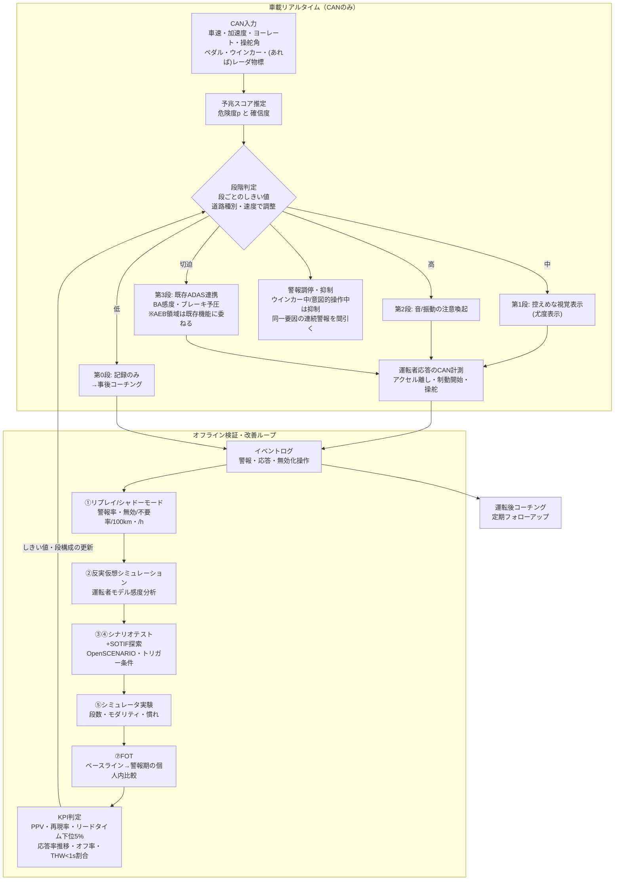

# 10. 出力層（警報・介入）の設計と、システムの評価・検証方法

- 調査日: 2026-11-01
- 論点: 予兆を検知しても、警報が遅い・多すぎる・無視されれば事故は防げない。CANデータのみで動く予兆検知システムについて、検知結果を事故防止につなげる出力層（警報・段階的介入・事後フィードバック）をどう設計し、それをどう評価・検証するかを整理する
- 既存調査との関係: README で判明済みの「偽警報率の報告がほとんどない」「Euro NCAP 2026 が誤警報を問題視」を前提とし、本書では (a) 警報タイミングの算出根拠、(b) 偽警報・不要警報が運転者に与える影響の定量値、(c) 実車FOTで報告された警報頻度、(d) 検証手法の体系、を深掘りする
- 表記: 文献に基づく事実には出典番号 [n] を付けた。筆者の推論は「【推察】」と明記した。単位換算や比率の計算は筆者が行ったもので「（筆者計算）」と記した

---

## 1. エグゼクティブサマリー

1. 警報タイミングの算出式は「運転者の反応時間＋運転者が受け入れる減速度」で組み立てるのが定石である。CAMP/NHTSA は反応時間 1.18 秒＋ブレーキ遅れ 0.20 秒を用い、運転者がいつ強いブレーキを踏むかを、速度に応じて変わる逆TTCのしきい値でモデル化した [2]。
2. 警報が早いほど効果は大きい。シミュレータ実験では、早い警報で衝突が 80.7% 減り、遅い警報では 50.0% 減にとどまった。効果の主因は、ブレーキの強さではなく、アクセルを早く離すことだった [4][5]。この反応は CAN で直接測れる。
3. 偽警報は確実に反応を弱める。注意を払っている運転者は数回の偽警報で反応しなくなった [6]。人は警報の信頼度に合わせて反応率を下げる（確率マッチング、約90%の被験者）[9]。事故はまれなので、高感度の検知器でも警報の大半は本物にならない [8]。
4. 実車FOTの報告値（乗用車 IVBSS）: FCW 警報は 0.4 回/100マイル、そのうち無効警報が 0.22 回/100マイル。それでも運転者は「さらに低くすべき」と感じ、FCW に付けたブレーキパルスが最も嫌われた [14]。トラックでは無効警報の割合が高く、警報を無視し始めた運転者がいた [14]。
5. 段階的警報（情報→注意→警告）は、単段警報より信頼されやすく、反応も速い傾向がある [26][28]。触覚（シート振動・ブレーキパルス）は反応が速い一方で、不快感が強く出ることがある [7][14][27]。
6. 検証は単一の手法では足りない。自然運転データのリプレイ（シャドーモード）、反実仮想シミュレーション [16][17][18][19]、シナリオベーステスト [20][21]、ドライビングシミュレータ [30]、FOT [14][15][23] を組み合わせる必要がある。反実仮想シミュレーションでは、どの運転者モデルを選ぶかで FCW の効果推定が大きく変わる [16]。
7. 行動適応（リスク補償）は無視できない。euroFOT では ACC+FCW 使用中に視覚的な脇見が3倍に増えた（ただしインシデント時には増えていない）[15]。IVBSS では車間1秒以下の時間割合が 21%→24% に増えた [14]。
8. 【推察】CANのみ構成では、物体認識の誤り（ゴースト物体）による無効警報は原理的に少ない。一方、「物理的には正しいが運転者には不要」な警報（Kaß の言う unnecessary alarm [12]）が主な課題になる。そのため KPI は「無効警報率」と「不要警報率」を分けて、/100 km と /時間の両方で管理すべきである。

---

## 2. 警報・介入設計の知見

### 2.1 警報タイミング

| 知見 | 数値・内容 | 出典 |
|---|---|---|
| タイミング算出の2つのパラメータ | ①警報から制動開始までの反応時間（システム遅れ・インタフェース遅れに加算）②警報後に運転者が行う減速の大きさ。この2つを車両間の運動方程式に入れ、必要な警報距離を求める | [2] |
| CAMP の遅れ時間 | DT = 1.18 s（運転者反応時間）＋ 0.20 s（ブレーキ系遅れ）＋ 表示遅れ（付録Eの擬似コード） | [2] |
| 制動開始モデル | 「必要減速度モデル」と「3段階逆TTCモデル」の2つ。後者は先行車が停止・減速中・定速の3場合に分けた式で、逆TTCのしきい値が速度とともに線形に下がる。先行車減速度は粗い推定で足りる | [2] |
| 被験者データ | テストコースで、模擬車両への接近時に「ぎりぎりのブレーキ」3,536試行と「ぎりぎりの車線変更」790試行を記録。72名、3年齢層。年齢・性別・試験場所の差は小さい | [2] |
| ニューサンスの構造的要因 | 60 mph では、意図的な車線変更の開始がブレーキ開始より遅い（より攻撃的）。「普通の」ぎりぎり車線変更のうち 15% 強が、モデルが示す警報点より車両に近い位置で起きた。つまりブレーキ前提のタイミングだと、追い越すつもりの運転者に警報が出てしまう | [2] |
| 受容性の結論 | どの程度のニューサンス警報が許容されるかは、FOT でしか分からないと結論 | [2] |
| 不意打ち試験 | 単段・音＋視覚の FCW は、試験条件の範囲で適切と判断された。効果が出たのは頭を下げる脇見課題のときだけで、前方を見たままの脇見課題では効果がなかった | [3] |
| 早い vs 遅い警報 | 早い警報: 衝突 −80.7%、重大度（運動エネルギー換算）−96.5%。遅い警報: 衝突 −50.0%、重大度 −87.5%。警報は制動の速さや最大減速度を変えず、アクセルを離すタイミングを早めた。警報音量の効果はなかった | [4][5] |
| 量産・評価での実務 | 多くのメーカーは、警報開始時刻を CAN のデジタル信号で取得し、NHTSA 試験手順の TTC 要件への適合を判定している（NHTSA 関連文書の記述） | [33] |
| 便益推定の前提例 | Kusano & Gabler は、衝突 1.7 秒前に警報する汎用システムを想定し、NASS/CDS の 1,396 件の追突事故をシミュレーションした。結果は追突の 3.2〜7.7% を回避、ΔV −14〜34% | [18] |

【推察】CANのみ構成で前方車両情報（レーダ物標）が CAN に流れていない車両では、逆TTCを直接計算できない。この場合の出力層は、FCW/AEB の代替ではなく、数秒〜数十秒前の予兆に対する「注意喚起段」に限定するのが妥当である。既存調査（04）の棲み分けとも整合する。

### 2.2 段階的警報（graded / multi-stage）

- Lee, Hoffman & Hayes（CHI 2004）は、脅威の度合いに応じて強さを変える段階的警報と単段警報を比べた。段階的警報の方が信頼され、触覚（振動シート）は「うるさくなく、より適切」と評価された [28]。
- Shariatmadari（Waterloo, 2024, 40名）では、TTC ベースの3段階警報が2段階警報より反応時間と衝突頻度を有意に減らした。被験者の多くは音による警報を好んだ [26]。
- NHTSA DOT HS 812 360（2016）は、安全メッセージ設計の章に「警報段階（Warning Stages）」と「ブレーキ反応時間に配慮したFCW」の節を設けている [32]（本文は取得できず、目次のみ確認）。
- ISO 11429 は、警報信号を緊急度に応じて体系化する一般原則を定める。ISO/TR 16352 は、車載警報の音・視覚・触覚の組み合わせを扱う [34]。
- 【推察】CAN 予兆検知の段階構成案は次のとおり。
  - 第0段（記録のみ・事後コーチング）
  - 第1段（控えめな視覚表示）
  - 第2段（音または触覚による注意喚起）
  - 第3段（車両側既存機能との連携: ブレーキ予圧・BA 感度変更など。ただし既存AEBの領域には踏み込まない）
  - 段が上がるほど高い適合率を要求する。偽警報の「コスト」が段ごとに違うためである。

### 2.3 モダリティ（音・視覚・触覚）

| 研究 | 結果 | 出典 |
|---|---|---|
| Scott & Gray 2008（16名、TTC 3.0 s / 5.0 s で発報） | 触覚警報の制動反応時間が最も短く、警報なし・視覚警報より有意に速い | [7] |
| Brown 2005（VT、交差点停止） | 600 ms・3パルスのブレーキパルス警報で停止率が警報なしの38倍、音＋視覚の7.6倍。音声「STOP」を加えるとさらに1.5倍 | [27] |
| IVBSS 乗用車 FOT | FCW に付けたブレーキパルスが、運転者に最も嫌われた属性。控えめな警報（ミラーLED・LDWのシート振動）を使う横方向サブシステムの方が好まれた | [14] |
| Mulder et al.（触覚アクセルペダル、21名） | 追従性能がやや改善し、操作量が減った | [29] |
| Mulder, Abbink & Boer 2012（触覚ステア、カーブ） | ハンドル反転率 −16%、操舵角SD −15% | [29] |
| Abbink et al. 2012（レビュー） | 触覚シェアードコントロールは短期的な性能向上の証拠が豊富。一方、長期的な信頼・過信・技能維持は研究不足 | [29] |

【推察】CAN 経由で出力できるアクチュエータは車種ごとに違う（メータ表示、ブザー、EPS のトルク重畳、ブレーキ予圧など）。後付けの場合、まず使えるのは音と後付けの振動デバイスに限られる。触覚は「速いが嫌われやすい」ので、上位段にだけ使うのが妥当である。

### 2.4 警報疲れ（cry-wolf）と信頼

| 知見 | 数値・内容 | 出典 |
|---|---|---|
| 偽FCWへの反応の減衰 | 16名の実車試験。偽警報を重ねるほど制動確率が下がった。注意を払っている運転者は数回で反応しなくなった。脇見中の運転者は、過去の偽警報の回数に関係なく反応し続けた | [6] |
| 確率マッチング | 信頼度 25/50/75% の警報に対し、約90%の被験者が反応率を信頼度に合わせた。約10%は全か無かの戦略をとった | [9] |
| 低基準率の問題 | 事故はまれなので、高感度の検知器でも警報が本物である事後確率は低い（PPV が下がる） | [8] |
| 尤度警報（LAS） | 2値警報ではなく「確からしさ」の段階で示すと、信頼・遵守・成績が向上した。2値警報では反応が全警報の約70%にとどまった。警報の妥当性情報を与えると cry-wolf が大きく減った | [10] |
| 不要警報（unnecessary alarm） | 自然運転データでは、従来型FCAの警報の約半数が不要警報だった（アルゴリズム上は正しいが、運転者はほぼ反応しない）。受容性は下がるが、システム全体の受容は崩れない。反応は繰り返しで弱まる | [12] |
| 実世界FCWの重大度 | 2台の量産車の自然発生FCW 2,000件超を映像で評価した結果、「衝突が起こりうる・差し迫っている」はわずか9件。道路種別・速度・交通密度・減速プロファイルが重大度を分けた | [13] |
| 信頼の較正 | 自動化への依存は信頼に導かれる。過信（misuse）と不信（disuse）の両方を避けるよう、信頼を能力に合わせて較正する設計が要る | [11] |
| LDW を切る運転者 | IIHS（2017）では、LDW の有無による事故低減が過去研究より小さかった。米国の運転者が LDW を頻繁に切っていることが一因とされた [25]。報道によると、販売店に入庫した車両で LDW がオンだったのは 51%、BSM は 99% [25b] | [25][25b] |

【推察】Seaman らの「2,000件超のうち9件」は、本書の対象である CAN 予兆検知の運用点を考えるうえで重要である。量産 FCW ですら、警報のほとんどは「実際には衝突しなかった状況」で出ている。予兆段（より早い段）の警報は、本質的に PPV がさらに低くなる。だから予兆段の出力は、運転者の行動を強く求めない控えめな形（2.2 の第1段）にとどめるのが妥当である。

### 2.5 介入と長期フィードバック

- 段階的ブレーキ・シェアードコントロール: 触覚ペダル・ステアの短期効果は確認されている [29]。量産での FCW→ブレーキ予圧→AEB の段階連携は、既存調査（04）の範囲である。
- 運転後フィードバック（コーチング）: Toledo & Lotan（2006, 33名）では、記録装置を付けたこと自体で行動と安全性が有意に改善し、個人ページでのフィードバックがさらに改善を加えた。ただし、フォローアップを続けないと、どちらの効果も持続しなかった。危険指標は過去の事故歴と有意に相関した [24]。
- 【推察】予兆を検知しても「その場で警報するほど確信が持てない」場合は、リアルタイム警報ではなく事後コーチングに回せる。そうすれば偽警報のコストを運転中の注意から切り離せる。ただし効果は減衰するので、定期的な再介入の設計が要る [24]。

### 2.6 行動適応（リスク補償）

- euroFOT（約1,200名、3,500万km超）[15]
  - ACC+FCW 使用時は、車間時間が有意に伸び、急ブレーキとインシデントの相対頻度が減った
  - 一方、乗用車の運転者は通常走行中に視覚的な二次タスクを行う確率が3倍になった。インシデント時にはこの差はなかった
  - LDW では、警報と実際の危険の結びつきが弱いと感じる運転者がいて、「多くの警報が不要と受け止められた」
- IVBSS 乗用車（108名）[14]
  - 二次タスクの頻度に変化はなかった
  - 車間1秒以下の時間割合は 21%→24%（有意だが実用上は小さい）
  - 報告書は、目立った負の行動適応はないと結論した
- AAA Foundation のレビュー [31]: 機能限界にまれにしか達しないADASでは、運転者のメンタルモデルが不正確になりやすい。
- 【推察】CAN 予兆検知で「いつもは鳴らない」警報を出す場合、運転者が「鳴らない＝安全」と解釈するリスク（依存 reliance の過剰）がある。Wiczorek & Manzey [10] や Cotté ら（偽警報が多く見逃しが少ないと依存が増え、偽警報が少ないと遵守が増える）[36] が示すとおり、偽警報と見逃しのバランスは、依存（reliance）と遵守（compliance）に逆向きに効く。運用点の選択は人間側の行動まで含めて評価する必要がある。

---

## 3. 評価指標の定義と推奨

### 3.1 警報の分類（定義例）

文献ごとに用語が違うため、本プロジェクトでは次の4分類を推奨する。

| 分類 | 定義 | 根拠 |
|---|---|---|
| 真警報（valid, needed） | 危険が実在し、運転者が対処を要した（または対処しなければ事故・ニアミスになった） | — |
| 不要警報（unnecessary / nuisance） | アルゴリズム上は正しく危険指標がしきい値を超えたが、運転者の意図（追い越しなど）や状況から見て不要だった | Kaß [12]、CAMP の車線変更ニューサンス [2] |
| 無効警報（invalid / false） | システムが環境を誤って評価した警報。見かけ上ランダムで、原因が分からない（例: 路側固定物） | IVBSS の定義 [14] |
| 見逃し（miss） | 真の危険（ニアミス・事故）に対し、所定のリードタイム内に警報が出なかった | — |

【推察】CANのみ構成では、レーダ物標の誤検知以外の「無効警報」は、主に信号の欠損・ノイズ・車種ごとのスケーリング誤りから生じる。不要警報は、運転者の意図を推定できないことから生じる。

### 3.2 推奨KPI

| KPI | 定義 | 備考 |
|---|---|---|
| 警報率 | 警報数 / 100 km、警報数 / 運転時間 | IVBSS は /100マイルで報告 [14]。【推察】都市部と高速では km あたりの頻度が大きく違うので、時間あたりも併記する |
| 無効警報率・不要警報率 | 各分類の警報数 / 100 km（/h） | IVBSS 乗用車 FCW: 無効 0.22/100マイル ≒ 0.14/100 km（筆者計算）[14] |
| 警報適合率（PPV） | 真警報 / 全警報 | IVBSS 乗用車 FCW は無効率から逆算して PPV ≦ 約45%（0.22/0.4 = 55% が無効。筆者計算）[14] |
| 再現率（検出率） | 警報できたニアミス・事故 / 全ニアミス・事故 | 分母のイベント定義（SHRP2 のニアミス定義など）を固定する |
| リードタイム分布 | 警報時刻から衝突（推定）時刻・回避操作開始時刻までの時間。中央値・下位5%点 | Lee et al. の早い/遅い警報の差 [4] を考えると、平均値だけでなく下側の分布が重要 |
| 運転者応答指標 | 警報→アクセル離し時間、→ブレーキ開始時間、最大減速度、ステア操作 | 警報効果の主因はアクセル離しの早期化 [4][5]。すべて CAN で取得できる |
| 応答率の推移 | 曝露回数ごとの応答率（慣れ・cry-wolf の検出） | [6][9][12] |
| 無効化率 | 運転者が機能をオフにした時間の割合 | IIHS の LDW オフ問題 [25][25b] |
| 行動適応指標 | 短車間（THW < 1 s）の時間割合、速度分布、（可能なら）二次タスク | IVBSS [14]、euroFOT [15] |

### 3.3 ROC 運用点の選び方

- Parasuraman らの議論 [8] に沿えば、運用点は検出器の ROC だけでなく、事前確率（基準率）を入れた PPV で評価すべきである。
- 【推察】数値例（筆者計算、仮定値）: 判定窓あたりの危険基準率を 0.1%、感度 99%、偽陽性率 1% とすると、PPV ≈ 0.99×0.001 / (0.99×0.001 + 0.01×0.999) ≈ 9%。ROC 上は優秀に見える検出器でも、警報の9割が偽になる。
- 【推察】推奨手順:
  1. 走行データで「警報数 / 100 km」を横軸、再現率を縦軸にした運用曲線を描く（偽陽性率ではなく、運転者が体感する頻度で描く）
  2. 段ごとに許容頻度の上限を決める。上位段の基準には IVBSS 乗用車 FCW（全警報 0.4/100マイル、無効 0.22/100マイル）を目安にできる。それでも運転者は多すぎると感じた [14] ので、上限はこれ以下にする
  3. 下位段（控えめ表示・事後コーチング）は頻度上限を緩め、再現率を優先する
  4. CAMP の逆TTCモデルのように、確率しきい値を道路種別・速度・運転者属性で調整できる構造にしておく [2]。Seaman らも、道路種別・速度で重大度が分かれることを示している [13]

---

## 4. 検証手法の整理

| 手法 | 概要 | 必要データ | 長所 | 短所 | 代表文献 | CANのみ構成での適用方法 |
|---|---|---|---|---|---|---|
| ① 自然運転データのリプレイ（オフライン／シャドーモード） | 記録済みの走行データにアルゴリズムを流し、警報がいつ出たか・出なかったかを評価する。McLaughlin らは、事故・ニアミスのデータを警報モデルに入れ、警報時刻と回避に必要な応答時間を比較した | 長時間の通常走行（偽警報の分母）と、ラベル付きの事故・ニアミス（再現率の分母） | 安価・再現可能。偽警報率を大量データで推定できる | 警報に対する運転者の反応は再現できない（開ループ）。事故サンプルが少ない | McLaughlin et al. 2008 [19]、Seaman et al. 2022 [13] | CAN ログを時系列のまま再生して判定する。偽警報率は comma2k19 などの通常走行で、再現率は SHRP2 などのイベントで評価する（既存調査03）。量産車ではシャドーモード（警報を出さずに記録）で、無効警報率・不要警報率を推定する【推察】 |
| ② 反実仮想シミュレーション | 実際の事故の直前状況を再構成し、「システムがあったら」を運転者モデル付きでシミュレーションする | 事故前の運動データ（EDR・自然運転・事故再構成）、運転者応答モデル | 事故そのものに対する効果（回避率・ΔV低減）を推定できる | 運転者モデルの選択で結果が大きく変わる（FCW では特に）[16]。警察記録のみの再構成は不確実 [17] | Bärgman et al. 2017 [16]、Kusano & Gabler 2012 [18]、Scanlon et al. 2021 [17] | 反応時間（例: CAMP の 1.18 s [2]）や減速度の分布を変えた感度分析を必ず行う。CAN で取れる量（速度・加減速・ペダル・操舵）は EDR 項目と重なるので、事故再構成データとの接続性が高い【推察】 |
| ③ シナリオベーステスト | シナリオを体系的に定義し（6層モデル: 道路・インフラ・一時変更・動的物体・環境・デジタル情報）、パラメータを振って網羅的に試験する | シナリオDB、シミュレータ（OpenSCENARIO / OpenDRIVE） | 再現性・網羅性が高く、まれなシナリオも試せる。規格化が進んでいる | 人間の運転者行動のモデル化が難しい。シナリオ外の未知事象は残る | PEGASUS / 6層モデル [20]、ASAM OpenSCENARIO XML 1.3.1 [21] | シミュレータから CAN 相当の信号（車速・加速度・ヨーレート・ペダル）を合成し、アルゴリズムに入力する。CANのみ構成は入力次元が小さいので、パラメータ掃引による誤警報の境界探索がしやすい【推察】 |
| ④ SOTIF の未知危険シナリオ探索 | ISO 21448 の4領域（既知安全・既知危険・未知危険・未知安全）のうち、未知危険（領域3）を縮小する。機能不全を引き起こすトリガー条件を探す | ③ に加え、FOT・リプレイで見つかった異常事例 | 「意図した機能の不十分さ」（偽警報・見逃し）を体系的に扱える | 規格本体が有償。定量的な合格基準は自分で設定する必要がある | ISO 21448 解説 [22] | トリガー条件の候補: 車種ごとの CAN スケーリング差、信号欠損、坂道・積載による加速度オフセット、運転スタイルの個人差など【推察】 |
| ⑤ ドライビングシミュレータ実験 | 被験者に警報を体験させ、反応・受容・慣れを計測する | 被験者（数十名規模）、シナリオ | 危険場面を安全に再現できる。警報の段数・モダリティ・タイミングを比較できる | 妥当性の確証は限定的。44研究のレビューで、絶対的または相対的妥当性を示したのは約半数、非妥当が約1/3 [30]。サンプルが小さい | Lee et al. 2002 [4]、Scott & Gray 2008 [7]、Shariatmadari 2024 [26]、Wynne et al. 2019 [30] | HMI設計（段数・音・振動）の比較に使う。応答指標は実車と同じ CAN 相当量（アクセル離し・ブレーキ開始）で定義し、FOT と直接比べられるようにする【推察】 |
| ⑥ テストコース（模擬標的） | 実車で安全に「ぎりぎり操作」や不意打ち場面を作る | 模擬車両・テストコース | 実車の運動・知覚を再現できる | 費用が高い。シナリオ数が限られる | CAMP [1][2][3] | 警報タイミングの較正（運転者の受容減速度）に使う |
| ⑦ FOT（実路運用試験） | 一般運転者が日常的に使い、ベースライン期間と警報提示期間を個人内で比較する | 計装車両・数十〜数百名・数十万〜数千万 km | 実世界の警報頻度・受容・行動適応が分かる | 費用と期間がかかる。事故はまれなので、事故低減を統計的に示しにくい（euroFOT の事故影響推定も多くの仮定に依存 [15]） | IVBSS [14]、euroFOT [15]、FESTA ハンドブック [23] | IVBSS 型の「ベースライン12日→警報28日」の個人内比較 [14] が、CAN ロガーだけで実施しやすい。FESTA の手順（研究課題→仮説→指標）に沿って計画する [23] |
| ⑧ 事後的な事故統計分析 | 装備車と非装備車の事故率を比べる | 保険・警察の事故データと VIN | 本当の事故低減効果が分かる | 市場投入後にしか使えない。オフ率の影響を受ける | IIHS / Cicchino 2017 [25] | 長期的な効果検証として実施する |

---

## 5. 主要文献

| # | タイトル | 著者・組織 | 年 | 種別 | URL | 要点 | 示唆 |
|---|---|---|---|---|---|---|---|
| 1 | Development and Validation of Functional Definitions and Evaluation Procedures for Collision Warning/Avoidance Systems (DOT HS 808 964) | Kiefer ほか / CAMP, NHTSA | 1999 | 公的報告書 | https://webarchive.library.unt.edu/eot2008/20081105063457/http://www-nrd.nhtsa.dot.gov/pdf/nrd-12/acas/HS808964_Report-1999-08.pdf | FCW 警報開始タイミング算出法の原点。テストコースの不意打ち試験で反応時間を取得 | タイミング設計の基礎になる |
| 2 | FCW Requirements Project Final Report – Task 1 (DOT HS 809 574) | Kiefer, Cassar, Flannagan, LeBlanc, Palmer ほか / CAMP, NHTSA | 2003 | 公的報告書 | https://rosap.ntl.bts.gov/view/dot/34015/dot_34015_DS1.pdf | 3,536回のぎりぎり制動と790回のぎりぎり車線変更から、3段階逆TTCモデルを構築。DT = 1.18 + 0.20 s。普通の車線変更の15%強は警報点より手前（車両に近い側）で始まる | 確率しきい値型のタイミング設計と、ニューサンスの構造的要因 |
| 3 | Surprise Braking Trials, Time-to-Collision Judgments, and "First Look" Maneuvers (DOT HS 809 902) | Kiefer ほか / CAMP | 2005 | 公的報告書 | https://rosap.ntl.bts.gov/view/dot/3658 | 単段・音＋視覚の FCW のタイミングは妥当。効果は頭を下げる脇見時のみ | 脇見の種類で効果が違う |
| 4 | Collision Warning Timing, Driver Distraction, and Driver Response to Imminent Rear-End Collisions in a High-Fidelity Driving Simulator | Lee, McGehee, Brown, Reyes / Human Factors 44(2) | 2002 | 査読論文 | https://iro.uiowa.edu/esploro/outputs/journalArticle/Collision-Warning-Timing-Driver-Distraction-and/9984187061302771 | 早い警報で衝突 −80.7%、重大度 −96.5% | 早期警報の価値 |
| 5 | Driver distraction, warning algorithm parameters, and driver response to imminent rear-end collisions (DOT HS 809 448) | 同上 / NHTSA | 2002 | 公的報告書 | https://www.nhtsa.gov/sites/nhtsa.dot.gov/files/documents/dot_hs_809_448.pdf | 遅い警報で衝突 −50.0%。効果の源はアクセル離しの早期化。音量の効果なし | 応答指標は CAN で測れる |
| 6 | The Effect of False Forward Collision Warnings on Driver Responses | Gish, Mercadante, Perel, Barickman / TRB 81st Annual Meeting | 2002 | 学会論文 | https://trid.trb.org/view/709838 | 偽警報を重ねると制動確率が低下。注意を払っている運転者は数回で反応しなくなる | cry-wolf の実車証拠 |
| 7 | A Comparison of Tactile, Visual, and Auditory Warnings for Rear-End Collision Prevention in Simulated Driving | Scott & Gray / Human Factors 50(2) | 2008 | 査読論文 | https://research.birmingham.ac.uk/en/publications/a-comparison-of-tactile-visual-and-auditory-warnings-for-rear-end/ | 触覚警報が最速の制動反応 | 上位段のモダリティ |
| 8 | Alarm effectiveness in driver-centred collision-warning systems | Parasuraman, Hancock, Olofinboba / Ergonomics 40(3) | 1997 | 査読論文 | https://trid.trb.org/View/482760 | 低基準率では、高感度検知器でも警報の事後確率が低い | PPV で運用点を評価する |
| 9 | Human probability matching behaviour in response to alarms of varying reliability | Bliss, Gilson, Deaton / Ergonomics | 1995 | 査読論文 | https://stars.library.ucf.edu/scopus1990/1980 | 約90%が警報の信頼度に合わせて反応率を調整 | 適合率がそのまま応答率に効く |
| 10 | Supporting Attention Allocation in Multitask Environments: Effects of Likelihood Alarm Systems on Trust, Behavior, and Performance | Wiczorek & Manzey / Human Factors 56 | 2014 | 査読論文 | https://depositonce.tu-berlin.de/items/e1d66216-e3f5-4626-a599-ba517ccb09b7 | 尤度警報で信頼・遵守・成績が向上 | 段階表示（確からしさの提示）の根拠 |
| 11 | Trust in Automation: Designing for Appropriate Reliance | Lee & See / Human Factors 46(1) | 2004 | 査読論文 | https://pubmed.ncbi.nlm.nih.gov/15151155/ | 信頼の較正・分解能・特異性。過信と不信 | 信頼較正の設計原則 |
| 12 | Unnecessary Alarms in Driving (博士論文) | Christina Kaß / Univ. Würzburg | 2019 | 博士論文 | https://opus.bibliothek.uni-wuerzburg.de/files/19252/Kass_Christina_Unnecessary_alarms.pdf | 自然運転データでは従来FCAの警報の約半数が不要警報。人と機械の状況認識のずれが原因 | 不要警報を無効警報と分けて管理する |
| 13 | Evaluating the Associations between Forward Collision Warning Severity and Driving Context | Seaman, Gershon, Angell, Mehler, Reimer / Safety 8(1) | 2022 | 査読論文 | https://dspace.mit.edu/handle/1721.1/139646 | 自然発生FCW 2,000件超のうち「衝突が起こりうる・差し迫っている」は9件 | 量産FCWでもPPVは低い。文脈別のしきい値 |
| 14 | Integrated Vehicle-Based Safety Systems Field Operational Test: Final Program Report | Sayer, LeBlanc, Bogard ほか / UMTRI, US DOT | 2011 | 公的報告書 | https://rosap.ntl.bts.gov/view/dot/3358 | 乗用車: 108名・213,309マイル。FCW 0.4/100マイル（無効0.22）、LDW 7.0（無効0.43）。ブレーキパルスが最も嫌われた。トラック: FCW 3.3（無効1.8）。無効警報で無視を始めた運転者がいた | 警報頻度の実測ベンチマーク |
| 15 | euroFOT Deliverable D11.3 Final Report (Executive Summary) | euroFOT consortium (Kessler ほか) | 2012 | 公的報告書（EU FP7） | https://www.ttsitalia.it/wp-content/uploads/2012/06/eurofot_d11_3_execsummaryresults_draft-2.pdf | 約1,200名・3,500万km超。ACC+FCWで車間時間が増加。視覚的二次タスクは3倍。LDWの警報の多くが不要と受け止められた | 行動適応とFOTの限界 |
| 16 | Counterfactual simulations applied to SHRP2 crashes: The effect of driver behavior models on safety benefit estimations of intelligent safety systems | Bärgman, Boda, Dozza / AAP 102 | 2017 | 査読論文 | https://research.chalmers.se/en/publication/248601 | 34件の追突事故で反実仮想シミュレーション。FCWの効果推定は運転者モデルで大きく変わる | 運転者モデルの感度分析が必須 |
| 17 | Waymo simulated driving behavior in reconstructed fatal crashes within an autonomous vehicle operating domain | Scanlon, Kusano ほか / AAP | 2021 | 査読論文 | https://waymo.com/research/waymo-simulated-driving-behavior-in-reconstructed/ | 72件の死亡事故を再構成。応答側で82%回避、10%軽減 | 事故再構成型の検証フロー |
| 18 | Safety Benefits of FCW, Brake Assist, and Autonomous Braking Systems in Rear-End Collisions | Kusano & Gabler / IEEE T-ITS 13(4) | 2012 | 査読論文 | https://ieeexplore.ieee.org/document/6180219 | NASS/CDS の1,396件。追突回避3.2〜7.7%、ΔV −14〜34% | 確率的運転者応答による便益推定 |
| 19 | A Method for Evaluating Collision Avoidance Systems Using Naturalistic Driving Data | McLaughlin, Hankey, Dingus / AAP 40 | 2008 | 査読論文 | https://swov.nl/en/publicatie/method-evaluating-collision-avoidance-systems-using-naturalistic-driving-data | 事故・ニアミスデータを警報モデルに入れ、警報時刻と必要応答を比較 | リプレイ評価の型 |
| 20 | 6-Layer Model for a Structured Description and Categorization of Urban Traffic and Environment | Scholtes ほか / IEEE Access | 2021 | 査読論文 | https://doaj.org/article/e80a615f2ff44355bff3228d1833abd4 | PEGASUS の6層シナリオモデルを都市部に拡張 | シナリオ設計の枠組み |
| 21 | ASAM OpenSCENARIO XML | ASAM | 2024 (v1.3.1) | 業界標準 | https://asam.net/standards/detail/openscenario-xml/ | 動的シナリオの記述形式。記録走行の軌跡も使える | 記録CANデータからシナリオを生成できる |
| 22 | Identifying Effective STPA Control Structures to Characterize SOTIF Areas 1, 2, 3, and 4 in Automated Vehicles | Yang ほか / China FAW・OMNEX（27th ESV） | 2023 | 学会論文 | https://index.mirasmart.com/27esv/PDFfiles/27ESV-000019.pdf | ISO 21448 の4領域（既知は領域1・2、危険は領域2・3）。目標は領域2・3を許容水準以下に縮小すること。トリガー条件などを STPA の制御構造で扱う | 未知の偽警報・見逃しの探索 |
| 36 | Older and younger drivers' reliance on collision warning systems | Cotté, Meyer, Coughlin / HFES 45th Annual Meeting | 2001 | 査読付き会議論文 | https://cris.bgu.ac.il/en/publications/older-and-younger-drivers-reliance-on-collision-warning-systems-2/ | 偽警報が多く見逃しが少ないと依存（警報なし時の速度）が増え、偽警報が少ないと遵守（警報後の減速）が増える | 運用点の選択は依存と遵守に逆向きに効く |
| 23 | FESTA Handbook Version 8 | FOT-Net / CARTRE ほか | 2021 | 方法論ハンドブック | https://www.connectedautomateddriving.eu/wp-content/uploads/2024/07/FESTA-Handbook-Version-8-FINAL-Version-20-09.pdf | FOT の手順（機能→ユースケース→研究課題→仮説→指標） | FOT 計画のテンプレート |
| 24 | In-Vehicle Data Recorder for Evaluation of Driving Behavior and Safety | Toledo & Lotan / TRR 1953 | 2006 | 査読論文 | https://trid.trb.org/view/776988 | 記録装置の設置とフィードバックで改善。ただしフォローがないと持続しない | 事後コーチング層の設計 |
| 25 | Lane departure warning, blind spot detection help drivers avoid trouble | IIHS / Cicchino | 2017 | 公的機関発表 | https://www.iihs.org/news/detail/lane-departure-warning-blind-spot-detection-help-drivers-avoid-trouble | LDW で該当事故 −11%、負傷事故 −21%。頻繁なオフが効果を下げる | 無効化率をKPIにする |
| 25b | Study: DC-area drivers turned off by lane departure alerts | WTOP（IIHS Reagan らの研究の報道） | 2017 | 報道 | https://wtop.com/consumer-news/2017/03/study-dc-drivers-turning-off-car-safety-feature | 入庫車でLDWがオンだったのは51%、BSMは99% | 同上 |
| 26 | Comparing 2-level and 3-level graded collision warning systems under distracted driving conditions | Shariatmadari / Univ. Waterloo | 2024 | 修士論文 | https://uwspace.uwaterloo.ca/handle/10012/20566 | 3段階警報で反応時間と衝突が有意に減少（40名） | 段階数の設計 |
| 27 | Effects of Haptic and Auditory Warnings on Driver Intersection Behavior and Perception | S. B. Brown / Virginia Tech | 2005 | 修士論文 | https://vtechworks.lib.vt.edu/items/61cdba49-b8a3-4f22-9c96-a49d7595063b | ブレーキパルスで停止率が38倍（警報なし比） | 触覚の強い効果 |
| 28 | Collision Warning Design to Mitigate Driver Distraction | Lee, Hoffman, Hayes / CHI 2004 | 2004 | 査読付き国際会議 | https://hci.rwth-aachen.de/materials/conferences/CHI2004/1p65.pdf | 段階的警報の方が信頼され、振動シートは不快感が少ない | 段階化と触覚 |
| 29 | Haptic shared control: smoothly shifting control authority? / Sharing Control With Haptics / Haptic gas pedal feedback | Abbink, Mulder, Boer ほか / CTW 14, Human Factors 54(5), Ergonomics | 2008–2012 | 査読論文 | https://research.tudelft.nl/en/publications/sharing-control-with-haptics-seamless-driver-support-from-manual-/ | 触覚ステアで操作量が減る（反転率 −16%）。長期効果は研究不足 | 介入層の選択肢 |
| 30 | A systematic review of driving simulator validation studies | Wynne, Beanland, Salmon / Safety Science | 2019 | 査読論文 | https://swov.nl/en/publicatie/systematic-review-driving-simulator-validation-studies | 44研究のうち妥当性を示したのは約半数 | シミュレータ結果の外挿に注意 |
| 31 | Literature Review of Behavioral Adaptations to Advanced Driver Assistance Systems | Sullivan, Flannagan, Pradhan, Bao / AAA Foundation | 2016 | 公的報告書（財団） | https://aaafoundation.org/literature-review-of-behavioral-adaptations-to-advanced-driver-assistance-systems/ | まれな機能限界はメンタルモデルを不正確にする | 行動適応のリスク |
| 32 | Human Factors Design Guidance for Driver-Vehicle Interfaces (DOT HS 812 360) | NHTSA / Battelle | 2016 | 公的ガイダンス | https://www.nhtsa.gov/sites/nhtsa.gov/files/documents/812360_humanfactorsdesignguidance.pdf | 警報段階、ブレーキ反応時間に配慮したFCW の節あり | HMI設計チェックリスト |
| 33 | NHTSA FCW 関連資料（警報開始時刻をCAN信号で判定する実務の記述） | NHTSA | — | 公的機関資料 | https://www.nhtsa.gov/node/10171 | メーカーはCANのデジタル信号で警報開始を判定し、TTC要件への適合を評価 | 出力層の検証もCANで閉じられる |
| 34 | ISO 15623:2013 / ISO 11429:1996 / ISO/TR 16352:2005 | ISO | 1996–2013 | 国際規格（有償） | https://iteh.es/catalog/standards/iso/93fb1fb3-da93-4d38-82c4-a9a36d3f238a/iso-15623-2013 , https://scc-ccn.ca/standardsdb/standards/8109205 | ISO 15623 は FCW の性能要件と試験法（曲率半径125 m超の道路）。ISO 11429 は緊急度別の信号体系。ISO/TR 16352 は車載警報のモダリティの組み合わせ | 数値要件は未確認 |
| 35 | Euro NCAP: New 2026 protocols target distraction, impairment, and speeding | ETSC | 2025 | 業界団体記事 | https://etsc.eu/euro-ncap-new-2026-protocols/ | 不快な警報や過剰な介入を批判されるADASを、実路走行でも評価する方向 | 実路での受容性評価が必要になる |

---

## 6. 出力層＋検証フローの構成案

### 図の説明（文献根拠と【推察】の区別）

| 要素 | 文献根拠 | 【推察】部分 |
|---|---|---|
| 確率しきい値による段階判定 | CAMP の逆TTCモデルは「強い制動が必要な確率」で表され、しきい値を運転者属性・天候・ニューサンスに応じて変えられる [2]。重大度は道路種別・速度で分かれる [13] | 予兆スコアにも同じ確率しきい値構造を適用し、段ごとに変えること |
| 尤度表示・段階的警報 | 尤度警報で信頼と遵守が向上 [10]。段階的警報の方が信頼される [28]。3段階で反応が速い [26] | CAN予兆の第1段を尤度表示にすること |
| 上位段に触覚 | 触覚は反応が最速 [7][27]。ただしブレーキパルスは嫌われた [14] | 触覚を切迫段だけに使うこと |
| 意図的操作の抑制 | 車線変更の意図がブレーキ前提タイミングのニューサンスを生む [2]。ウインカーなしの車線変更はLDW警報の主因で、turn-signal 使用が増えた [14] | ウインカーなどの CAN 信号で意図を推定して抑制すること |
| 応答のCAN計測 | 警報効果はアクセル離しの早期化 [4][5]。メーカーはCANで警報開始を判定 [33] | 運用中の応答率の推移を cry-wolf 監視に使うこと |
| 検証の多層化 | リプレイ [19]、反実仮想 [16][17][18]、シナリオ [20][21]、SOTIF [22]、シミュレータ [30]、FOT [14][15][23] | 実施順序（安価な順）と KPI の割り当て |
| 事後コーチング | IVDR フィードバックの効果と減衰 [24] | 第0段を独立した出力チャネルとすること |

---

## 7. 課題・ギャップ / 次のアクション提案

### 課題・ギャップ
1. 予兆段（数秒〜数十秒前）の警報に関する人間工学研究がほとんどない。既存研究は TTC 数秒の切迫警報が中心で、予兆段で許容される頻度は文献上不明である【推察: 本調査の範囲では見つからなかった】。
2. 「不要警報」の自動判定法が確立していない。Seaman らは映像評価を使った [13]。CANのみでは映像なしでラベルを付ける方法が要る。
3. 反実仮想シミュレーションは運転者モデルへの依存が大きい [16]。予兆段の警報に対する運転者の応答モデル（例: 予防的な減速の開始）は、文献上ほぼない。
4. 行動適応は長期データが不足している。IVBSS は警報期間が28日で、報告書自身が「長期曝露で現れる可能性」を指摘している [14]。
5. Euro NCAP 2026 の実路評価の具体的な合否基準（誤警報の閾値）は、一次資料で確認できていない。

### 次のアクション提案
1. KPI 定義書の作成: §3.1 の4分類と §3.2 の KPI を確定し、「/100 km」「/h」「PPV」「リードタイム下位5%点」の算出スクリプトを、既存の features.py の出力に対して実装する。
2. シャドーモードの偽警報ベンチマーク: comma2k19 などの通常走行 CAN で予兆スコアを走らせ、段ごとの警報率曲線（警報/100 km 対 再現率）を描く。目安は IVBSS 乗用車 FCW の 0.4/100マイル（無効 0.22）[14]。
3. CANベースの応答指標による不要警報の代理ラベル: 警報後 N 秒以内にアクセル離し・制動・操舵の変化がない警報を「応答なし警報」とし、不要警報の代理指標とする（Kaß の定義「運転者がほぼ反応しない」[12] に対応）。映像付きの小規模データで妥当性を確認する。
4. 反実仮想評価の感度分析: SHRP2/100-Car のイベントに対し、反応時間（例: 1.18 s ± 分布）[2] と応答タイプ（アクセル離しのみ／制動）を変えて、予兆段警報の回避率の幅を示す [16]。
5. 小規模シミュレータ実験と個人内FOT: 段数（2段/3段）とモダリティ（視覚/音/振動）をシミュレータで比較した後、IVBSS 型（ベースライン→警報期）の CAN ロガー FOT を実施する。応答率の推移とオフ率を追う。

---

## 8. 参考文献リスト

1. Kiefer, R. et al. (CAMP) (1999). Development and Validation of Functional Definitions and Evaluation Procedures for Collision Warning/Avoidance Systems. DOT HS 808 964. https://webarchive.library.unt.edu/eot2008/20081105063457/http://www-nrd.nhtsa.dot.gov/pdf/nrd-12/acas/HS808964_Report-1999-08.pdf
2. Kiefer, R. J., Cassar, M. T., Flannagan, C. A., LeBlanc, D. J., Palmer, M. D. et al. (CAMP) (2003). Forward Collision Warning Requirements Project Final Report – Task 1. DOT HS 809 574. https://rosap.ntl.bts.gov/view/dot/34015/dot_34015_DS1.pdf
3. Kiefer, R. J., Cassar, M. T., Flannagan, C. A., Jerome, C. J., Palmer, M. D. (2005). Surprise Braking Trials, Time-to-Collision Judgments, and "First Look" Maneuvers Under Realistic Rear-End Crash Scenarios. DOT HS 809 902. https://rosap.ntl.bts.gov/view/dot/3658
4. Lee, J. D., McGehee, D. V., Brown, T. L., Reyes, M. L. (2002). Collision Warning Timing, Driver Distraction, and Driver Response to Imminent Rear-End Collisions in a High-Fidelity Driving Simulator. Human Factors 44(2), 314–334. https://iro.uiowa.edu/esploro/outputs/journalArticle/Collision-Warning-Timing-Driver-Distraction-and/9984187061302771
5. Lee, J. D. et al. (2002). Driver distraction, warning algorithm parameters, and driver response to imminent rear-end collisions in a high-fidelity driving simulator. DOT HS 809 448. https://www.nhtsa.gov/sites/nhtsa.dot.gov/files/documents/dot_hs_809_448.pdf
6. Gish, K. W., Mercadante, M., Perel, M., Barickman, F. (2002). The Effect of False Forward Collision Warnings on Driver Responses. TRB 81st Annual Meeting. https://trid.trb.org/view/709838
7. Scott, J. J., Gray, R. (2008). A Comparison of Tactile, Visual, and Auditory Warnings for Rear-End Collision Prevention in Simulated Driving. Human Factors 50(2), 264–275. https://research.birmingham.ac.uk/en/publications/a-comparison-of-tactile-visual-and-auditory-warnings-for-rear-end/
8. Parasuraman, R., Hancock, P. A., Olofinboba, O. (1997). Alarm effectiveness in driver-centred collision-warning systems. Ergonomics 40(3), 390–399. https://trid.trb.org/View/482760
9. Bliss, J. P., Gilson, R. D., Deaton, J. E. (1995). Human probability matching behaviour in response to alarms of varying reliability. Ergonomics. https://stars.library.ucf.edu/scopus1990/1980
10. Wiczorek, R., Manzey, D. (2014). Supporting Attention Allocation in Multitask Environments: Effects of Likelihood Alarm Systems on Trust, Behavior, and Performance. Human Factors 56, 1209–1221. https://depositonce.tu-berlin.de/items/e1d66216-e3f5-4626-a599-ba517ccb09b7
11. Lee, J. D., See, K. A. (2004). Trust in Automation: Designing for Appropriate Reliance. Human Factors 46(1), 50–80. https://pubmed.ncbi.nlm.nih.gov/15151155/
12. Kaß, C. (2019). Unnecessary Alarms in Driving: The Impact of Discrepancies between Human and Machine Situation Awareness on Drivers' Perception and Behaviour. Dissertation, Univ. Würzburg. https://opus.bibliothek.uni-wuerzburg.de/files/19252/Kass_Christina_Unnecessary_alarms.pdf
13. Seaman, S., Gershon, P., Angell, L., Mehler, B., Reimer, B. (2022). Evaluating the Associations between Forward Collision Warning Severity and Driving Context. Safety 8(1), 5. https://dspace.mit.edu/handle/1721.1/139646
14. Sayer, J., LeBlanc, D., Bogard, S. et al. (UMTRI) (2011). Integrated Vehicle-Based Safety Systems Field Operational Test: Final Program Report. FHWA-JPO-11-150 / UMTRI-2010-36. https://rosap.ntl.bts.gov/view/dot/3358 （トラック FOT の概要は FleetOwner の記事でも確認: https://www.fleetowner.com/management/roadmap-safety-1101 ）
15. euroFOT Consortium (2012). Deliverable D11.3 Final Report – Executive Summary (draft). https://www.ttsitalia.it/wp-content/uploads/2012/06/eurofot_d11_3_execsummaryresults_draft-2.pdf
16. Bärgman, J., Boda, C.-N., Dozza, M. (2017). Counterfactual simulations applied to SHRP2 crashes. Accident Analysis & Prevention 102, 165–180. https://research.chalmers.se/en/publication/248601
17. Scanlon, J. M., Kusano, K. D., Daniel, T., Alderson, C., Ogle, A., Victor, T. (2021). Waymo simulated driving behavior in reconstructed fatal crashes within an autonomous vehicle operating domain. Accident Analysis & Prevention. https://waymo.com/research/waymo-simulated-driving-behavior-in-reconstructed/
18. Kusano, K. D., Gabler, H. C. (2012). Safety Benefits of Forward Collision Warning, Brake Assist, and Autonomous Braking Systems in Rear-End Collisions. IEEE T-ITS 13(4), 1546–1555. https://ieeexplore.ieee.org/document/6180219
19. McLaughlin, S. B., Hankey, J. M., Dingus, T. A. (2008). A Method for Evaluating Collision Avoidance Systems Using Naturalistic Driving Data. Accident Analysis & Prevention 40, 8–16. https://swov.nl/en/publicatie/method-evaluating-collision-avoidance-systems-using-naturalistic-driving-data
20. Scholtes, M. et al. (2021). 6-Layer Model for a Structured Description and Categorization of Urban Traffic and Environment. IEEE Access. https://doaj.org/article/e80a615f2ff44355bff3228d1833abd4
21. ASAM (2024). ASAM OpenSCENARIO XML (v1.3.1). https://asam.net/standards/detail/openscenario-xml/
22. Yang, X., Di, Z., Pimentel, J., Johansson, R., Gruska, G., Xu, R., Xu, F. (2023). Identifying Effective STPA Control Structures to Characterize SOTIF Areas 1, 2, 3, and 4 in Automated Vehicles. 27th ESV Conference, Paper 23-0019. https://index.mirasmart.com/27esv/PDFfiles/27ESV-000019.pdf
23. FOT-Net / CARTRE (2021). FESTA Handbook Version 8. https://www.connectedautomateddriving.eu/wp-content/uploads/2024/07/FESTA-Handbook-Version-8-FINAL-Version-20-09.pdf
24. Toledo, T., Lotan, T. (2006). In-Vehicle Data Recorder for Evaluation of Driving Behavior and Safety. Transportation Research Record 1953, 112–119. https://trid.trb.org/view/776988
25. IIHS (Cicchino, J.) (2017). Lane departure warning, blind spot detection help drivers avoid trouble. https://www.iihs.org/news/detail/lane-departure-warning-blind-spot-detection-help-drivers-avoid-trouble
25b. WTOP (2017). Study: DC-area drivers turned off by lane departure alerts. https://wtop.com/consumer-news/2017/03/study-dc-drivers-turning-off-car-safety-feature
26. Shariatmadari, K. (2024). Comparing 2-level and 3-level graded collision warning systems under distracted driving conditions. MASc thesis, Univ. Waterloo. https://uwspace.uwaterloo.ca/handle/10012/20566
27. Brown, S. B. (2005). Effects of Haptic and Auditory Warnings on Driver Intersection Behavior and Perception. MS thesis, Virginia Tech. https://vtechworks.lib.vt.edu/items/61cdba49-b8a3-4f22-9c96-a49d7595063b
28. Lee, J. D., Hoffman, J. D., Hayes, E. (2004). Collision Warning Design to Mitigate Driver Distraction. CHI 2004. https://hci.rwth-aachen.de/materials/conferences/CHI2004/1p65.pdf
29. Mulder, M., Abbink, D. A., Boer, E. R. (2012). Sharing Control With Haptics. Human Factors 54(5). https://research.tudelft.nl/en/publications/sharing-control-with-haptics-seamless-driver-support-from-manual-/ ／ Abbink, D. A., Mulder, M., Boer, E. R. (2012). Haptic shared control: smoothly shifting control authority? Cognition, Technology & Work 14, 19–28. https://drivingresearch.pages.dev/catalog/abbink-2011-haptic-shared-control-smoothly-shifting-control-au/ ／ Mulder, M. et al. Car-Following Support with Haptic Gas Pedal Feedback. https://repository.tudelft.nl/record/uuid:cf80e947-b8b2-4bfd-8b93-06189e7bf17c
30. Wynne, R. A., Beanland, V., Salmon, P. M. (2019). Systematic review of driving simulator validation studies. Safety Science. https://swov.nl/en/publicatie/systematic-review-driving-simulator-validation-studies
31. Sullivan, J. M., Flannagan, M. J., Pradhan, A. K., Bao, S. (2016). Literature Review of Behavioral Adaptations to Advanced Driver Assistance Systems. AAA Foundation for Traffic Safety. https://aaafoundation.org/literature-review-of-behavioral-adaptations-to-advanced-driver-assistance-systems/
32. NHTSA (2016). Human Factors Design Guidance for Driver-Vehicle Interfaces. DOT HS 812 360. https://www.nhtsa.gov/sites/nhtsa.gov/files/documents/812360_humanfactorsdesignguidance.pdf
33. NHTSA. FCW 関連資料（警報開始時刻の CAN 信号による判定に言及）. https://www.nhtsa.gov/node/10171
34. ISO 15623:2013 Forward vehicle collision warning systems. https://iteh.es/catalog/standards/iso/93fb1fb3-da93-4d38-82c4-a9a36d3f238a/iso-15623-2013 ／ ISO 11429:1996 Ergonomics – System of auditory and visual danger and information signals. https://scc-ccn.ca/standardsdb/standards/8109205 ／ ISO/TR 16352:2005 Warning systems（DIN 目次）. https://www.din.de/de/mitwirken/normenausschuesse/naautomobil/veroeffentlichungen/wdc-beuth:din21:86859988/toc-9700520/download
35. ETSC (2025). Euro NCAP: New 2026 protocols target distraction, impairment, and speeding. https://etsc.eu/euro-ncap-new-2026-protocols/
36. Cotté, N., Meyer, J., Coughlin, J. F. (2001). Older and younger drivers' reliance on collision warning systems. Proceedings of the HFES 45th Annual Meeting, 277–280. https://cris.bgu.ac.il/en/publications/older-and-younger-drivers-reliance-on-collision-warning-systems-2/

---

### 付記: 確認しきれなかった点
- NHTSA NCAP の FCW 合格基準（TTC 2.0/2.1/2.4 s とされる値）は一次資料で確認できなかった。IIHS が「2.1 秒以上前の警報」を評価基準とする旨は二次情報で見たのみで、本書の本文には採用していない。
- NHTSA DOT HS 812 360 は PDF の取得が拒否されたため、目次レベルの確認にとどまる。
- ISO 15623 / 11429 / 16352 は有償規格のため、数値要件（警報距離の式、反応時間の仮定など）は未確認である。
- Lee, Hoffman & Hayes [28]、Scott & Gray [7]、Parasuraman [8]、Bliss [9]、Wiczorek [10]、Wynne [30]、McLaughlin [19]、Kusano [18] は、検索結果の抄録・二次情報に基づく。本文の数値（サンプル詳細など）は未確認である。
- IVBSS トラックの LCM 無効警報率は、同じ報告書の中で 3.0/100マイル と 1.6/100マイル の2つの記述がある [14]。
- IIHS の「LDW オンが51%」は報道（WTOP 等）経由で、IIHS の原典ページは未取得である。
- Euro NCAP 2026 の誤警報に関する具体的な評価基準は、ETSC・業界記事レベルの情報にとどまる。
