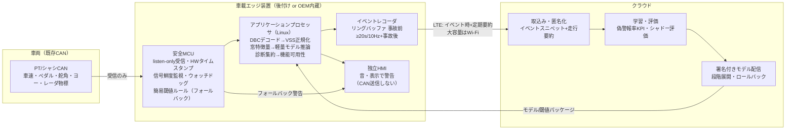

# テーマ11: CANデータ型安全システムの実装・デプロイ構成

- 調査日: 2026-11-01
- 論点: 論文や技術発表、OSSで示されている、CANデータを使う安全システムの物理的な配置（車載エッジ、クラウド、後付けデバイス）とソフトウェア上の配置を整理し、リアルタイムに予兆を検知する実装方式を比較する
- 前提: 有人運転車両を対象とし、CANデータのみを使う（カメラ・LiDAR・DMS映像は使わない）。既存調査（README、01〜06）と重ならないよう、「どこで・何で・どう動かすか」に絞った

---

## 2. エグゼクティブサマリー

1. CANデータのみで動く予兆検知の配置を「OEMのECU／中央計算機」「TCU」「CANタップ型の後付けデバイス」「OBD-IIドングル」「スマホ＋BT-OBD」「クラウド」の6つに分けると、リアルタイム警告に向くのは車載エッジ（OEMのECU、またはCANタップ型の後付け機）である。クラウドのみで処理すると推論遅延が秒単位になる見積りがあり（cloud-only 3.5秒に対し edge 1秒未満）、警告には使えない。
2. 組込みMLの計算負荷は小さい。TFLMのインタプリタは2KB以下、メモリは合計9〜82KB、オーバーヘッドは0.1%未満〜4%と実測されている。CAN向けの異常検知モデルも31KB程度の実装例がある。MCU級のハードでも、数十ms以内に推論できる見込みは十分にある。
3. ボトルネックは計算ではなく入力にある。OBD-IIのPIDポーリングは、遅延が車種やインタフェースに左右される（Machado et al. 2025）。FCAのSecure Gatewayのように、OBDポートからのアクセスはOEMによって制限されつつある。後付けで使える信号は、配置によって大きく変わる。
4. 参照アーキテクチャとして最も参考になるのは openpilot である。複雑な処理はLinux上の多数のプロセスに任せ、CAN送信の可否は小さなMCUファームウェア（panda）に集約している。pandaは起動時にCANを沈黙させ、MISRAのチェックとカバレッジ100%のテストを課している。これは「QMの複雑な処理＋監視・制限をする小さな安全核」というパターンの実例である。
5. Autoware は、診断を運用モード別のフォールトツリー（DAG）に集約し、可用性の入力が0.5秒途絶えると緊急停止に移る。警告システムでも、信号の途絶を検知して機能を縮退させる設計を流用できる。
6. データパイプラインには、業界で定まった型がある。1分単位のセグメントに分けて、間引いたログを優先してアップロードする（openpilot）。条件ベースの収集キャンペーンとデコーダマニフェストを使う（AWS IoT FleetWise）。RDP法で曲線を圧縮する（Geotab）。イベントの前後をリングバッファで保存する。米国EDR規則が、事故前のデータを5秒・2Hzから20秒・10Hzに拡張したことは、イベントスニペットの長さを決める目安になる。
7. 連合学習は、CAN信号を使う方向指示器の予測や運転スコアで「集中学習と同等」と報告されている。ただし通信量や車載での計算量の実測はほとんどなく、量産に向けた評価はまだ足りない。
8. 後付けデバイスの最大のリスクは、CANへの書き込み経路である。保険用ドングルの遠隔乗っ取り（WOOT'15）や、Bosch Drivelogのフィルタ不備によるエンジン停止（2017）が報告されている。警告専用であれば、受信専用（listen-only）のハードウェアにするのが最も合理的である【推察】。

---

## 3. 配置方式の比較

### 3.1 比較表

| 方式 | 構成 | 警告までのレイテンシ | 取得可能信号 | コスト | 安全・セキュリティ上の論点 | 代表事例・文献 |
|---|---|---|---|---|---|---|
| A. OEMのECUに内蔵（Classic AUTOSAR） | 既存のECU（ブレーキ・ステアリング・ゲートウェイ等）にアルゴリズムを載せる | 最小。CAN受信から判定まで ms 単位【推察】 | 全バスの信号にアクセスできる（舵角、ペダル、ヨーレート、レーダ物標など） | 車両単価は小さいが、開発・認証のコストが大きい | ISO 26262のHARAとASILの割り当てが要る。R155/R156の対象になる | 量産の眠気検知（02参照）。AURIX TC4xのPPUは「ASIL-DまでのAIベース機能安全」をうたう（Infineon） |
| B. OEMの中央計算機・ゾーン構成（SDV、Adaptive AUTOSAR、Linux） | ゾーンECUがCANを集約し、Ethernet経由で中央HPCのアプリが購読する | 数ms〜数十ms【推察】 | ゾーンゲートウェイが公開する信号（VSSなどで抽象化される） | OTAで機能を追加できる | SOAの通信路（SOME/IP）自体が攻撃対象になる。SOME/IP向けの異常検知研究がある（SISSA） | SAE 2024-01-2035、Sghaier et al. 2025 |
| C. TCU（テレマティクスユニット） | OEMまたはTier1のTCUがCANを読み、LTEで送る | 車内で判定するなら A と同等。クラウドで判定するなら秒単位 | ゲートウェイ経由で許可された信号 | 既存のハードウェアを流用できる | 外部通信の入口なので、R155の脅威分析の中心になる | AWS IoT FleetWise Edge Agent（ゲートウェイ機での動作を想定） |
| D. 後付けのCANタップ型デバイス（listen-only） | ハーネスやコネクタに割り込み、MCU＋APで受信・推論し、独自のHMIで警告する | ms〜数十ms（openpilotは can を100Hzで扱うとの二次情報あり） | 割り込んだバスに流れるブロードキャスト信号すべて。DBCの解析が要る（opendbc） | 中程度。車種ごとにハーネスとDBCを用意する必要がある | 書き込み経路を持たなければ、車両制御への影響は最小になる【推察】。保証・改造規制の確認が要る | openpilot（comma four＋car harness）、panda |
| E. OBD-IIドングル（PIDのポーリング） | J1962のポートに挿す。標準PIDまたはOEMのPIDを要求・応答で取得する | ポーリングの周期と応答遅延が支配的で、車種とインタフェースに依存する（Machado et al. 2025） | 標準PID（車速、回転数、スロットルなど）が中心。舵角やブレーキ圧は取れないことが多い【推察】 | 低い | 送信機能を持つので攻撃面になる（Foster et al. 2015、Drivelog 2017）。SGWが書き込みを制限する（FCA） | 保険テレマティクス（06参照）、Geotab GO |
| F. スマホ＋Bluetooth OBD-II | ELM327系のアダプタとスマホアプリで取得・推論する | BTとポーリングの遅延が加わる。実時間性は端末と車種に依存する | E と同等（スマホのIMU・GNSSで補える。ただしCAN以外のデータになる） | 最も低い | Just-Works方式のペアリングが脆弱（Drivelog）。端末が一定しない | DrivingStyles（Meseguer et al. 2016）、PeerJ 2026（BT-OBDのみの実装） |
| G. エッジ–クラウド協調／クラウドのみ | 車載で前処理と軽量推論を行い、クラウドで再学習とフリート分析を行う | クラウドのみでは推定3.5秒、エッジなら1秒未満（Khemani et al. 2026）。LTEとMECでV2Vは30ms未満（Car2MEC） | 車載側の取得範囲に依存する | 通信費とクラウド費がかかる | 通信の途絶に耐える設計が要る。モデル更新はR156の範囲になりうる | FleetWise、openpilotのuploader、Lampe & Eckstein 2026 |

### 3.2 方式ごとの補足

**A／B（OEM内蔵）**
- Infineon AURIX TC4x は28nmのMCUである。SynopsysのARC EVプロセッサによるPPU（ベクトル演算のコプロセッサ）を持ち、RNN、CNN、MLPなどの推論を加速できる。Infineonはこれを「ASIL-DまでのAIベース機能安全」と位置づけている（Infineon プレスリリース、Synopsys／emmtrixの解説）。PPUのベクトル幅は資料によって128〜512bitと記述がばらつく。
- NXP eIQ Auto DL Toolkit は、A-SPICE認定の推論エンジンをうたう。TensorFlow、PyTorch、ONNXのモデルを取り込み、枝刈り・量子化・圧縮を行う。ただし公式ページの対象は S32V23x（ビジョン用プロセッサ）で、ISO 26262やASILの記載はない（NXP公式）。
- 【推察】CANのみの予兆検知は時系列のMLPやGRU程度で足りる。そのため、AURIX TC3xやTC4x、S32Kのような量産MCUに載せられる規模に収まる可能性が高い。

**D（CANタップ型の後付け）**
- openpilot では、pandaがUSBまたはSPIでCANフレームを中継し、pandadがそれを cereal バスに `can` として流す。CANデータベースは opendbc（DBC＋CarState解析）が提供する（opendbc、二次情報としてDeepWiki）。
- 警告専用のシステムでは、pandaの「SAFETY_SILENT（起動時にCANを沈黙させる）」に相当する状態を常時の既定にできる。その場合、送信回路を物理的に持たない設計（トランシーバのサイレントモード）が取れる【推察】。

**E／F（OBD系）**
- 2018年以降のFCA（現Stellantis）車には Secure Gateway Module が載っている。排出ガス関連以外のモジュールへのOBDポートからのアクセスを制限し、非OEMのツールに許されるのは故障コードの読み出しとデータストリームの閲覧に限られる。解除にはAutoAuthへの登録が必要である（Repairer Driven News 2020、業界誌）。
- 【推察】他のOEMにも同様のゲートウェイが広がっている（同記事は「他のOEMもファイアウォールを導入予定」と報じる）。今後、OBD経由で舵角やブレーキ圧などのシャシ系信号を継続的に取るのは難しくなる。

**G（エッジ–クラウド）**
- Car2MEC（ドイツ・A9アウトバーン、2019年）では、LTE＋MECによってV2Vメッセージを30ms未満で届けた。エッジクラウドで遅延は20ms以上短縮したが、4Gの無線区間がボトルネックとして残った。
- 【推察】ドライバーへの警告はネットワークに依存させず車載で完結させ、クラウドはモデル更新とフリート分析に限るのが妥当である。

---

## 4. データパイプラインとMLOps

### 4.1 車載パイプラインの段階と根拠

| 段階 | 実装の型 | 根拠 |
|---|---|---|
| 受信・時刻付け | MCUで受信した時点のタイムスタンプを付ける。CAN／CAN FDを複数バスで扱う | panda（STM32H725、CAN/CAN FD、全バスでのHILテスト） |
| デコード | DBCで物理値に変換し、標準信号名（VSS）にマッピングする | opendbc（DBC＋CANパーサ）。KUKSA can-provider（DBC→VSSのJSONマッピング、SocketCANとcandumpの再生に対応）。FleetWise（シグナルカタログ＋デコーダマニフェスト。独自デコーダをエッジに置ける） |
| プロセス間配信 | pub/sub方式。1トピックにつき発行者は1つ。購読者は最新値を受け取る | openpilot cereal（SubMaster/PubMaster。二次情報として DeepWiki、pyshine） |
| 特徴量・推論 | 固定長の窓で特徴量を作り、軽量モデルで推論する。メモリはアリーナで静的に確保する | TFLM（動的確保なし、メモリプランナ、複数モデルでアリーナを共有） |
| 異常時の縮退 | 診断をフォールトツリーで集約し、可用性を判定する。入力が途絶えたら縮退する | Autoware diagnostic_graph_aggregator、mrm_handler（既定のタイムアウト0.5秒） |
| イベント記録 | リングバッファに事故前のデータを保持し、トリガ時に事故後のデータと合わせて永続化する | EDR規則（事故前20秒・10Hz、7要素）。イベントレコーダ系の特許群（30秒前＋60秒後など） |
| 圧縮・選別 | 曲線近似（RDP）による間引き。条件ベースの収集。間引きログの優先送信 | Geotab（緯度経度→速度の順にRDPを適用。固定の記録周期はない）。FleetWise（条件式によるキャンペーン）。openpilot（qlog＝rlogの間引き版。qlogとqcameraを優先して送り、大容量の動画はWi-Fiで送る） |
| アップロード | 1分単位のセグメント。優先度付きキュー。オンデマンドの取得はRPCで行う | openpilot（セグメント、uploader、athenad。二次情報として DeepWiki） |

補足
- openpilot のログは、ルート（イグニッションONからOFFまで）を1分のセグメントに分けて保存する。`rlog`（全メッセージ）と `qlog`（間引き版）は、どちらも Zstandard 圧縮した Cap'n Proto 形式である（docs.comma.ai）。
- 米国のEDR規則（49 CFR 563）は2024年12月の最終規則で、事故前データを5秒・2Hzから20秒・10Hzに拡張した。対象は車速、アクセル、ブレーキON/OFF、回転数、ABS、ESC、操舵入力である。2026年5月の規則で、適用は2028年9月から段階的に導入する形に延期された（2031年9月に100%）。延長の根拠は「5秒では回避操作の開始を取り逃す。20秒あれば追突・交差点・路外逸脱の事故前行動の90パーセンタイルを含む」とされた。
- 【推察】予兆検知のイベントスニペットは「事故前20秒以上・10Hz以上」を最低ラインとするのが妥当である。EDRと同じ7信号に、ヨーレート、横加速度、レーダ物標を加えれば、05で扱ったTTC・THWを事後に再計算できる。

### 4.2 組込み推論のリソース実測値

| 対象 | ハードウェア | 実測値 | 出典 |
|---|---|---|---|
| TFLM（汎用） | Apollo3（Cortex-M4、96MHz） | インタプリタ本体は2KB以下。メモリ合計は Conv 9.04KB、Hotword 12.80KB、VWW 81.79KB。インタプリタのオーバーヘッドは VWW で0.1%未満、Hotword で3〜4%。CMSIS-NNで4倍以上高速化 | David et al. 2021 |
| 同上（換算） | 同上 | Hotword最適化版は36.4Kサイクル、96MHz換算で約0.38ms。VWW最適化版は4,857.7Kサイクルで約51ms（本調査での換算値） | 同上 |
| CAN異常検知 CANLite | 推論時メモリの評価（PC上） | 30.91KB（比較対象のNeuroCANは59.71KB） | Balaji et al. 2022 |
| CAN侵入検知（2bit量子化MLP） | FPGA（XCZU7EV） | 受信から0.11ms、1推論0.23mJ | Khandelwal & Shanker 2023 |
| 同上の比較（fp32） | Jetson Nano | 1.2ms（検索抜粋による） | 同上 |
| エッジとクラウドの比較 | 車載エッジ | クラウドのみの推定3.5秒に対し、エッジは1秒未満 | Khemani et al. 2026 |

- 【推察】CAN信号の周期（10〜100ms）を考えると、推論そのものは警告遅延のごく一部に過ぎない。遅延の大半は特徴量の窓長（数秒）と、警告の持続条件（誤警報を抑えるためのヒステリシス）で決まる。

### 4.3 MLOps・OTA・連合学習

- **CI/CDとOTA**: Weiß et al.（2025）は、コンテナ化したOSSを使うSDV向けCI/CDを提案した。ハードウェア構成に応じてモデルの変種を選び、OTAミドルウェアで配信・ロールバックする。自動バレーパーキングのデモで、2種類の物体検出モデルを配信できたと報告している。
- **閉ループのMLOps**: Lampe & Eckstein（RWTH ika、2026）は5層のMLOpsアーキテクチャを提案した。開発層、学習層、フリート層、車両層からなり、車両とフリートのフィードバックでモデルとセーフティケースを継続的に改善する。シャドーモードの運用も含む（arXiv本体は未確認で、索引サイトと要約で確認した）。
- **連合学習**
  - Doomra et al.（2020）: CAN信号を入力とするLSTMで方向指示器のON/OFFを予測し、集中学習と連合学習を同じ条件で比較した。連合学習が有効であると報告している。動機はプライバシーと帯域の制約である。
  - Lu（2024）FedDriveScore: ラベルなしで運転スコアを付ける手法を、車両とクラウドの連合学習で実現した。集中学習と同等の有用性を報告している。
  - Kwon & Kim（2025, KICS）: クロスデバイス型の連合学習とMobileNetで運転行動の異常を検知し、集中学習と同等の精度を報告している。
  - 【推察】3件とも、通信量、車載での学習時間、電力の実測を示していない。CANのみで予兆を検知する用途では、まずクラウドでの集中学習と、匿名化したイベントスニペットの収集で始めるのが現実的である。連合学習は、プライバシーの要件が厳しい市場（EUなど）向けの将来の選択肢と位置づけるのが妥当である。

---

## 5. 機能安全・セキュリティ・法規の要件

### 5.1 機能安全（ISO 26262／SOTIF）
- ASILは、HARAで評価する重大度（S）、暴露頻度（E）、制御可能性（C）の組み合わせで、QMまたはASIL A〜Dに決まる。ASILの分解には、要素同士の十分な独立性を示す必要がある（ISO 26262-9。Wikipediaの「Automotive Safety Integrity Level」で概要を確認）。
- 警告専用の機能について、規範となるASILは公開資料で確認できなかった。教材にはLKAをASIL Bと例示するものがある。
- 【推察】警告のみで制御に介入しない予兆検知では、ハザードは主に「誤警報による驚愕・注意の奪取」と「警報の欠落によって期待した安全効果が得られないこと」になる。前者はドライバーの制御可能性が高いため、QM〜ASIL A になる可能性が高い。後者は性能の限界の問題で、ISO 21448（SOTIF）で扱うのが適切である。
- openpilot の SAFETY.md は、ISO 26262のガイドラインに従うと宣言している。原則は「ドライバーがいつでも即座に操作を取り戻せる」「アクチュエータは制限内に収める（横方向は約0.9秒で1m移動。ISO 11270／15622に由来）」である。こうした制約を Linux 側ではなく panda（C、MISRA）で強制している。これは「QMの複雑な処理＋安全核による監視・制限」の実例である。
- Autoware は、診断を運用モードごとのフォールトツリー（AND/ORのユニットからなるDAG）に集約し、`emergency-stop` や `comfortable-stop` などの可用性を発行する。MRMハンドラは、可用性の入力が既定0.5秒途絶えると緊急停止を選ぶ。
- 【推察】警告システムでもこの型を流用できる。「入力信号の鮮度」「CANのタイムアウト」「モデルの入力範囲外」を診断ユニットとして持ち、条件を満たさないときは警告機能を「利用不可」と表示する（黙って機能を止めない）。

### 5.2 セキュリティ（後付けデバイス）
- Foster et al.（USENIX WOOT'15）: 保険会社が配布するOBD-IIのTCU（Mobile Devices C4E）を遠隔から発見・侵害し、車両を任意に遠隔操作できることを示した（ブレーキ操作を含む）。CERT VU#209512 は、同じ機種で全装置共通のSSH秘密鍵が使われていたことを報告している。
- PlaxidityX（旧Argus, 2017）: Bosch Drivelog Connector は、診断要求をサービスIDでフィルタしていた。しかしOEM固有のメッセージや拡張IDのメッセージは通過できた。さらに、Just-Works方式のBTペアリングでは8桁のPINを約30分でオフライン総当たりできた。結果として、BTの圏内から走行中の車両のエンジンを停止できた。
- 【推察】要件は次の3点に整理できる。(1) 警告専用ならCANへの送信路を物理的に持たない。(2) 外部通信（LTE、BT）は推論系から分離し、署名付きのモデルとファームウェアだけを受け付ける。(3) 診断要求（UDS）は発行しない。どうしても必要な場合は、許可リスト方式で最小限に限定する。

### 5.3 法規（UN R155／R156、EDR）
- UN R155 はCSMS（サイバーセキュリティ管理システム）を義務づけ、ISO/SAE 21434 はその実装方法を示す。CSMSは開発、生産、生産後のフェーズを対象とする（itemis、EU Regulation 2025/5、SIP-adusの資料）。
- UN R156 はSUMS（ソフトウェア更新管理システム）とRXSWIN（型式認証に関わるソフトウェアの識別子）を定める。OTAは「ケーブル以外の無線によるデータ転送」と定義されている。2026年時点でも、RXSWIN要件の改正がGRVAで議論されている（itemis、Stellantis/ITUの資料、globalautoregs）。
- 【推察】OEMが組み込む場合（方式A〜C）、モデルのOTA更新はSUMSの管理下に入る。型式認証に関わる機能（DDAWなど）であれば、RXSWINを更新する必要が出る可能性がある。後付けデバイス（方式D〜F）は車両型式の認証の対象外だが、R155の背景にある脅威（外部インタフェースからの侵入）は同じなので、ISO/SAE 21434に準じた脅威分析をしておくのが望ましい。
- EDRの拡張（20秒・10Hz）は、車載メモリと処理能力の負担が論点になったが、NHTSAは既存のEDRで多くは対応可能と判断している（Federal Register 2024）。

---

## 6. 参照実装の構成

### 6.1 openpilot（comma.ai）
- 全体: マネージャ（system/manager）がプロセス表に従って多数のデーモンを起動し、すべての通信を cereal（pub/sub）に載せる（DeepWiki、pyshine。どちらも二次情報）。
- 主なプロセス
  - pandad: pandaとのUSB／SPIリンクを持つ。`can` と `pandaStates` を発行し、`sendcan` を送信する
  - card: 車種ごとの CarState／CarController（opendbc）を動かす
  - controlsd: 制御指令を計算する。100Hzとする記述と20Hzとする記述があり、資料間で食い違う
  - selfdrived: エンゲージの状態機械（disabled／enabled／soft-disabling／overriding）
  - plannerd、modeld（カメラNN）、dmonitoringd（車内カメラ）
  - loggerd と uploader: 1分のセグメント、rlog／qlog、優先度付きのアップロード
  - athenad: WebSocketによるJSON-RPC
- 安全核: panda（STM32H725）のファームウェアは、opendbcの車種別セーフティを組み込んでビルドする。起動時は `SAFETY_SILENT` で、セーフティモードを選ぶまで何も送信できない。`controls_allowed` のフラグで送信できるメッセージを制限する。テストとして、cppcheckによるMISRA C:2012チェック、行カバレッジ100%のユニットテスト、ミューテーションテスト、HILテストを課している（panda、opendbc）。
- データ: 道路側カメラ、CAN、GPS、IMUなどを既定でアップロードする（ユーザーはオフにできる）。車内カメラとマイクはオプトインである。ライセンスはMITである（openpilot README）。
- CANのみの予兆検知への示唆【推察】: modeld、dmonitoringd、カメラ系を取り除き、pandad → card（CarStateの解析）→ 独自のriskd（特徴量と推論）→ alertd（HMI）→ loggerd／uploader という縮小構成にすれば、そのまま試作の基盤になる。comma2k19（03参照）と同じログ形式なので、学習とリプレイも同じパイプラインで回せる。

### 6.2 Autoware（Autoware Foundation）
- ROS 2 ベースである。`/diagnostics` を入力とする diagnostic_graph_aggregator が、運用モード別のフォールトツリーを評価し、`/system/operation_mode/availability` を発行する。mrm_handler がこれを受けて、緊急停止、快適停止、路肩停止のどれを実行するかを選ぶ。
- 示唆【推察】: 自動運転向けの構成ではあるが、「診断の集約 → 機能の可用性 → 縮退動作」という分離は、警告システムのHMI設計（警告を出せない状態をドライバーに知らせる）に流用できる。

### 6.3 その他のOSS・プラットフォーム
- Eclipse KUKSA（kuksa-can-provider＋Databroker）: DBCでデコードしたCAN信号をCOVESA VSSに写像し、gRPCのブローカで配信する。candumpの再生に対応しているので、CIでのリプレイ試験に向く。
- AWS IoT FleetWise: シグナルカタログ（VSS対応）、デコーダマニフェスト、条件ベースと時間ベースのキャンペーン、Edge Agent からなる。ただし2026年時点で新規顧客の受付を終了しており、AWSは代替として Guidance for Connected Mobility を案内している。設計の型としては参考になるが、採用の候補にはしにくい。
- Geotab GO: 曲線ロギング（RDP）で、一定の誤差の範囲に収まる最小限の点だけを送る。シートベルトは変化時、オドメータは2kmごと、などの規則がある。

---

## 7. 主要文献

| # | タイトル | 著者・組織 | 年 | 種別 | 要点 | 示唆 |
|---|---|---|---|---|---|---|
| 1 | TensorFlow Lite Micro: Embedded Machine Learning for TinyML Systems | R. David, P. Warden ほか（Google, Harvard） | 2021 | 論文（MLSys） | インタプリタは2KB以下、メモリ合計9〜82KB、オーバーヘッドは0.1%未満〜4%。Cortex-M4とHiFi DSPで評価 | MCU級でも推論できる根拠になる。インタプリタ方式なのでモデルのOTA更新に向く |
| 2 | CANLite: Anomaly Detection in CAN with Multitask Learning | P. Balaji, M. Ghaderi（Calgary）, H. Zhang（Wedge Networks） | 2022 | 論文（IEEE VTC） | マルチタスクLSTMでメモリを30.91KBに抑え、NeuroCANの約半分 | 複数信号を1つの共有モデルで扱えば、ECUのメモリを節約できる |
| 3 | Exploring Highly Quantised Neural Networks for IDS in Automotive CAN | S. Khandelwal, S. Shanker | 2023 | 論文（FPL） | 2bitのMLPをFPGAで動かし、0.11ms、0.23mJ。ECUへの統合を提案 | 極端に量子化しても高精度を保てる（CAN侵入検知で99.9%） |
| 4 | INDRA: Intrusion Detection using Recurrent Autoencoders in Automotive Embedded Systems | V. K. Kukkala ほか（Colorado State） | 2020 | 論文（CASES） | GRU自己符号化器によるCAN異常検知。組込み向けの評価 | 正常運転を学習する手法（01参照）を組込みに載せるときの参考になる |
| 5 | AI-Driven Predictive Maintenance ... for Connected Vehicles | K. Khemani, A. N. Qureshi ほか | 2026 | 論文（Discov. Veh.） | OBD-IIとCANの入力でエッジ推論。クラウドのみの推定3.5秒に対しエッジは1秒未満。車両ごとに適応学習 | エッジとクラウドの役割分担の定量的な根拠になる |
| 6 | Turn Signal Prediction: A Federated Learning Case Study | S. Doomra, N. Kohli, S. Athavale | 2020 | 論文（arXiv） | CAN信号とLSTMで方向指示器を予測。連合学習と集中学習を比較 | CAN時系列への連合学習の先行例 |
| 7 | FedDriveScore | L. Lu | 2024 | 論文（arXiv） | ラベルなしの運転スコアを車両–クラウドの連合学習で実現し、集中学習と同等 | ラベルのないCANデータの評価に応用できる |
| 8 | Driver Behavior Anomaly Detection Based on FL Considering Data Distribution Imbalance | B. Kwon, S. Kim（慶北大） | 2025 | 論文（KICS誌） | クロスデバイス型の連合学習とMobileNetで、集中学習と同等の精度 | 車両間のnon-IID問題への対処例 |
| 9 | Fast and Vulnerable: A Story of Telematic Failures | I. Foster ほか（UCSD） | 2015 | 論文（USENIX WOOT） | OBD-IIの保険用TCUを遠隔で侵害し、車両を制御できた | 後付け機器の送信路と外部通信の危険性を示す |
| 10 | An OpenSource CI/CD Pipeline for Variant-Rich SDVs | M. Weiß ほか（Stuttgart） | 2025 | 論文（arXiv） | 変種の選択、OTAミドルウェア、ロールバック、MLOps | 車種やハードウェアごとのモデル配信の型になる |
| 11 | A Five-Layer MLOps Architecture for Connected Automated Driving | B. Lampe, L. Eckstein（RWTH ika） | 2026 | 論文（arXiv 2605.12719、索引サイトで確認） | フリートの閉ループ、シャドーモード、セーフティケースの更新 | 予兆モデルを継続的に改善するときの全体像になる |
| 12 | Avaliação da Latência em Sistemas de Monitoramento Veicular Embarcado com ML | H. Machado ほか（UFRN） | 2025 | 論文（SBC WTF） | ECUの応答時間とアプリ上のML実行時間を実測し、車種とインタフェースへの依存を指摘 | OBD方式では入力遅延が支配的であることの根拠 |
| 13 | SISSA: Real-time Monitoring of Hardware FuSa and Cybersecurity with SOME/IP | Q. Liu ほか | 2024 | 論文（arXiv） | SOME/IP上で故障と攻撃を同時に分類（検索抜粋では検知時間は1ms未満） | SDVのSOA構成での監視の例 |
| 14 | CAN-based IVN data used for drowsiness detection | CiA（Izmir Bakircay大／Tofas） | 2025 | 技術記事（CAN Newsletter） | CANとECGで3クラスの眠気分類、精度85%。今後は組込みとリアルタイム推論を最適化する予定 | CANのみで眠気を推定する量産化の課題（メモリ、計算、コスト）が明示されている |
| 15 | openpilot（README、SAFETY.md） | comma.ai | 2026 | OSS | 300車種以上。ISO 26262のガイドラインに準拠し、安全はpandaで強制。MIT | 参照アーキテクチャ |
| 16 | panda／opendbc | comma.ai | 2026 | OSS | SAFETY_SILENTを既定とし、MISRAチェック、行カバレッジ100%、HILテスト | 安全核の設計とテストの水準の手本 |
| 17 | openpilot logs（docs.comma.ai） | comma.ai | 2026 | 公式ドキュメント | 1分のセグメント、rlog／qlog（zstd＋Cap'n Proto） | ログ形式とアップロード設計 |
| 18 | Autoware diagnostic_graph_aggregator／mrm_handler | Autoware Foundation | 2025–26 | OSS | 診断のDAGを運用モードの可用性に変換し、0.5秒の途絶で緊急停止 | 縮退設計 |
| 19 | AWS IoT FleetWise Key concepts | AWS | 2026 | 公式ドキュメント | デコーダマニフェスト、条件ベースのキャンペーン。新規受付は終了 | データ収集の設計の型 |
| 20 | Geotab GO device logging | Geotab | 2026 | 公式ドキュメント | RDPによる曲線ロギング。固定の記録周期はない | データ量の削減 |
| 21 | kuksa-can-provider | Eclipse KUKSA | 2026 | OSS | DBCからVSSへの変換、candumpの再生 | 車種間の信号の正規化 |
| 22 | eIQ Auto DL Toolkit | NXP | 2024 | 公式ドキュメント | A-SPICE認定の推論エンジン（S32V23x） | 量産向け推論ツールチェーンの例 |
| 23 | AURIX TC4x（プレスリリース、Synopsysの解説） | Infineon／Synopsys | 2022 | 公式発表 | PPU（ARC EV）でAIを加速し、ASIL-Dに対応 | OEM内蔵MCUでのAI実行の可能性 |
| 24 | EDR Final Rule（2024）／延期規則（2026） | NHTSA | 2024／2026 | 法規 | 事故前20秒・10Hz。2028年から段階適用 | イベントスニペットの長さの基準 |
| 25 | A Remote Attack on the Bosch Drivelog Connector Dongle | PlaxidityX（旧Argus） | 2017 | セキュリティ報告 | フィルタ不備とBTのPIN総当たりで走行中にエンジンを停止できた | ドングル型のリスク |
| 26 | CIC: FCA SGW explained | Repairer Driven News | 2020 | 業界記事 | SGWによるOBDアクセス制限。他OEMも追随予定 | 後付け方式で取れる信号の制約 |
| 27 | Car2MEC（eeNews Europe） | DT, Continental, Nokia, Fraunhofer ESK ほか | 2019 | 技術記事 | LTE＋MECでV2Vは30ms未満、無線区間がボトルネック | クラウド・MECで警告するときの限界 |

---

## 8. 推奨デプロイ構成案

### 説明（根拠と【推察】の区別）

| 要素 | 内容 | 根拠／推察 |
|---|---|---|
| 受信専用のCAN接続 | 送信路を物理的に持たない | 根拠: OBDドングルの遠隔侵害（Foster 2015、Drivelog 2017）。pandaは既定で沈黙する。【推察】警告専用なら送信は不要なので、攻撃面を最小にできる |
| MCUとAPの2層構成 | MCUが受信、時刻付け、鮮度の監視、フォールバックのルールを担い、APが推論とログを担う | 根拠: openpilot（panda＋Linux）、TFLMの実測（MCUでも推論できる）。【推察】APが異常な状態でも、MCUの閾値ルールで最低限の警告を続けられる |
| DBC→VSSの正規化 | 車種ごとの差をデコード層で吸収する | 根拠: opendbc、KUKSA、FleetWiseのデコーダマニフェスト |
| 診断の集約と可用性の表示 | 信号の途絶や範囲外を検知したら「警告利用不可」を表示する | 根拠: Autowareの診断グラフと0.5秒タイムアウト。【推察】黙って機能を止めると、ドライバーが過信するのを防げない |
| イベント記録 | 事故前20秒以上・10Hz以上、事故後も含めて記録する | 根拠: NHTSAのEDR規則（20秒で事故前行動の90パーセンタイルを含む） |
| 選別アップロード | イベントスニペットと要約を優先し、大容量はWi-Fiで送る。曲線圧縮を使う | 根拠: openpilotのqlog優先送信、Geotabの曲線ロギング、FleetWiseの条件ベース収集 |
| 学習と配信 | クラウドで集中学習し、シャドーモードで評価してから署名付きで段階的に展開し、ロールバックできるようにする | 根拠: Weiß 2025、Lampe & Eckstein 2026。【推察】偽警報率を、配信を判定する主要な指標にする（README横断の要点4） |
| 連合学習 | 将来の選択肢とする | 根拠: Doomra 2020、FedDriveScore、Kwon 2025で同等性能が報告されている。【推察】通信量と計算量の実測がないので、初期には採用しない |
| OEMへの展開 | 同じソフトウェア構成を、ゾーンや中央HPCのアプリ、またはAURIX級のECUに移植する | 【推察】OEMに組み込む場合は、R156のSUMSの管理と、ISO 26262のHARA（警告専用ならQM〜ASIL Aの見込み）が要る |

---

## 9. 課題・ギャップ／次のアクション

### 課題・ギャップ
- CANのみの予兆検知を、実車の組込み機器上で動かし、レイテンシ・偽警報率・消費電力を同時に報告した公開文献は見当たらなかった。報告されている実測値は、汎用TinyML、CAN侵入検知、予知保全のものに限られる。
- OBD-IIのPIDポーリングで得られる実効サンプリング周波数を、車種別に整理した一次データは確認できなかった（Machado 2025の数値は本文PDFを取得できなかった）。
- 警告専用機能のASILについて、規範となる例は公開資料では確認できなかった。
- 連合学習の車載適用で、通信量と車載での学習コストを実測した例が乏しい。

### 次のアクション提案
1. **openpilot縮小構成での試作**: comma2k19 と opendbc を使い、pandad → card → riskd → loggerd の構成を PC 上のリプレイで動かす。窓長と推論周期を変えたときの「警告の先行時間」と「偽警報率」を測る。
2. **MCUへの移植性の検証**: 01・05で候補になった軽量モデル（MLP、GRU、OCSVM相当）をTFLMで量子化し、Cortex-M4/M7の評価ボードでメモリとサイクル数を実測する。目標はメモリ100KB未満、推論10ms未満【推察による目標値】。
3. **信号の入手性の調査**: 対象とする車種について「OBDのPID」「OBDポートに出るブロードキャスト」「ゲートウェイの内側のCAN」で取れる信号と周期を比べる表を作る。SGWのある車両を少なくとも1台含める。
4. **安全とセキュリティの分析の雛形**: 警告専用・受信専用を前提に、ISO 26262のHARA（誤警報と警報欠落）と、ISO/SAE 21434のTARA（LTE、BT、OTA経路）を簡易に実施し、ASILと必要な対策の初期案を作る。
5. **イベントスニペットの仕様**: EDRの7要素に、ヨーレート、横加速度、レーダ物標、方向指示器を加えた「事故前20秒・10Hz」のスニペット形式と、匿名化の規則（VINのハッシュ化、位置の粗視化）を決め、アップロード量を見積もる。

---

## 10. 参考文献リスト

論文・技術報告
1. David, R., Warden, P. et al. "TensorFlow Lite Micro: Embedded Machine Learning for TinyML Systems." MLSys 2021. https://proceedings.mlsys.org/paper_files/paper/2021/hash/6c44dc73014d66ba49b28d483a8f8b0d-Abstract.html （arXiv版: https://arxiv.org/abs/2010.08678v1 ）
2. Balaji, P., Ghaderi, M., Zhang, H. "CANLite: Anomaly Detection in Controller Area Networks with Multitask Learning." IEEE VTC 2022. https://cspages.ucalgary.ca/~mghaderi/docs/vtc22-canlite.pdf
3. Khandelwal, S., Shanker, S. "Exploring Highly Quantised Neural Networks for Intrusion Detection in Automotive CAN." FPL 2023. https://arxiv.org/abs/2401.11030
4. Kukkala, V. K. et al. "INDRA: Intrusion Detection using Recurrent Autoencoders in Automotive Embedded Systems." CASES 2020. https://arxiv.org/abs/2007.08795
5. Khemani, K., Qureshi, A. N. et al. "AI-Driven Predictive Maintenance with Environmental Context Integration for Connected Vehicles." Discov. Veh. 2026. https://arxiv.org/abs/2603.13343
6. Doomra, S., Kohli, N., Athavale, S. "Turn Signal Prediction: A Federated Learning Case Study." 2020. https://arxiv.org/abs/2012.12401
7. Lu, L. "FedDriveScore: Federated Scoring Driving Behavior with a Mixture of Metric Distributions." 2024. https://arxiv.org/abs/2401.06953
8. Kwon, B., Kim, S. "Driver Behavior Anomaly Detection Based on Federated Learning Considering Data Distribution Imbalance." JKICS 50(3), 2025. https://research.knu.ac.kr/en/publications/driver-behavior-anomaly-detection-based-on-federated-learning-con/
9. Foster, I., Prudhomme, A., Koscher, K., Savage, S. "Fast and Vulnerable: A Story of Telematic Failures." USENIX WOOT 2015. https://www.usenix.org/conference/woot15/workshop-program/presentation/foster
10. Weiß, M. et al. "An OpenSource CI/CD Pipeline for Variant-Rich Software-Defined Vehicles." 2025. https://arxiv.org/abs/2507.19446
11. Lampe, B., Eckstein, L. "A Five-Layer MLOps Architecture for Connected Automated Driving." 2026（arXiv 2605.12719。索引ページで確認）. https://www.catalyzex.com/paper/a-five-layer-mlops-architecture-for-connected
12. Machado, H. et al. "Avaliação da Latência em Sistemas de Monitoramento Veicular Embarcado com Aprendizado de Máquina." SBC WTF 2025. https://sol.sbc.org.br/index.php/wtf/article/view/35649
13. Liu, Q. et al. "SISSA: Real-time Monitoring of Hardware Functional Safety and Cybersecurity with In-vehicle SOME/IP Ethernet Traffic." 2024. https://arxiv.org/abs/2402.14862
14. Sghaier, K. et al. "Advancing Security in Software-Defined Vehicles: A Comprehensive Survey and Taxonomy." 2025. https://arxiv.org/abs/2510.09675
15. Meseguer, J. E. et al. "DrivingStyles: A mobile platform for driving styles and fuel consumption characterization." JCN, 2016. https://arxiv.org/abs/1611.09065
16. Jiang, S. "Vehicle E/E Architecture and Key Technologies Enabling Software-Defined Vehicle." SAE 2024-01-2035. https://saemobilus.sae.org/papers/vehicle-e-e-architecture-key-technologies-enabling-software-defined-vehicle-2024-01-2035
17. CiA. "CAN-based IVN data used for drowsiness detection." CAN Newsletter 4/2025. https://can-cia.org/fileadmin/cia/documents/publications/cnlm/december_2025/cnlm_25-4_p12_can-based_ivn_data_used_for_drowsiness_detection_holger_zeltwanger_cia.pdf
18. PeerJ Computer Science cs-3493（スマホ＋BT-OBD-IIによる運転行動分類。本文は403で取得できず、検索抜粋で確認）. https://peerj.com/articles/cs-3493

公式ドキュメント・OSS
19. comma.ai openpilot（README）. https://github.com/commaai/openpilot
20. comma.ai openpilot SAFETY.md. https://github.com/commaai/openpilot/blob/master/docs/SAFETY.md
21. comma.ai panda. https://github.com/commaai/panda
22. comma.ai opendbc. https://github.com/commaai/opendbc
23. comma.ai docs "Logs". https://docs.comma.ai/concepts/logs/
24. Autoware diagnostic_graph_aggregator. https://github.com/autowarefoundation/autoware_universe/tree/main/system/autoware_diagnostic_graph_aggregator
25. Autoware mrm_handler. https://autowarefoundation.github.io/autoware_universe/pr-10075/system/autoware_mrm_handler
26. AWS IoT FleetWise "Key concepts and features". https://docs.aws.amazon.com/iot-fleetwise/latest/developerguide/how-iotfleetwise-works.html
27. Geotab "GO Device Logging". https://developers.geotab.com/myGeotab/guides/goDeviceLogging
28. Eclipse KUKSA kuksa-can-provider. https://github.com/eclipse-kuksa/kuksa-can-provider
29. NXP eIQ Auto Deep Learning Toolkit. https://www.nxp.com/design/design-center/software/eiq-auto-ml-sw-kit/eiq-auto-deep-learning-dl-toolkit-for-s32v23x-processors:EIQ-AUTO-TOOLKIT
30. Infineon AURIX TC4x プレスリリース（2022）. https://www.infineon.com/cms/en/about-infineon/press/market-news/2022/INFATV202201-038.html
31. Synopsys blog（AURIX TC4x PPU）. https://origin-www.synopsys.com/blogs/chip-design/automotive-mcu-performance-infineon.html

法規・規格・セキュリティ報告・業界記事
32. NHTSA, EDR Final Rule, Federal Register 89(243), 2024-12-18. https://www.govinfo.gov/content/pkg/FR-2024-12-18/html/2024-29862.htm
33. NHTSA, EDR 適用延期規則, Federal Register 91(95), 2026-05-18. https://www.govinfo.gov/content/pkg/FR-2026-05-18/html/2026-09849.htm
34. EU Regulation 2025/5（UN R155 の EU 版テキスト）. https://eur-lex.europa.eu/eli/reg/2025/5/oj/eng
35. itemis glossary "UNECE R156". https://www.itemis.com/en/glossary/unece-r156/
36. Stellantis/ITU presentation（R155/R156, RXSWIN）. https://fnc.itu.int/wp-content/uploads/2021/03/Kai-Frederik-ZASTROW-STELLANTIS-V2.pdf
37. Wikipedia "Automotive Safety Integrity Level". https://en.wikipedia.org/wiki/Automotive_Safety_Integrity_Level
38. PlaxidityX "A Remote Attack on the Bosch Drivelog Connector Dongle"（2017）. https://plaxidityx.com/?p=1380
39. CERT/CC VU#209512（Mobile Devices C4 OBD-II dongle）. https://www.kb.cert.org/vuls/id/209512
40. Repairer Driven News "CIC Emerging Tech head explains FCA SGW"（2020）. https://www.repairerdrivennews.com/2020/01/20/cic-emerging-tech-head-explains-fca-sgw-says-other-oem-firewalls-coming/
41. eeNews Europe "Project proves networked vehicle applications need fast computer access"（Car2MEC, 2019）. https://www.eenewseurope.com/en/project-proves-networked-vehicle-applications-need-fast-computer-access/

二次情報（参考扱い）
42. DeepWiki "openpilot core control architecture". https://deepwiki.com/opgm/openpilot/2-core-control-architecture
43. DeepWiki "openpilot log upload and data pipeline". https://deepwiki.com/commaai/openpilot/7.2-log-upload-and-data-pipeline
44. pyshine "Openpilot Source Tour: Real-Time Process Graph". https://pyshine.com/Openpilot-Source-Tour-Real-Time-Process-Graph/

---

### 確認しきれなかった点
- openpilotの各サービスの周波数（`cereal/services.py`）と、プロセスの構成ファイル（`process_config.py`）は、raw URLが404になったため一次情報で確認できていない。プロセス名と100Hzなどの値は、二次情報（DeepWiki、pyshine）に基づく。
- Machado et al. 2025 と PeerJ cs-3493 は本文を取得できず、OBDの応答遅延の具体値は未確認である。
- INDRA と SISSA は、ハードウェア上の推論時間を本文で確認していない（SISSAの「1ms未満」は検索抜粋による）。Khandelwal & Shanker の Jetson Nano 1.2ms も検索抜粋による。
- Lampe & Eckstein 2026 は、arXiv本体ではなく索引サイトと要約で確認した。
- UN R155／R156の原文（UNECE）は直接取得していない。後付け機器の扱いは、規則の文言として確認できていない。
- Infineon の公式製品ページは本文を取得できず、PPUの仕様はプレスリリースの検索抜粋と、Synopsys、emmtrixの解説に基づく。
