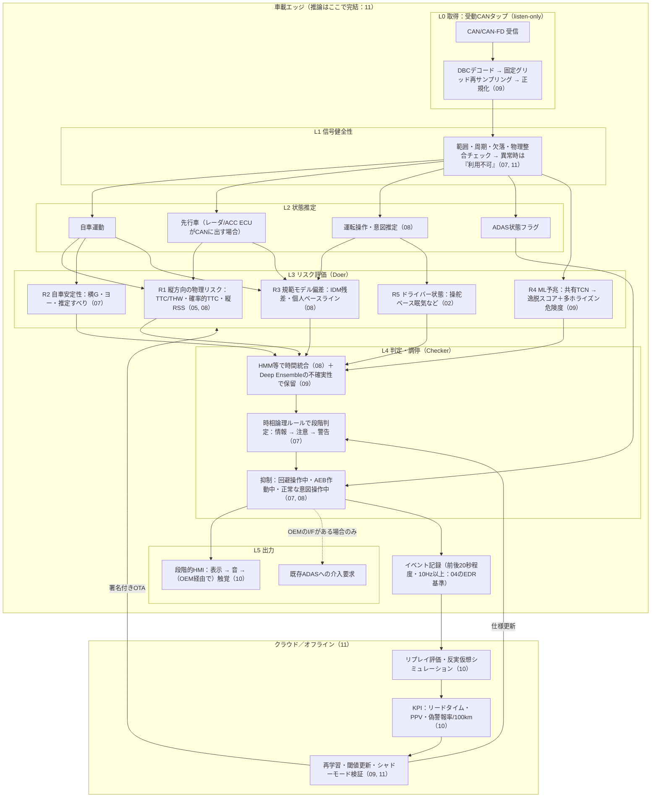

# 統合アーキテクチャ — CANデータのみによる有人運転の事故予防

- 作成日: 2026-11-02
- 位置づけ: 論点07〜11の調査結果（01〜06も参照）を1つの参照アーキテクチャにまとめた統合文書
- 注意: 各要素の根拠は、出典ファイル番号（例: 07, 10）で示す。複数の調査を組み合わせた設計判断は、全体として【推察】である。個々の文献の詳細とURLは各ファイルを参照のこと

## 1. 問い

自動運転・ADAS・CANを扱う論文には、事故を「未然に」防ぐためのどのようなアーキテクチャがあるか。また、それを有人運転かつCANのみの構成にどう落とし込むか。

## 2. 論点の分解

事故予防システムを、データの流れに沿って5つの論点に分けて調査した。

1. **システム全体の構成**（07）: 監視・介入の役割を、どの層にどう分けるか
2. **リスク評価・予測の手法**（08）: 「危ない」を何で計算するか
3. **機械学習モデルの構成**（09）: 予兆をどう学習・推論するか
4. **出力（警報・介入）と検証**（10）: 検知を事故防止につなげる方法と、その効果を確かめる方法
5. **実装・デプロイ**（11）: どこに載せ、どう運用・更新するか

## 3. 論文に見られるアーキテクチャ類型（07）

1. **ガーディアン型／Parallel Autonomy**: 人が運転し、危ないときだけシステムが最小限介入する（Toyota Guardian、MIT）
2. **ハプティック共有制御**: ハンドルやペダルの反力で、人を連続的に誘導する（Abbink、Stanford DDL）
3. **安全監視型**（Simplex／Doer-Checker／ランタイム検証）: 複雑な本体（Doer）と、小さく検証可能な監視役（Checker）を分ける（Koopman、Kane 2015、RV-ECU）
4. **形式安全モデル**（RSS／SFF）: 安全な車間距離や回避余地を数式で定義する（Mobileye、NVIDIA）
5. **ドライバーモデル比較型**: 規範的な運転者モデルや個人のベースラインからの逸脱を見る（Brännström、Olleja 2024）

CANのみの構成への転用性:
- 1・2・5は周辺物体の知覚を前提にしている。CANのみでは、縦方向・先行車1台・自車の安定性に縮退する
- 最も転用しやすいのは3である。受動的なCANタップと時相論理モニタの組み合わせには先例がある

## 4. 統合参照アーキテクチャ

07の6層構成を骨格とし、08（L3のリスク計算）、09（L3のMLとL4の不確実性）、10（L5の出力とL6の検証）、11（物理配置とMLOps）を重ねた。

## 5. 層ごとの設計要点

### L0 取得
- 後付け構成では、CANへの送信路を持たない読み取り専用にする。OBD-IIの保険用TCUが遠隔から侵害され、車両を操作された事例がある（11: Foster 2015）
- OBD-IIのポーリングは遅延が大きく、OEMのゲートウェイがアクセスを制限することもある。そのため、入力側がボトルネックになる（11）
- 入力は「DBCでデコードした物理量 → 固定グリッドに再サンプリング → 信号ごとに正規化」が主流である（09）。DBCがない車種は opendbc や CAN-D で補う（03）

### L1 信号健全性
- センサの冗長性が乏しいため、物理整合で妥当性を確認する（07）
  - 例: 車輪速から求めた加速度と、加速度センサ値の一致
- 異常時は黙って止めず、「利用不可」と表示する。Autoware の診断集約の型を流用できる（11）

### L2 状態推定
- 先行車の情報は、ACC/AEB ECUがCANに出しているかどうかで決まる。車種ごとに調査が必要である（07, 03）
- CANからの意図推定（車線変更開始・減速開始）は、主に警報の抑制（正常操作の判定）に使う（08）

### L3 リスク評価（並列の5系統）
- **R1 縦方向の物理リスク**: 急迫した危険には強いが、予兆は捉えにくい（08）
  - 自車のphysics予測が信頼できるのは約1秒（08）
  - 実事故の制動開始はTTC 1.1〜1.4秒（05）
- **R2 自車安定性**: 横すべり角はCANから直接取れないため、推定で求める（07）
- **R3 規範モデル偏差**: リードタイムを稼ぐ主役になると推察した（08）
  - IDMパラメータのオンライン推定はC実装で1ms未満（08: Liebner 2013）
  - 参照モデル単独では、ニアミス時に制動が遅すぎるか早すぎる（07: Olleja 2024）。そのため個人ベースラインと併用する
- **R4 ML予兆**: 小型モデルで十分に効く（09）
  - 軽量TCNは偽陽性がINDRAの約1/10
  - 大規模CAN基盤モデル（1Hz）は衝突検出でGLMに負けた
  - 学習時だけ映像などを特権情報として使い、推論はCANのみで行う枠組みが有望（09）
- **R5 ドライバー状態**: 操舵ベースの眠気検知は量産実績がある。EU DDAWの要件（KSS≥8で感度40%超）は、CANのみでも満たせる可能性がある（02, 04）

### L4 判定・調停
- MLの出力は「情報・注意」までにとどめる。「警告」は形式ルールを満たしたときだけ出し、偽警報の責任範囲を限定する（07）
- 瞬時閾値ではなく、HMMなどで時間統合する（08）。さらにDeep Ensembleの不確実性が大きいときは保留する（09: Grewal 2024 では、偽警報なしでほとんどの誤動作を予測できた）
- 運転者が回避操作中のとき、AEB作動中のとき、正常な意図操作のときは抑制する（07, 08）

### L5 出力
- 早い警報ほど効果が大きい。衝突は早い警報で−80.7%、遅い警報で−50%（10: Lee 2002）。効果の主因はアクセルを離すのが早まることで、これはCANで測れる
- 偽警報が数回続くと、運転者は反応しなくなる。量産FCWでも、自然発生した警報2,000件超のうち差し迫った危険は9件だけだった（10）
- 上位段の警報には触覚が最速（10: Scott & Gray 2008）。ただし後付け構成では表示と音まで（07, 11）
- 直接制御はしない。介入は、OEMが提供するインタフェース経由で既存ADASに「要求」する場合に限る（07, 11）

### L6 記録・検証・更新
- イベントの前後をログに残す。EDR改正（20秒・10Hz）がログ長の基準になる（04）
- 検証は、リプレイ、反実仮想シミュレーション、シナリオテスト、シミュレータ、FOTを組み合わせる（10）
  - 反実仮想の結果は運転者モデルで大きく変わるため、感度分析が必須である（10: Bärgman 2017）
- KPIは、リードタイム、PPV（警報の何割が本物か）、偽警報率（/100km）とする。ベンチマークは IVBSS の乗用車FCW 0.4回/100マイル（10）
- クラウドで再学習し、シャドーモードで検証してから、署名付きOTAで配信する（11）

### 物理配置と機能安全（11）
- リアルタイム警告は車載エッジで完結させる。推論遅延は、クラウドのみで約3.5秒、エッジで1秒未満
- 組込み推論の負荷は小さい
  - TFLMのメモリ合計は9〜82KB
  - CAN異常検知のLSTMは約31KB
- 参照構成は2つある
  - openpilot: 複雑な処理はLinux側、安全の強制は小型MCU（panda）が担う
  - Autoware: 診断を集約し、可用性を判定して縮退させる
- 警告専用機能のASILについて、規範となる例は公開資料に見当たらない。QM〜ASIL Aに相当し、性能限界はSOTIFで扱うと推察した

## 6. 段階的な導入ロードマップ【推察】

1. **フェーズ1：ルールベースの基準線**
   - comma2k19 と opendbc（03）で L0〜L2 を作る
   - R1（TTC/THW）とR2を閾値で実装し、偽警報率とリードタイムを測る
2. **フェーズ2：規範モデル偏差と時間統合**
   - R3（IDM残差・個人ベースライン）と HMM 統合を加え、瞬時閾値と比べる（08）
3. **フェーズ3：ML予兆**
   - 自己教師ありで事前学習したTCN（R4）と Deep Ensemble を加える
   - SHRP2 のニアミスラベル（申請が必要：03, 05）で評価する
4. **フェーズ4：実車評価**
   - 受動タップの後付け機でシャドーモード走行（警報を出さずに記録だけ）を行う
   - PPV と偽警報率が目標を満たしてから、HMI を有効にする（10, 11）

## 7. 未解決の論点

- CANのみで数秒以上先を予測し、実車で検証した研究は見当たらない（08）
- 秒単位のCAN警報について、偽警報率を報告した研究はほとんどない（05, 08, 10）
- CAN信号の車種間ドメイン適応と、生存分析型ニューラルネットの先行研究が見当たらない（09）
- 先行車情報がCANに出ているかは車種依存である。出ていなければ R1 と R3 の一部が成立しない（07, 08）
- 後付け機器が UN R155/R156 でどう扱われるかは、原文で確認していない（11）

## 8. 出典ファイル

- [07_safety_supervisor_architectures.md](07_safety_supervisor_architectures.md) — 安全監視・ガーディアン型の全体構成（24件）
- [08_risk_assessment_algorithms.md](08_risk_assessment_algorithms.md) — リスク評価・予測アルゴリズム（31件）
- [09_ml_model_architectures.md](09_ml_model_architectures.md) — CAN時系列MLモデルの構成（27件）
- [10_warning_intervention_and_validation.md](10_warning_intervention_and_validation.md) — 警報・介入の設計と検証（37件）
- [11_deployment_architectures.md](11_deployment_architectures.md) — 実装・デプロイ構成（44件）
- 第1弾の調査（01〜06）は [README.md](README.md) を参照

## 更新履歴

- 2026-11-01: 13の知見より、L1に入力健全性のDAG／可用性ベクトル（Autoware型）、L5に警告の単調エスカレートとラッチ、推論ハートビート途絶時の「警告不能」通知（Apollo Guardian型）を設計候補として追加（【推察】。一次資料の再確認が必要）
